# 🍽️ পদ্মা রেস্তোরাঁর গল্প: Express.js ES6 Folder Structure — Routing, Controllers, JSON ও Middleware

> এই ফাইলে আমরা বানাবো একটা **সাজানো-গোছানো রেস্তোরাঁ — "পদ্মা রেস্তোরাঁ"**। এখানে গ্রাহক আছে, ওয়েটার আছে, কাউন্টারের ম্যানেজার আছে (**Router**), শেফ আছে (**Controller**), গেটের নিরাপত্তারক্ষী আছে (**Middleware**), আর সবার বোঝার মতো একটা স্ট্যান্ডার্ড প্যাকেট আছে (**JSON**)।
> আজকের গল্পের মূল প্রশ্ন: **একটা Express.js প্রজেক্টকে ES6 (`import`/`export`) দিয়ে কীভাবে সাজাবো — যাতে Route, Controller, Middleware আর JSON প্রত্যেকের নিজের জায়গা থাকে?**
> 📌 এই ফাইলের কোডগুলো **Node.js 20.6+** আর **Express 5** ধরে লেখা। শেষে পুরো প্রজেক্টটা একসাথে দেওয়া আছে, কপি না করে নিজে টাইপ করে চালালে বেশি লাভ।

---

## 📚 সূচিপত্র (Table of Contents)

0. [ভূমিকা: গল্পের চরিত্র + আজকের লক্ষ্য](#ভূমিকা-গল্পের-চরিত্র--আজকের-লক্ষ্য)
1. [Server-side vs Client-side — রেস্তোরাঁর সামনে আর পেছনে](#১-server-side-vs-client-side--রেস্তোরাঁর-সামনে-আর-পেছনে)
2. [Request-Response Model — অর্ডার-স্লিপ আর প্লেটের খেলা](#২-request-response-model--অর্ডার-স্লিপ-আর-প্লেটের-খেলা)
3. [ES6 Folder Structure — রেস্তোরাঁর নকশা](#৩-es6-folder-structure--রেস্তোরাঁর-নকশা)
4. [Routing Concept — কাউন্টারের ম্যানেজার](#৪-routing-concept--কাউন্টারের-ম্যানেজার)
5. [Controller Concept — রান্নাঘরের শেফ](#৫-controller-concept--রান্নাঘরের-শেফ)
6. [Introduction to JSON — স্ট্যান্ডার্ড প্যাকেট](#৬-introduction-to-json--স্ট্যান্ডার্ড-প্যাকেট)
7. [Best Practices of JSON — প্যাকেট সাজানোর নিয়ম](#৭-best-practices-of-json--প্যাকেট-সাজানোর-নিয়ম)
8. [Middleware Concept — গেটের পাহারাদার দল](#৮-middleware-concept--গেটের-পাহারাদার-দল)
9. [Controller Best Practices — ভালো শেফের অভ্যাস](#৯-controller-best-practices--ভালো-শেফের-অভ্যাস)
10. [Middleware Best Practices — ভালো পাহারাদারের অভ্যাস](#১০-middleware-best-practices--ভালো-পাহারাদারের-অভ্যাস)
11. [পুরো প্রজেক্ট একসাথে — পদ্মা রেস্তোরাঁ API](#১১-পুরো-প্রজেক্ট-একসাথে--পদ্মা-রেস্তোরাঁ-api)
12. [চালিয়ে পরীক্ষা করা (curl / Postman)](#১২-চালিয়ে-পরীক্ষা-করা-curl--postman)
13. [সাধারণ ভুল আর সমাধান](#১৩-সাধারণ-ভুল-আর-সমাধান)
14. [সারসংক্ষেপ ও Practice আইডিয়া](#১৪-সারসংক্ষেপ-ও-practice-আইডিয়া)


---

## ভূমিকা: গল্পের চরিত্র + আজকের লক্ষ্য

কল্পনা করুন, আপনি ঢাকায় **"পদ্মা রেস্তোরাঁ"** খুলেছেন। প্রথম দিন আপনি একাই সব করছেন — অর্ডার নিচ্ছেন, রান্না করছেন, ক্যাশে বসছেন, গেটও পাহারা দিচ্ছেন। দু'দিনেই সব তালগোল পাকিয়ে গেল। তাই আপনি **কাজ ভাগ** করে দিলেন। প্রত্যেকের একটাই দায়িত্ব।

Express.js প্রজেক্টেও ঠিক এটাই হয়। একটা ফাইলে `app.get(...)`, validation, ডেটা বদলানো, error handling সব লিখলে ২০০ লাইনের পর আর কেউ কিছু খুঁজে পায় না। তাই আমরা কোডকে **ভাগ করি**।

### 🎭 গল্পের চরিত্র (পুরো ফাইলে এগুলোই ঘুরবে)

| গল্পে | টেকনিক্যাল নাম |
|---|---|
| ডাইনিং হলে বসা গ্রাহক | Client (Browser / React app / Postman / Mobile app) |
| রেস্তোরাঁর রান্নাঘর (গ্রাহক যেখানে ঢুকতে পারে না) | Server (Node.js + Express) |
| অর্ডার-স্লিপ | HTTP Request |
| পরিবেশন করা প্লেট | HTTP Response |
| ডেলিভারির স্ট্যান্ডার্ড প্যাকেট (সবাই চেনে) | JSON |
| কাউন্টারের ম্যানেজার ("এই অর্ডার কোন শেফের কাছে যাবে?") | Router (`routes/`) |
| রান্নাঘরের শেফ (আসল কাজ করে) | Controller (`controllers/`) |
| গেটের পাহারাদার, হাত-ধোয়ার স্টেশন, কোট-জমার ডেস্ক | Middleware (`middlewares/`) |
| ভাঁড়ার ঘরের খাতা (আপাতত একটা Array) | Data (`data/`) — পরে MongoDB হবে |
| রেস্তোরাঁর মূল দরজা (বিদ্যুৎ চালু, দরজা খোলা) | `server.js` |
| রেস্তোরাঁর ভেতরের সাজসজ্জা ও নিয়মকানুন | `app.js` |

### 🎯 আজকের শেষ ফলাফল

আমরা একটা ছোট **Menu API** বানাবো, যেটা এই কাজগুলো করবে:

| কাজ | Method + URL |
|---|---|
| সব মেনু দেখা (ফিল্টারসহ) | `GET /api/v1/menu` |
| একটা আইটেম দেখা | `GET /api/v1/menu/:id` |
| নতুন আইটেম যোগ | `POST /api/v1/menu` |
| আইটেম বদলানো | `PUT /api/v1/menu/:id` |
| আইটেম মুছা | `DELETE /api/v1/menu/:id` |

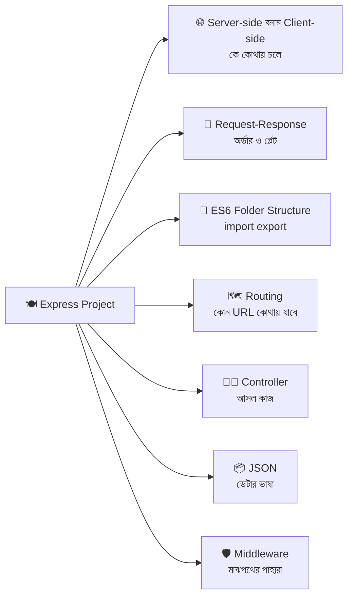

---

## ১. Server-side vs Client-side — রেস্তোরাঁর সামনে আর পেছনে

### গল্প

পদ্মা রেস্তোরাঁর দুটো অংশ:

- **ডাইনিং হল (সামনের দিক):** এখানে গ্রাহক বসেন। মেনু দেখেন, ছবি দেখেন, পছন্দ করেন। সুন্দর আলো, সুন্দর টেবিল। এটাই **Client-side**।
- **রান্নাঘর (পেছনের দিক):** এখানে শেফরা রান্না করেন, ভাঁড়ার ঘর থেকে মাল আনেন, হিসাব রাখেন। গ্রাহক ভেতরে ঢুকতে পারেন না। এটাই **Server-side**।

গ্রাহক সরাসরি ভাঁড়ার ঘরে গিয়ে চাল-ডাল ঘাঁটতে পারেন না। তিনি শুধু **অর্ডার-স্লিপ** পাঠান, আর রান্নাঘর **প্লেট** ফেরত পাঠায়। এই "কে কোথায় থাকে" ভাগটাই Web Development-এর সবচেয়ে বড় ভিত্তি।

একটা বিপজ্জনক গল্পও শুনুন: এক গ্রাহক স্লিপে লিখলেন **"কাচ্চি বিরিয়ানি — দাম ১ টাকা"**। যদি রান্নাঘর শুধু স্লিপ দেখে বিশ্বাস করে ফেলে, রেস্তোরাঁ দেউলিয়া! তাই রান্নাঘরকে **নিজের খাতা থেকে দাম মিলিয়ে নিতে হয়**। এটাই বিখ্যাত নিয়ম: **"Client-কে কখনো বিশ্বাস করো না"** (Never trust the client)।

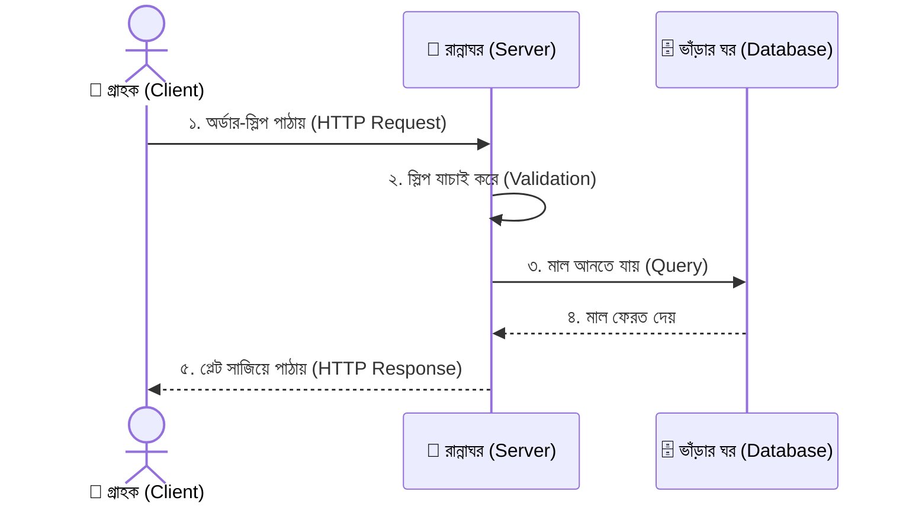

### তুলনা এক নজরে

| বিষয় | Client-side (সামনে) | Server-side (পেছনে) |
|---|---|---|
| গল্পে | ডাইনিং হল | রান্নাঘর |
| কোথায় চলে | ব্যবহারকারীর ব্রাউজার / ফোন | আপনার সার্ভার কম্পিউটার (বা ক্লাউড) |
| ভাষা / টুল | HTML, CSS, JavaScript, React | Node.js, Express, PHP, Python ইত্যাদি |
| কাজ | UI দেখানো, বাটন ক্লিক, ফর্ম পূরণ | ডেটা সংরক্ষণ, হিসাব, নিরাপত্তা, ডাটাবেস |
| কোড কে দেখতে পারে | **যে কেউ** (Browser DevTools → Sources) | শুধু আপনি (সার্ভারে থাকে) |
| গোপন জিনিস (পাসওয়ার্ড, API key) | ❌ কখনো রাখা যাবে না | ✅ এখানে নিরাপদ (`.env`) |
| ডাটাবেসে সরাসরি যাওয়া | ❌ না | ✅ হ্যাঁ |
| MERN-এ কে | **R**eact | **E**xpress + **N**ode (আর **M**ongoDB ডাটাবেস) |

### 🔑 মনে রাখার তিনটা নিয়ম

1. **Client শুধু দেখায় ও অনুরোধ পাঠায়**, সিদ্ধান্ত নেয় না।
2. **Server সব যাচাই করে** — Client-এর ফর্মে validation থাকলেও Server-এ আবার লাগবে (কারণ কেউ Postman দিয়ে সরাসরি অনুরোধ পাঠাতে পারে)।
3. **গোপন তথ্য সবসময় Server-এ** — React কোডে API key লিখলে সবাই দেখে ফেলবে।

> 💡 **এই ফাইলে আমরা শুধু Server-side বানাচ্ছি।** Client হিসেবে আমরা `curl` / Postman / ব্রাউজার ব্যবহার করবো। পরে React এসে এই API-কেই ডাকবে।

---

## ২. Request-Response Model — অর্ডার-স্লিপ আর প্লেটের খেলা

### গল্প

রেস্তোরাঁর নিয়ম খুব সোজা: **একটা অর্ডার-স্লিপ এলে ঠিক একটা প্লেট ফেরত যাবে।** দুটো প্লেট নয়, শূন্য প্লেটও নয় (গ্রাহক না খেয়ে বসে থাকবে!)। এই নিয়মটাই **Request-Response Model**।

গ্রাহক এই কথোপকথনটা **HTTP** নামের একটা ভাষায় বলেন। HTTP হলো সবার জানা নিয়ম: "স্লিপ কীভাবে লিখতে হবে, প্লেটে কী কী থাকবে।"

### অর্ডার-স্লিপের (Request) ভেতরে কী থাকে?

```
POST /api/v1/menu HTTP/1.1                ← ১) Request Line: Method + Path
Host: localhost:5000                      ← ২) Headers (অতিরিক্ত তথ্য — চিঠির খামের লেখা)
Content-Type: application/json            ←    "ভেতরের জিনিসটা JSON"
x-api-key: padma-secret-123               ←    পরিচয়পত্র
                                          ← (ফাঁকা লাইন)
{ "name": "Beef Tehari", "price": 280 }   ← ৩) Body (আসল মালপত্র — GET-এ সাধারণত থাকে না)
```

| অংশ | গল্পে | Express-এ কীভাবে পড়বো |
|---|---|---|
| **Method** | অর্ডারের ধরন (দেখাও / দাও / বদলাও / ফেলো) | `req.method` |
| **Path** | কোন কাউন্টারে যাচ্ছি | `req.path`, `req.originalUrl` |
| **Route Params** | স্লিপের নম্বর (`/menu/5`-এর `5`) | `req.params.id` |
| **Query String** | ফিল্টারের নোট (`?category=main`) | `req.query.category` |
| **Headers** | খামের গায়ের লেখা | `req.headers`, `req.get('x-api-key')` |
| **Body** | স্লিপের ভেতরের আসল লেখা | `req.body` (JSON পড়তে `express.json()` লাগবে) |

### প্লেটের (Response) ভেতরে কী থাকে?

```
HTTP/1.1 201 Created                      ← ১) Status Line: ফলাফলের কোড + নাম
Content-Type: application/json            ← ২) Headers: "প্লেটে JSON আছে"
                                          ← (ফাঁকা লাইন)
{ "success": true, "data": { ... } }      ← ৩) Body: আসল প্লেট
```

### HTTP Method = কাজের ধরন (CRUD)

| Method | CRUD | গল্পে | উদাহরণ |
|---|---|---|---|
| `GET` | **R**ead | "মেনুটা দেখাও" (কিছু বদলায় না) | `GET /menu` |
| `POST` | **C**reate | "নতুন আইটেম যোগ করো" | `POST /menu` |
| `PUT` | **U**pdate (পুরোটা বদলানো) | "এই আইটেমের পুরো বিবরণ নতুন করে লেখো" | `PUT /menu/5` |
| `PATCH` | **U**pdate (আংশিক) | "শুধু দামটা বদলাও" | `PATCH /menu/5` |
| `DELETE` | **D**elete | "এই আইটেম মেনু থেকে সরাও" | `DELETE /menu/5` |

### Status Code = প্লেটের গায়ের স্টিকার

| কোড | নাম | গল্পে | কখন |
|---|---|---|---|
| `200` | OK | "নিন, আপনার অর্ডার" | সফল GET / PUT / DELETE |
| `201` | Created | "নতুন আইটেম খাতায় তোলা হলো" | সফল POST |
| `204` | No Content | "কাজ হয়েছে, দেখানোর কিছু নেই" | সফল DELETE (বডি ছাড়া) |
| `400` | Bad Request | "স্লিপটাই তো ভুল লেখা" | ভুল ইনপুট / Validation fail |
| `401` | Unauthorized | "আপনি কে? পরিচয়পত্র দেখান" | লগইন/Key নেই |
| `403` | Forbidden | "চিনি, কিন্তু আপনার ঢোকা নিষেধ" | অনুমতি নেই |
| `404` | Not Found | "এই নামে কোনো আইটেম নেই" | আইডি/URL পাওয়া যায়নি |
| `409` | Conflict | "এই নামে আগেই একটা আছে" | ডুপ্লিকেট |
| `500` | Internal Server Error | "রান্নাঘরে আগুন লেগেছে!" | আমাদের কোডের ভুল |

> 💡 **মনে রাখার ছড়া:** `2xx` = সফল, `4xx` = **Client**-এর ভুল, `5xx` = **Server**-এর ভুল।

### প্রথম Express সার্ভার (সবচেয়ে ছোট রেস্তোরাঁ)

```javascript
// ফাইল: server.js — ফোল্ডার ভাগ করার আগে একদম বেসিক রূপ
import express from 'express';
// import = অন্য জায়গা থেকে জিনিস আনা (ES6 নিয়ম)। 'express' = npm থেকে ইনস্টল করা প্যাকেজ।
// express = ফ্রেমওয়ার্কের মূল ফাংশন, যা দিয়ে আমরা অ্যাপ বানাই

const app = express();
// app = আমাদের রেস্তোরাঁ। express() ডাকলে একটা নতুন খালি অ্যাপ (অবজেক্ট) তৈরি হয়,
// যার ভেতরে app.get / app.post / app.use ইত্যাদি সব যন্ত্র আছে

const PORT = 5000;
// PORT = কম্পিউটারের কোন "দরজা নম্বরে" আমাদের সার্ভার অপেক্ষা করবে (localhost:5000)

app.get('/', (req, res) => {
  // app.get = "যদি GET method-এ '/' path-এ কেউ আসে, তাহলে এই ফাংশন চালাও"
  // req = Request অবজেক্ট (অর্ডার-স্লিপ), res = Response অবজেক্ট (প্লেট পাঠানোর যন্ত্র)
  res.status(200).json({ message: 'পদ্মা রেস্তোরাঁয় স্বাগতম!' });
  // res.status(200) = স্টিকার লাগানো (সফল)। .json({...}) = অবজেক্টকে JSON বানিয়ে প্লেটে সাজিয়ে পাঠানো
  // ⚠️ একটা request-এ একবারই response পাঠানো যায়
});

app.listen(PORT, () => {
  // app.listen = সার্ভার চালু! PORT নম্বরে অপেক্ষা শুরু। দ্বিতীয় আর্গুমেন্ট = চালু হলে যে ফাংশন একবার চলবে
  console.log(`🍽️ Server চলছে: http://localhost:${PORT}`);
});
```

### একটা ছোট কিন্তু গুরুত্বপূর্ণ ভুল

```javascript
app.get('/menu', (req, res) => {
  res.json({ a: 1 });
  res.json({ b: 2 });   // ❌ Error: Cannot set headers after they are sent to the client
});
// কারণ: প্লেট একবার পাঠিয়ে দিয়েছেন, আবার একটা প্লেট পাঠানো যায় না।
// সমাধান: শর্তের ভেতরে response পাঠালে `return res.json(...)` লিখুন, যাতে নিচের কোড আর না চলে
```

---

## ৩. ES6 Folder Structure — রেস্তোরাঁর নকশা

### গল্প

রেস্তোরাঁ বড় হচ্ছে। এখন আপনি **নকশা** (architect-এর ছক) আঁকলেন:

- 🚪 **মূল দরজা** (`server.js`) — শুধু বিদ্যুৎ চালু করে আর দরজা খোলে (port-এ শোনা শুরু)।
- 🏠 **ভেতরের সাজসজ্জা** (`app.js`) — কোন পাহারাদার কোথায় বসবে, কোন ম্যানেজার কোন কাউন্টারে, সব সাজানো।
- 🗺️ **কাউন্টার** (`routes/`) — কোন URL কোথায় যাবে।
- 👨‍🍳 **রান্নাঘর** (`controllers/`) — আসল কাজ।
- 🛡️ **পাহারাদার** (`middlewares/`) — মাঝপথে যাচাই।
- 📒 **ভাঁড়ারের খাতা** (`data/`) — ডেটা (পরে `models/` + MongoDB)।
- 🧰 **টুলবক্স** (`utils/`) — ছোট ছোট সাহায্যকারী (যেমন Error ক্লাস)।
- ⚙️ **কনফিগ** (`config/`) — সেটিংস।

### ফোল্ডার স্ট্রাকচার

```
📦 padma-restaurant-api
 ┣ 📂 src
 ┃ ┣ 📜 server.js                  ← 🚪 মূল দরজা: app.listen() শুধু এখানে
 ┃ ┣ 📜 app.js                     ← 🏠 Express অ্যাপ বানানো, middleware ও route জোড়া
 ┃ ┣ 📂 routes
 ┃ ┃ ┣ 📜 index.js                 ← 🗺️ সব route একত্র করে ('/menu', '/orders'...)
 ┃ ┃ ┗ 📜 menu.routes.js           ← 🗺️ শুধু মেনুর route
 ┃ ┣ 📂 controllers
 ┃ ┃ ┗ 📜 menu.controller.js       ← 👨‍🍳 মেনুর আসল কাজ (CRUD ফাংশন)
 ┃ ┣ 📂 middlewares
 ┃ ┃ ┣ 📜 logger.middleware.js     ← 🛡️ কে কখন কী চাইলো লিখে রাখে
 ┃ ┃ ┣ 📜 apiKey.middleware.js     ← 🛡️ পরিচয়পত্র যাচাই
 ┃ ┃ ┣ 📜 validateMenu.middleware.js ← 🛡️ স্লিপের লেখা ঠিক আছে কি না
 ┃ ┃ ┣ 📜 notFound.middleware.js   ← 🛡️ ঠিকানা না মিললে 404
 ┃ ┃ ┗ 📜 error.middleware.js      ← 🚨 সব দুর্ঘটনা সামলানোর জায়গা (সবার শেষে)
 ┃ ┣ 📂 data
 ┃ ┃ ┗ 📜 menu.data.js             ← 📒 আপাতত In-memory Array
 ┃ ┗ 📂 utils
 ┃   ┗ 📜 ApiError.js              ← 🧰 নিজস্ব Error ক্লাস
 ┣ 📜 .env                         ← 🔐 গোপন সেটিংস (GitHub-এ যাবে না!)
 ┣ 📜 .env.example                 ← নমুনা (GitHub-এ যাবে)
 ┣ 📜 .gitignore
 ┗ 📜 package.json
```

### কেন `server.js` আর `app.js` আলাদা?

| ফাইল | কাজ | কেন আলাদা |
|---|---|---|
| `app.js` | Express অ্যাপ তৈরি, middleware ও route সাজানো, `export default app` | পরে **টেস্ট** লেখার সময় সার্ভার চালু না করেই `app`-কে import করা যায় |
| `server.js` | `app.listen(PORT)` | শুধু "দরজা খোলা" — একটাই কাজ |

### ফাইলগুলো কীভাবে একে অপরকে ডাকে?

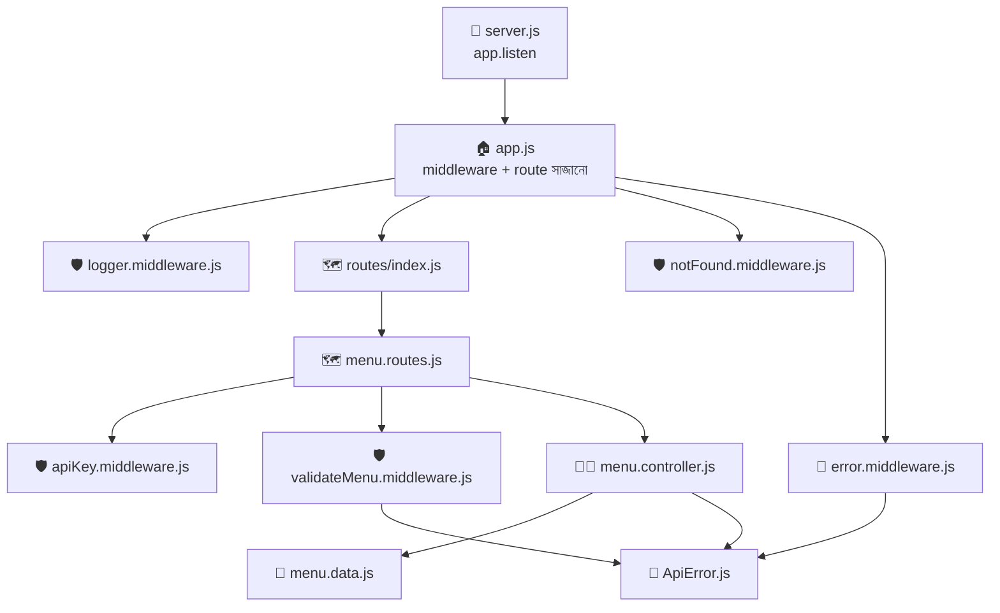

### ES6 Module — `import` / `export`

আগে Node.js-এ `require()` / `module.exports` চলতো (**CommonJS**)। এখন আধুনিক নিয়ম **ES Modules (ESM)**, যেটা React-এও একই — তাই একই ভাষায় ফ্রন্ট-ব্যাক দুই জায়গায় কাজ।

| বিষয় | CommonJS (পুরোনো) | ES6 Module (নতুন, আমরা এটা ব্যবহার করবো) |
|---|---|---|
| আনা | `const express = require('express')` | `import express from 'express'` |
| পাঠানো (একটা) | `module.exports = app` | `export default app` |
| পাঠানো (অনেক) | `module.exports = { a, b }` | `export const a = ...` / `export { a, b }` |
| ফাইলের নামের শেষে `.js` | লিখতে না-ও পারেন | **লিখতেই হবে** (`'./app.js'`) |
| চালু করার শর্ত | কিছু না | `package.json`-এ `"type": "module"` |

```javascript
// ===== Default export: একটা ফাইল থেকে "মূল একটা জিনিস" পাঠানো =====
// ফাইল: utils/ApiError.js
class ApiError extends Error { /* ... */ }
export default ApiError;
// অন্য ফাইলে আনার সময় যে-কোনো নাম দেওয়া যায় (তবে একই নাম রাখাই ভালো):
// import ApiError from '../utils/ApiError.js';   ← { } ব্রেস নেই

// ===== Named export: একটা ফাইল থেকে "অনেকগুলো জিনিস" পাঠানো =====
// ফাইল: controllers/menu.controller.js
export const getAllMenu = (req, res) => { /* ... */ };
export const getMenuById = (req, res) => { /* ... */ };
// অন্য ফাইলে আনার সময় হুবহু একই নাম লাগবে, ব্রেস { } সহ:
// import { getAllMenu, getMenuById } from '../controllers/menu.controller.js';
```

| কখন কোনটা | নিয়ম |
|---|---|
| ফাইলে **একটাই** প্রধান জিনিস (Router, app, Class) | `export default` |
| ফাইলে **একাধিক** ফাংশন (controller, middleware) | `export const` (named) |

### `package.json` — ESM চালু করা

```json
{
  "name": "padma-restaurant-api",
  "version": "1.0.0",
  "type": "module",
  "scripts": {
    "start": "node src/server.js",
    "dev": "node --watch --env-file=.env src/server.js"
  },
  "dependencies": {
    "express": "^5.1.0"
  }
}
```

| লাইন | কেন |
|---|---|
| `"type": "module"` | Node-কে বলে দেয় — এই প্রজেক্টে `.js` ফাইলে `import/export` চলবে |
| `"start"` | প্রোডাকশনে চালানোর কমান্ড (`npm start`) |
| `"dev"` | ডেভেলপমেন্টে। `--watch` = ফাইল সেভ করলেই নিজে রিস্টার্ট (nodemon লাগে না)। `--env-file=.env` = `.env` ফাইল পড়ে `process.env`-এ রাখে (dotenv লাগে না)। **Node 20.6+ লাগবে** |

শুরু করার কমান্ড:

```bash
mkdir padma-restaurant-api && cd padma-restaurant-api
npm init -y                 # package.json বানায় (তারপর "type" আর scripts নিজে বসান)
npm install express         # Express ইনস্টল (এখন ডিফল্ট Express 5)
```

> ⚠️ **ESM-এ `__dirname` নেই!** ফাইলের ফোল্ডার জানতে চাইলে Node 20.11+ এ `import.meta.dirname` ব্যবহার করুন (পুরোনো Node-এ `fileURLToPath(import.meta.url)`)।

---

## ৪. Routing Concept — কাউন্টারের ম্যানেজার

### গল্প

রেস্তোরাঁর দরজা দিয়ে অর্ডার-স্লিপ ঢুকলো। এখন কে ঠিক করবে এই স্লিপ কোন শেফের কাছে যাবে? **কাউন্টারের ম্যানেজার।** তার হাতে একটা তালিকা আছে:

> - "**দেখাও** + **মেনু**" লেখা থাকলে → মেনু-শেফের কাছে
> - "**দাও** + **মেনু**" লেখা থাকলে → নতুন-আইটেম-শেফের কাছে
> - "**ফেলো** + **মেনু নম্বর ৫**" লেখা থাকলে → মুছে-ফেলা শেফের কাছে
> - তালিকায় নেই এমন কিছু → "দুঃখিত, এই কাউন্টার নেই" (404)

এই "**Method + Path দেখে সঠিক ফাংশনে পাঠানো**" কাজটাই **Routing**।

### Route-এর গঠন

```javascript
app.METHOD(PATH, HANDLER);
//  │       │      └─ যে ফাংশন চলবে (Controller): (req, res) => { ... }
//  │       └─ URL-এর পথ ('/menu', '/menu/:id')
//  └─ get / post / put / patch / delete
```

### Route Params আর Query String

```javascript
// ---------- Route Param: পথের ভেতরের পরিবর্তনশীল অংশ ----------
app.get('/menu/:id', (req, res) => {
  // ':id' = একটা "ফাঁকা ঘর"। /menu/5 হলে id = "5", /menu/12 হলে id = "12"
  const id = req.params.id;
  // req.params = পথের সব ফাঁকা ঘরের মান রাখা অবজেক্ট → { id: "5" }
  // ⚠️ মান সবসময় STRING আসে ("5"), সংখ্যা চাইলে Number(...) করতে হবে
  res.json({ idReceived: id, type: typeof id });   // type: "string"
});

// ---------- Query String: ? এর পরের ফিল্টার ----------
// URL: /menu?category=main&maxPrice=300
app.get('/menu', (req, res) => {
  const { category, maxPrice } = req.query;
  // req.query = ? এর পরের সব key=value অবজেক্ট → { category: "main", maxPrice: "300" }
  // category = কোন ধরনের আইটেম চাই; maxPrice = সর্বোচ্চ দাম (এটাও STRING!)
  // কিছু না দিলে দুটোই undefined হবে — তাই কোডে "আছে কি না" দেখতে হবে
  res.json({ category, maxPrice });
});
```

| কখন কোনটা | উদাহরণ |
|---|---|
| **একটা নির্দিষ্ট জিনিস** চিহ্নিত করতে → **Param** | `/menu/5`, `/users/42/orders` |
| **তালিকা ছাঁকতে / সাজাতে / পাতা ভাগ** করতে → **Query** | `/menu?category=main&page=2&limit=10` |

### সব route একই ফাইলে? — না! `express.Router()`

`app.js`-এ ১০০টা route লিখলে সেটা আবার সেই এলোমেলো রান্নাঘর। তাই **প্রতিটা বিভাগের জন্য আলাদা মিনি-ম্যানেজার (Router)**:

```javascript
// ফাইল: src/routes/menu.routes.js
import { Router } from 'express';
// Router = Express-এর ভেতরের "মিনি অ্যাপ"। শুধু route সাজানোর কাজ করে, নিজে সার্ভার চালায় না

import {
  getAllMenu, getMenuById, createMenuItem, updateMenuItem, deleteMenuItem,
} from '../controllers/menu.controller.js';
// ../ = এক ধাপ উপরের ফোল্ডারে যাও (routes থেকে বেরিয়ে controllers-এ)
// এখানে named import, তাই { } ব্রেস, আর শেষে .js আবশ্যক

const router = Router();
// router = শুধু মেনু-বিভাগের ম্যানেজার। app.get-এর মতোই router.get / router.post ব্যবহার করা যায়

router.get('/', getAllMenu);          // GET    /api/v1/menu      → সব মেনু
router.get('/:id', getMenuById);      // GET    /api/v1/menu/5    → একটা আইটেম
router.post('/', createMenuItem);     // POST   /api/v1/menu      → নতুন আইটেম
router.put('/:id', updateMenuItem);   // PUT    /api/v1/menu/5    → আপডেট
router.delete('/:id', deleteMenuItem);// DELETE /api/v1/menu/5    → মুছা
// লক্ষ্য করুন: এখানে path শুধু '/' বা '/:id' — আগের অংশ ('/api/v1/menu') বাইরে থেকে জোড়া হবে

export default router;
// default export: এই ফাইলের "মূল জিনিস" = router
```

একই path-এ একাধিক method থাকলে `router.route()` দিয়ে সংক্ষেপে লেখা যায়:

```javascript
router
  .route('/')                 // route('/') = এই path-এর জন্য একটা চেইন শুরু
  .get(getAllMenu)            // GET  /  → getAllMenu
  .post(createMenuItem);      // POST /  → createMenuItem

router
  .route('/:id')
  .get(getMenuById)
  .put(updateMenuItem)
  .delete(deleteMenuItem);
```

### সব Router একত্র করা — `app.use(prefix, router)`

```javascript
// ফাইল: src/routes/index.js — "প্রধান ম্যানেজার", যে সব বিভাগের ম্যানেজারকে একত্র করে
import { Router } from 'express';
import menuRoutes from './menu.routes.js';
// menuRoutes = menu.routes.js থেকে আসা default export (router)। default তাই যে-কোনো নাম দেওয়া যায়
// ./ = একই ফোল্ডারের ফাইল

const router = Router();

router.use('/menu', menuRoutes);
// router.use(prefix, অন্যRouter) = "/menu দিয়ে শুরু হওয়া সব অনুরোধ menuRoutes-এর কাছে পাঠাও"
// ভবিষ্যতে: router.use('/orders', orderRoutes);  router.use('/users', userRoutes);

export default router;
```

```javascript
// ফাইল: src/app.js-এর একটা অংশ
app.use('/api/v1', routes);
// '/api/v1' = সব API-র সামনে বসা উপসর্গ (prefix)। v1 = সংস্করণ (version)
// ফলাফল: '/api/v1' + '/menu' + '/:id' = '/api/v1/menu/:id'
// কেন version? ভবিষ্যতে ভাঙনধরা পরিবর্তন এলে /api/v2 বানানো যাবে, পুরোনো অ্যাপ v1-এ চলতে থাকবে
```

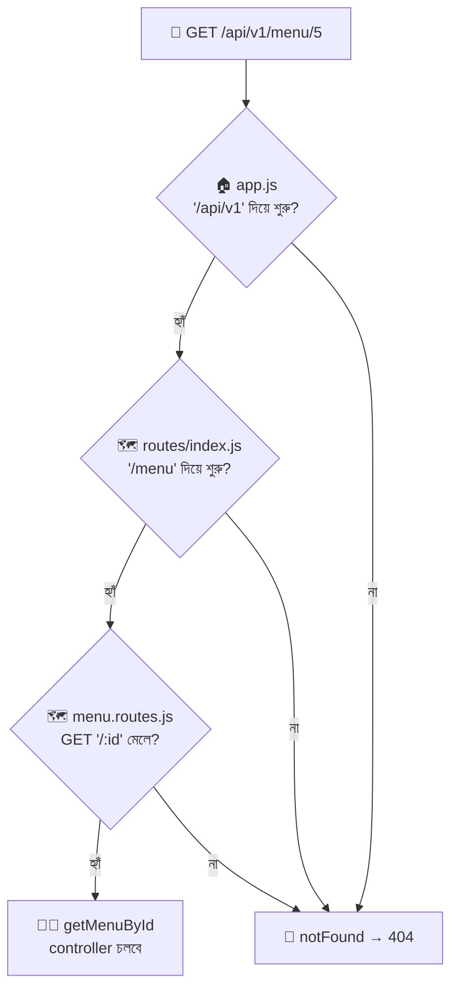

### ⚠️ Route-এর ক্রম গুরুত্বপূর্ণ

Express route-গুলো **উপর থেকে নিচে** মিলিয়ে দেখে, **প্রথম যেটা মেলে সেটাই চলে**।

```javascript
// ❌ ভুল ক্রম
router.get('/:id', getMenuById);       // '/special'-ও এখানে ধরা পড়বে, ভাববে id = "special"
router.get('/special', getSpecialMenu); // এটা কখনো চলবেই না!

// ✅ সঠিক ক্রম: নির্দিষ্ট (static) আগে, পরিবর্তনশীল (dynamic) পরে
router.get('/special', getSpecialMenu);
router.get('/:id', getMenuById);
```

### সব অমিল হলে — 404 ধরা

```javascript
// সবার শেষে (সব route-এর পরে) বসান — কোনো route না মিললে এখানে এসে পড়বে
app.use((req, res) => {
  res.status(404).json({ success: false, message: `Route not found: ${req.method} ${req.originalUrl}` });
  // req.method = GET/POST...; req.originalUrl = পুরো পথ (query সহ) — ডিবাগে কাজে লাগে
});
```

> 📌 **Express 5 নোট:** "যেকোনো path" ধরার পুরোনো `'*'` এখন কাজ করে না; লাগলে `'/*splat'` লিখতে হয়। তবে 404 ধরতে আমরা path ছাড়া `app.use(...)`-ই ব্যবহার করছি, তাই সমস্যা নেই।

---

## ৫. Controller Concept — রান্নাঘরের শেফ

### গল্প

ম্যানেজার (Router) স্লিপটা সঠিক শেফের হাতে দিয়ে দিলেন। এখন **আসল কাজ** — রান্না — করবেন শেফ। ম্যানেজার রান্না করেন না; শেফ কাউন্টারে বসে ঠিকানা মেলান না। **দুজনের কাজ আলাদা।**

- **Router:** "কে কোথায় যাবে" ঠিক করে।
- **Controller:** স্লিপ পড়ে (`req`), প্রয়োজনীয় কাজ করে (ডেটা আনা/বদলানো/হিসাব), তারপর প্লেট সাজিয়ে পাঠায় (`res`)।

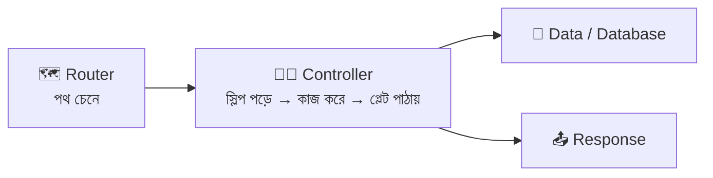

### Router-এ সরাসরি লিখলে বনাম Controller আলাদা করলে

```javascript
// ❌ সব route ফাইলে ঢুকিয়ে দেওয়া — বড় হলেই অসহ্য
router.get('/:id', (req, res) => {
  const item = menu.find((i) => i.id === Number(req.params.id));
  if (!item) return res.status(404).json({ message: 'not found' });
  res.json(item);
});

// ✅ route শুধু "কে কাকে ডাকবে" বলে, কাজ থাকে controller-এ
router.get('/:id', getMenuById);
```

### একটা Controller ফাংশনের গঠন

```javascript
export const getMenuById = (req, res) => {
  // export const = named export, যাতে route ফাইল import { getMenuById } করে ডাকতে পারে
  // getMenuById = ফাংশনের নাম। নাম দেখেই বোঝা যাবে কী করে (ক্রিয়া + বিষয়)
  // (req, res) = Express নিজে এই দুটো জিনিস দিয়ে ফাংশনটা ডাকে — আমরা শুধু নাম বসাই

  const id = Number(req.params.id);
  // id = URL থেকে পাওয়া "5" (string)-কে সংখ্যায় বদলানো। কেন? কারণ ডেটায় id সংখ্যা,
  // আর === দিয়ে "5" ও 5 মেলে না

  const item = menu.find((i) => i.id === id);
  // item = মেনু Array থেকে মেলানো আইটেম। না পেলে undefined
  // i = প্রতিটা আইটেমের অস্থায়ী নাম (find-এর ভেতরে প্রতি চক্রে একটা করে)

  if (!item) throw new ApiError(404, 'Menu item not found');
  // না পেলে 404 error ছুঁড়ে দিই। এই error নিজে নিজে পৌঁছে যাবে error-handling middleware-এ (পরে দেখবো)

  res.status(200).json({ success: true, data: item });
  // পেলে 200 স্টিকার + JSON প্লেট। এটাই আমাদের "সফল response"-এর ছাঁচ
};
```

### Controller-এ কী থাকবে, কী থাকবে না

| ✅ থাকবে | ❌ থাকবে না |
|---|---|
| `req` থেকে `params`, `query`, `body` পড়া | URL মেলানো / path লেখা (এটা Router-এর কাজ) |
| ডেটা আনা/বদলানো (বা Service/Model ডাকা) | সার্ভার চালু করা (`app.listen`) |
| সঠিক status code + JSON response পাঠানো | বারবার একই validation কোড (এটা Middleware-এ যাবে) |
| "পাওয়া যায়নি" ধরনের error ছোঁড়া | সরাসরি `process.env` ছড়িয়ে ছিটিয়ে ব্যবহার |

---

## ৬. Introduction to JSON — স্ট্যান্ডার্ড প্যাকেট

### গল্প

পদ্মা রেস্তোরাঁ এখন সারা দুনিয়ায় ডেলিভারি দেয়। কিন্তু সমস্যা: জাপানের গ্রাহক জাপানি ভাষায়, আমেরিকার গ্রাহক ইংরেজিতে স্লিপ পাঠান — রান্নাঘর বুঝবে কীভাবে? তাই আপনি নিয়ম বানালেন: **"সব অর্ডার আর সব প্লেট একটা স্ট্যান্ডার্ড প্যাকেটে আসবে — যার ভেতরের লেখার নিয়ম সবার জানা।"** সেই প্যাকেটের নামই **JSON** (**J**ava**S**cript **O**bject **N**otation)।

JSON দেখতে JavaScript অবজেক্টের মতো, কিন্তু এটা শুধু **টেক্সট** — Java, Python, PHP, Dart সবাই পড়তে পারে। তাই React (JS), Flutter (Dart), PHP — যে-ই ক্লায়েন্ট হোক, আমাদের Express API-র সাথে JSON দিয়েই কথা বলে।

```json
{
  "id": 1,
  "name": "Kacchi Biryani",
  "price": 350,
  "isAvailable": true,
  "tags": ["rice", "spicy"],
  "nutrition": { "calories": 780, "protein": 32 },
  "discount": null
}
```

### JSON-এর ৬টা ডেটা টাইপ

| টাইপ | উদাহরণ | মন্তব্য |
|---|---|---|
| **String** | `"Kacchi"` | **ডাবল** কোটেশন আবশ্যক (সিঙ্গল চলবে না) |
| **Number** | `350`, `4.5`, `-2` | কোটেশন ছাড়া |
| **Boolean** | `true`, `false` | ছোট হাতের |
| **null** | `null` | "ইচ্ছে করে খালি" |
| **Array** | `["a", "b"]` | ক্রমানুযায়ী তালিকা |
| **Object** | `{ "k": "v" }` | key অবশ্যই ডাবল কোটেশনে |

### JSON বনাম JavaScript Object — কোথায় আলাদা?

| বিষয় | JavaScript Object | JSON |
|---|---|---|
| Key | `name:` (কোটেশন ছাড়া চলে) | `"name":` (**ডাবল কোটেশন আবশ্যক**) |
| String | `'a'` / `"a"` / `` `a` `` | শুধু `"a"` |
| শেষ কমা (trailing comma) | চলে | ❌ ভুল |
| Comment | চলে | ❌ নেই |
| `undefined`, ফাংশন | রাখা যায় | ❌ রাখা যায় না |
| আসলে কী | মেমরির ভেতরের জীবন্ত জিনিস | নেটওয়ার্কে পাঠানোর **টেক্সট** |

### দুটো জাদুর ফাংশন: `JSON.stringify` আর `JSON.parse`

```javascript
const item = { name: 'Firni', price: 90, isAvailable: true, addedAt: new Date('2025-08-01') };
// item = একটা সাধারণ JS অবজেক্ট (মেমরিতে জীবন্ত)। addedAt = তারিখের অবজেক্ট

const text = JSON.stringify(item);
// stringify = অবজেক্ট → JSON টেক্সট (প্যাকেটে ভরা)। text-এর টাইপ এখন string
// ফলাফল: '{"name":"Firni","price":90,"isAvailable":true,"addedAt":"2025-08-01T00:00:00.000Z"}'
// লক্ষ্য করুন: Date নিজে নিজে ISO string হয়ে গেছে

const back = JSON.parse(text);
// parse = JSON টেক্সট → আবার জীবন্ত অবজেক্ট (প্যাকেট খোলা)
// back.price = 90 (সংখ্যাই ফিরে এসেছে)। কিন্তু back.addedAt এখন STRING, Date নয়!

console.log(JSON.stringify({ a: undefined, b: () => 1, c: 1 }));
// আউটপুট: {"c":1}  → undefined আর ফাংশন চুপচাপ বাদ পড়ে যায়

JSON.parse('{ name: "x" }');
// ❌ SyntaxError — key-তে ডাবল কোটেশন নেই বলে। ভুল JSON পড়লে parse ক্র্যাশ করে
```

### Express-এ JSON — প্যাকেট খোলা ও বাঁধা

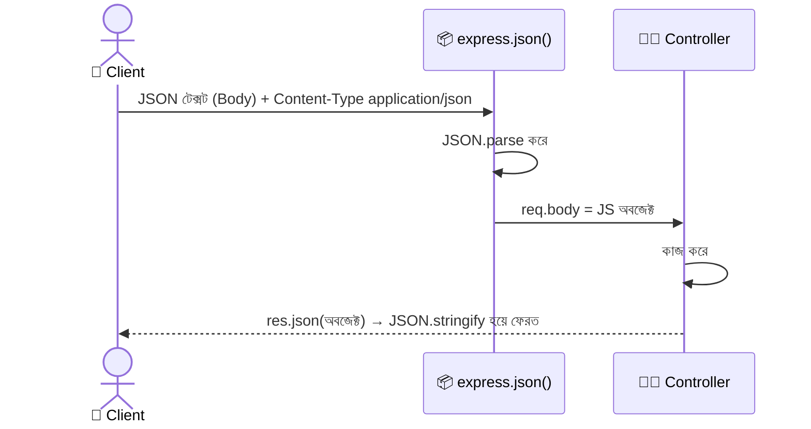

```javascript
import express from 'express';
const app = express();

app.use(express.json());
// express.json() = Express-এর বিল্ট-ইন middleware। কাজ: ঢোকা অনুরোধের Body যদি JSON হয় (Content-Type: application/json),
// তাহলে JSON.parse করে ফলাফল req.body-তে বসিয়ে দেয়
// ⚠️ এটা ছাড়া req.body পড়লে Express 5-এ undefined আসে (Express 4-এ {} আসতো)
// ⚠️ এটা অবশ্যই route-গুলোর আগে বসাতে হবে, নইলে route চলার সময় body তৈরিই হয়নি

app.post('/echo', (req, res) => {
  const body = req.body;
  // body = Client-এর পাঠানো JSON অবজেক্ট (parse হয়ে এসেছে)। যেমন { name: "Tehari", price: 280 }

  res.status(201).json({ received: body });
  // res.json(x) = ভেতরে JSON.stringify(x) করে + Content-Type: application/json হেডার নিজে বসিয়ে পাঠায়
});
```

| `res` মেথড | কী পাঠায় | কখন |
|---|---|---|
| `res.json(obj)` | JSON + `Content-Type: application/json` | **API-তে প্রায় সবসময় এটা** |
| `res.send('text')` | টেক্সট/HTML (অবজেক্ট দিলে JSON-ও পাঠায়) | সাধারণ টেক্সট |
| `res.sendStatus(204)` | শুধু status + তার নাম টেক্সট | বডি ছাড়া উত্তর |
| `res.status(404)` | শুধু status সেট করে (চেইন করতে হয়) | `res.status(404).json({...})` |

---

## ৭. Best Practices of JSON — প্যাকেট সাজানোর নিয়ম

### গল্প

পদ্মা রেস্তোরাঁর প্যাকেট এখন হাজারো অ্যাপ পড়ছে। কেউ প্যাকেটে লিখেছে `Price`, কেউ `price`, কেউ `PRICE`; কখনো সফল হলে `{"data": ...}`, কখনো সরাসরি Array। ফ্রন্টএন্ড ডেভেলপাররা পাগল! তাই আপনি **প্যাকেট সাজানোর নিয়ম** বেঁধে দিলেন — প্রতিটা প্যাকেট দেখতে একরকম।

### ১) সবসময় একই ছাঁচ (Consistent Envelope)

```javascript
// ✅ সফল response-এর ছাঁচ
{
  "success": true,                 // success = কাজ হলো কি না (Client সহজে if করতে পারে)
  "message": "Menu fetched",       // message = মানুষের পড়ার মতো ছোট বার্তা
  "count": 2,                      // count = তালিকার আইটেম সংখ্যা (শুধু তালিকায়)
  "data": [ { "id": 1 }, { "id": 2 } ]   // data = আসল মাল। সবসময় এই নামেই থাকবে
}

// ✅ ব্যর্থ response-এর ছাঁচ
{
  "success": false,
  "message": "Validation failed",
  "errors": ["price must be a positive number"]   // errors = কী কী ভুল (Array, একাধিক হতে পারে)
}
```

### ২) নামকরণ

| নিয়ম | ❌ খারাপ | ✅ ভালো |
|---|---|---|
| key **camelCase** | `Item_Name`, `PRICE` | `itemName`, `price` |
| Boolean-এ `is/has` উপসর্গ | `available`, `discount` | `isAvailable`, `hasDiscount` |
| তালিকার নাম **বহুবচন** | `item: [...]` | `items: [...]` |
| URL-এর resource **বহুবচন noun** | `/getMenu`, `/createItem` | `/menu`, `/menu/5` (কাজ বোঝাবে HTTP method) |
| Date → **ISO 8601** string | `"01/08/25"` | `"2025-08-01T10:00:00.000Z"` |
| সংখ্যা → **Number** | `"price": "350"` | `"price": 350` |

### ৩) Status code মিথ্যা বলবে না

```javascript
// ❌ সবচেয়ে বড় অভ্যাসগত ভুল: ব্যর্থ হয়েও 200 পাঠানো
res.status(200).json({ success: false, message: 'Not found' });
// Client-এর (fetch/axios) কাছে এটা "সফল" মনে হবে; error হ্যান্ডলিংই কাজ করবে না

// ✅ status code-ও বলুক, JSON-ও বলুক
res.status(404).json({ success: false, message: 'Menu item not found' });
```

### ৪) সংবেদনশীল তথ্য কখনো বাইরে পাঠাবেন না

```javascript
const user = { id: 7, name: 'Karim', email: 'karim@example.com', password: 'hashed_abc', role: 'admin' };
// user = ডাটাবেস থেকে পাওয়া পুরো রেকর্ড (এতে password hash-ও আছে!)

// ❌ পুরো অবজেক্ট পাঠিয়ে দেওয়া
res.json({ success: true, data: user });   // password ফাঁস!

// ✅ destructuring দিয়ে password আলাদা করে বাকিটা পাঠানো
const { password, ...safeUser } = user;
// password = আলাদা করে ফেলে রাখা (ব্যবহার করবো না)
// ...safeUser = rest operator; বাকি সব ফিল্ড একটা নতুন অবজেক্টে জমা হয়
res.json({ success: true, data: safeUser });   // id, name, email, role — password নেই
```

### ৫) তালিকা সবসময় Array — খালি হলেও `[]`

```javascript
// ❌ কিছু না পেলে null/মেসেজ পাঠানো → Client-এ .map() ভেঙে যায়
res.json({ data: null });

// ✅ তালিকার endpoint সবসময় Array ফেরত দেবে
res.json({ success: true, count: 0, data: [] });
// "তালিকা খালি" আর "রিসোর্স পাওয়া যায়নি" আলাদা জিনিস: তালিকা খালি = 200 + [], আইডি পাওয়া যায়নি = 404
```

### ৬) বড় তালিকায় Pagination

```javascript
// GET /api/v1/menu?page=2&limit=5
{
  "success": true,
  "data": [ /* ... ৫টা আইটেম ... */ ],
  "pagination": {
    "page": 2,          // এখন কত নম্বর পাতা
    "limit": 5,         // প্রতি পাতায় কয়টা
    "total": 23,        // মোট কয়টা আইটেম আছে
    "totalPages": 5     // Math.ceil(23 / 5) = 5
  }
}
```

### ৭) অন্যান্য ছোট নিয়ম

| নিয়ম | কেন |
|---|---|
| `null` বনাম অনুপস্থিত ফিল্ড — একটা নিয়ম ঠিক করে তাতেই থাকুন | Client-এর কোড সহজ থাকে |
| অতিরিক্ত গভীর nesting (৩-৪ স্তরের বেশি) এড়ান | পড়া ও আপডেট করা কঠিন হয় |
| Error-এ `stack trace`/ডাটাবেস মেসেজ পাঠাবেন না | হ্যাকারকে ভেতরের খবর দেওয়া হয় (শুধু লগে রাখুন) |
| `express.json({ limit: '10kb' })` দিয়ে body-র আকার সীমিত করুন | কেউ বিশাল JSON পাঠিয়ে সার্ভার আটকাতে না পারে |
| ID-র ধরন সব জায়গায় একই রাখুন (সংখ্যা বা string) | Client-এ তুলনা ভুল হয় না |
| Response-এ শুধু যা দরকার তাই পাঠান | নেটওয়ার্ক ও নিরাপত্তা দুটোই ভালো |

### ছাঁচ এক জায়গায় রাখার ট্রিক (ঐচ্ছিক, DRY নিয়ম)

```javascript
// ফাইল: utils/sendResponse.js
export const sendResponse = (res, statusCode, payload) => {
  // res = Express-এর response অবজেক্ট (যার মাধ্যমে পাঠাবো)
  // statusCode = কোন স্টিকার (200/201...)
  // payload = বাকি সব ফিল্ড ({ message, data, count ... })
  res.status(statusCode).json({ success: statusCode < 400, ...payload });
  // success আমরা statusCode থেকে নিজেই বের করছি (400-র নিচে হলে সফল)। ...payload = বাকি ফিল্ড ঢেলে দেওয়া
};
// ব্যবহার: sendResponse(res, 200, { message: 'Menu fetched', data: result });
```

---

## ৮. Middleware Concept — গেটের পাহারাদার দল

### গল্প

গ্রাহকের স্লিপ গেট দিয়ে ঢুকে শেফের কাছে পৌঁছানোর **মাঝের পথে** পদ্মা রেস্তোরাঁ কয়েকজন দাঁড় করিয়েছে:

1. 📝 **খাতা-লেখক:** "কে, কখন, কী চাইলো" লিখে রাখে (Logger)।
2. 📦 **প্যাকেট-খোলক:** JSON প্যাকেট খুলে ভেতরের লেখা বের করে দেয় (`express.json()`)।
3. 🔑 **পরিচয়-যাচাইকারী:** "পরিচয়পত্র কই?" — না থাকলে **সেখানেই ফিরিয়ে দেয়** (Auth)।
4. ✅ **স্লিপ-পরীক্ষক:** "দাম লেখা আছে তো? ঋণাত্মক নয় তো?" (Validation)।

প্রত্যেক পাহারাদারের তিনটা সম্ভাব্য কাজ:

- 👍 "ঠিক আছে, **এগিয়ে যাও**" → `next()` ডাকে।
- ✋ "না, **এখানেই শেষ**" → নিজেই response পাঠিয়ে দেয় (শেফ পর্যন্ত পৌঁছায়ই না)।
- 🚨 "**গোলমাল!**" → `next(error)` ডাকে — সরাসরি দুর্ঘটনা-সামলানো দলের কাছে।

এই **"request আর response-এর মাঝখানে বসা ফাংশন"-ই Middleware।**

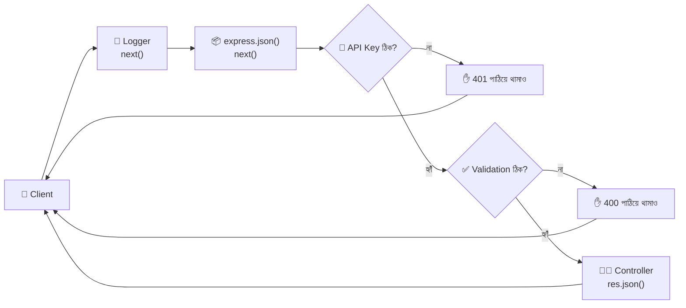

### Middleware-এর গঠন

```javascript
// ফাইল: src/middlewares/logger.middleware.js
export const requestLogger = (req, res, next) => {
  // requestLogger = middleware-এর নাম
  // তিনটা প্যারামিটার, ক্রম বদলানো যাবে না:
  //   req  = ঢোকা অনুরোধ (এখানে পড়া/বদলানো যায়)
  //   res  = ফেরত যাওয়া প্লেটের যন্ত্র
  //   next = "পরের পাহারাদারের কাছে যাও" বলার ফাংশন

  const start = Date.now();
  // start = অনুরোধ ঢোকার সময় (মিলিসেকেন্ডে সংখ্যা)। পরে কতক্ষণ লাগলো হিসাব করতে কাজে লাগবে

  res.on('finish', () => {
    // res.on('finish', fn) = "প্লেট পুরোপুরি পাঠানো শেষ হলে fn চালাও"
    // তখনই আমরা জানি শেষ status code কী ছিল আর কতক্ষণ লাগলো
    const duration = Date.now() - start;
    // duration = এখনকার সময় − শুরুর সময় = কত ms লাগলো
    console.log(`${req.method} ${req.originalUrl} → ${res.statusCode} (${duration}ms)`);
    // উদাহরণ: POST /api/v1/menu → 201 (4ms)
  });

  next();
  // ⚠️ সবচেয়ে গুরুত্বপূর্ণ লাইন! next() না ডাকলে আর respond-ও না করলে request ঝুলে থাকবে (Client অনন্তকাল অপেক্ষা)
};
```

### Middleware কোথায় বসানো যায় — ৫ ধরন

| ধরন | কোথায় বসে | উদাহরণ | গল্পে |
|---|---|---|---|
| **Application-level** | `app.use(mw)` — সব অনুরোধে চলে | `requestLogger`, `express.json()` | গেটের সবার জন্য পাহারা |
| **Router-level** | `router.use(mw)` — এই Router-এর সব route-এ | শুধু `/admin` route-গুলোতে auth | বিশেষ কাউন্টারের পাহারা |
| **Route-level** | `router.post('/', mw, controller)` — শুধু এক route-এ | `validateMenuBody` শুধু POST-এ | নির্দিষ্ট এক স্লিপের পরীক্ষা |
| **Built-in** | Express-এর সাথেই আসে | `express.json()`, `express.urlencoded()`, `express.static()` | রেস্তোরাঁর নিজস্ব স্টাফ |
| **Third-party** | `npm install` করে আনা | `cors`, `morgan`, `helmet`, `cookie-parser` | ভাড়া করা এক্সপার্ট |
| **Error-handling** | **৪টা** প্যারামিটার `(err, req, res, next)` | `errorHandler` | দুর্ঘটনা-সামলানো দল |

```javascript
// ===== একই middleware তিন জায়গায় বসানোর পার্থক্য =====
app.use(requestLogger);                          // ১) Application-level: প্রতিটা অনুরোধে
router.use(requireApiKey);                       // ২) Router-level: এই router-এর সব route-এ
router.post('/', requireApiKey, validateMenuBody, createMenuItem);
// ৩) Route-level: শুধু এই এক route-এ। একাধিক middleware কমা দিয়ে লাইন করে বসে, বাঁ থেকে ডানে চলে,
//    সবার শেষে controller (এটাও আসলে শেষ ধাপের একটা handler)
```

### পরিচয়-যাচাইকারী (Auth) middleware

```javascript
// ফাইল: src/middlewares/apiKey.middleware.js
import ApiError from '../utils/ApiError.js';

export const requireApiKey = (req, res, next) => {
  const clientKey = req.get('x-api-key');
  // clientKey = Client Header-এ যে চাবি পাঠিয়েছে। req.get('নাম') = header পড়ার নিরাপদ উপায় (ছোট/বড় হাতের পার্থক্য করে না)

  const serverKey = process.env.API_KEY;
  // serverKey = আমাদের সার্ভারের গোপন চাবি, .env ফাইল থেকে আসে (কোডে সরাসরি লেখা নিষেধ!)

  if (!clientKey || clientKey !== serverKey) {
    // চাবি না থাকলে, বা না মিললে — ঢুকতে দেওয়া যাবে না
    return next(new ApiError(401, 'Invalid or missing API key'));
    // next(error) = সোজা error-handling middleware-এ লাফ। return লিখেছি যাতে নিচের next() আর না চলে
  }

  next();
  // চাবি ঠিক → পরের পাহারাদার/controller-এর কাছে যাও
};
// ⚠️ এটা শুধু শেখার জন্য সরল নমুনা। আসল প্রজেক্টে JWT / Session ব্যবহার হয় (সামনের মডিউলে আসবে)
```

### Middleware দিয়ে তথ্য পাঠানো (`req`-এ জমা রাখা)

```javascript
const attachRequestTime = (req, res, next) => {
  req.requestTime = new Date().toISOString();
  // req একটা সাধারণ অবজেক্ট — আমরা নিজের নামে নতুন ফিল্ড (requestTime) জুড়ে দিতে পারি
  // পরের middleware/controller-এ req.requestTime পড়া যাবে (যেমন লগইন করা user: req.user)
  next();
};
```

### Error-handling middleware — সবচেয়ে বিশেষ পাহারাদার

```javascript
// ফাইল: src/middlewares/error.middleware.js
export const errorHandler = (err, req, res, next) => {
  // ⚠️ ঠিক ৪টা প্যারামিটার (err সবার আগে) — Express এই সংখ্যা দেখেই বোঝে এটা error-handler
  // next ব্যবহার না করলেও লিখতে হবে, নইলে Express এটাকে সাধারণ middleware ভেবে বসবে

  const statusCode = err.statusCode || 500;
  // statusCode = আমাদের ApiError-এ যা দিয়েছি; না থাকলে (অপ্রত্যাশিত বাগ) ধরে নিই 500
  const message = statusCode === 500 ? 'Internal Server Error' : err.message;
  // message = 500 হলে ভেতরের আসল কারণ Client-কে বলবো না (নিরাপত্তা), অন্যথায় আমাদের লেখা মেসেজ

  if (statusCode === 500) console.error(err);
  // অপ্রত্যাশিত বাগ — পুরোটা সার্ভারের লগে রাখি যাতে আমরা পরে খুঁজে পাই

  res.status(statusCode).json({ success: false, message, errors: err.errors ?? [] });
  // errors = ApiError-এ দেওয়া বিস্তারিত তালিকা; না থাকলে খালি Array (ছাঁচ ঠিক রাখতে)
};
```

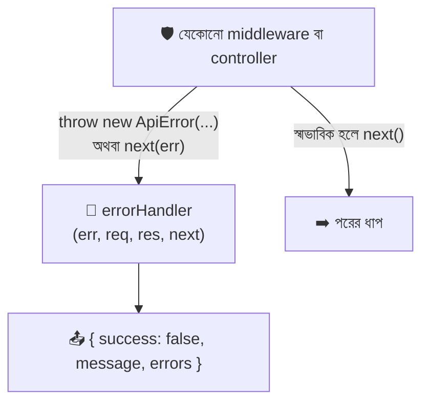

> 📌 **Express 5 সুবিধা:** `async` controller-এ `throw` করলে বা `await` করা Promise reject হলে Express 5 **নিজেই** error-handler-এ পাঠিয়ে দেয়। Express 4-এ হলে প্রতিটা async ফাংশন `try/catch` বা `asyncHandler` দিয়ে মুড়তে হতো।

---

## ৯. Controller Best Practices — ভালো শেফের অভ্যাস

### গল্প

পদ্মা রেস্তোরাঁর সেরা শেফের কিছু অভ্যাস আছে: স্লিপ পড়েই সন্দেহ হলে প্রশ্ন করেন, রান্না শেষ করে **ঠিক একটাই** প্লেট পাঠান, আর নিজের কাজ ছাড়া অন্যের কাজে নাক গলান না।

### ১) Controller হবে পাতলা (Thin) — এক ফাংশন, এক কাজ

```javascript
// ❌ এক ফাংশনে সব: validation + ডেটা + হিসাব + response
export const createMenuItem = (req, res) => { /* ৬০ লাইনের বিশাল কোড */ };

// ✅ validation গেছে middleware-এ, ডেটা-লজিক আলাদা জায়গায়; controller শুধু সমন্বয়কারী
export const createMenuItem = (req, res) => {
  const newItem = addItem(req.body);                  // কাজটা অন্য ফাংশন করছে (ভবিষ্যতে service/model)
  res.status(201).json({ success: true, data: newItem });
};
```

### ২) নামকরণ: ক্রিয়া + বিষয়

| ভালো নাম | কাজ |
|---|---|
| `getAllMenu` | সব মেনু |
| `getMenuById` | একটা মেনু |
| `createMenuItem` | তৈরি |
| `updateMenuItem` | বদল |
| `deleteMenuItem` | মুছা |

### ৩) Early return — আগে ভুল ধরো, পরে সফলতা

```javascript
// ❌ গভীর if-else-এর পিরামিড
export const getMenuById = (req, res) => {
  const item = menu.find((i) => i.id === Number(req.params.id));
  if (item) {
    res.json({ success: true, data: item });
  } else {
    res.status(404).json({ success: false, message: 'Not found' });
  }
};

// ✅ আগে "না"-গুলো সামলাও, শেষে সোজা পথে সফলতা
export const getMenuById = (req, res) => {
  const item = menu.find((i) => i.id === Number(req.params.id));
  if (!item) throw new ApiError(404, 'Menu item not found');   // ভুল আগে বিদায়
  res.status(200).json({ success: true, data: item });           // সোজা পথ
};
```

### ৪) `req.body` থেকে শুধু প্রয়োজনীয় ফিল্ড নাও (Whitelist)

```javascript
// ❌ পুরো body ঢুকিয়ে দেওয়া — কেউ "id": 999 বা "isAdmin": true পাঠিয়ে ফেলতে পারে (Mass Assignment আক্রমণ)
const newItem = { ...req.body };

// ✅ শুধু যে ফিল্ডগুলো আমরা চাই সেগুলোই নাও
const { name, price, category, isAvailable } = req.body;
// destructuring = body অবজেক্ট থেকে চারটা নির্দিষ্ট ফিল্ড তুলে আলাদা ভেরিয়েবলে রাখা; বাকি সব উপেক্ষিত
const newItem = { id: nextId, name, price, category, isAvailable: isAvailable ?? true };
// ?? = nullish coalescing: isAvailable undefined/null হলে ডান পাশের true ধরো (false দিলে false-ই থাকবে!)
```

### ৫) ধরন বদলে নাও (Type Conversion)

```javascript
const id = Number(req.params.id);            // "5" → 5
const maxPrice = Number(req.query.maxPrice); // "300" → 300
if (Number.isNaN(id)) throw new ApiError(400, 'id must be a number');
// Number("abc") = NaN। NaN === NaN মিথ্যা, তাই Number.isNaN() দিয়েই পরীক্ষা করতে হয়
```

### ৬) সঠিক status code

| কাজ | সফল হলে | ব্যর্থ হলে |
|---|---|---|
| GET (তালিকা) | `200` + `[]` (খালি হলেও) | — |
| GET (একটা) | `200` | `404` |
| POST | `201` | `400` (ভুল ডেটা), `409` (ডুপ্লিকেট) |
| PUT/PATCH | `200` | `400`, `404` |
| DELETE | `200` (বা `204`) | `404` |

### ৭) একটা request, একটাই response

```javascript
// ❌ শর্তের পরেও কোড চলতে থাকে → দুইবার response → "Cannot set headers after they are sent"
if (!item) res.status(404).json({ message: 'not found' });
res.json(item);

// ✅ return দিয়ে থামাও, অথবা throw করো
if (!item) return res.status(404).json({ message: 'not found' });
res.json(item);
```

### ৮) Async হলে Error সামলাও

```javascript
// Express 5: async ফাংশনের throw নিজেই errorHandler-এ যায় — try/catch ছাড়াই চলে
export const getAllOrders = async (req, res) => {
  const orders = await Order.find();   // পরের মডিউলে ডাটাবেস এলে এভাবেই লিখবো। Promise reject হলে Express 5 নিজে ধরে ফেলে
  res.json({ success: true, data: orders });
};

// Express 4 হলে (পুরোনো প্রজেক্টে) এই র‍্যাপার লাগতো:
export const asyncHandler = (fn) => (req, res, next) =>
  Promise.resolve(fn(req, res, next)).catch(next);
// fn = আমাদের async controller। .catch(next) = কোনো ভুল হলে next(error) ডাকো। এটা একটা "ফাংশন ফেরত দেওয়া ফাংশন"
```

### ৯) বড় প্রজেক্টে আরও এক স্তর: Service

ছোট প্রজেক্টে controller-ই ডেটা ডাকে। প্রজেক্ট বাড়লে একটা নতুন ফোল্ডার আসে:

```
Route → Controller → Service → Model (ডাটাবেস)
        (req/res)    (ব্যবসার নিয়ম)  (ডেটা সংরক্ষণ)
```

| স্তর | `req`/`res` চেনে? | কাজ |
|---|---|---|
| Controller | ✅ চেনে | HTTP-র ভাষা (params, status, JSON) |
| Service | ❌ চেনে না | ব্যবসার নিয়ম (ছাড় হিসাব, স্টক কমানো) |
| Model | ❌ চেনে না | ডাটাবেসের সাথে কথা |

---

## ১০. Middleware Best Practices — ভালো পাহারাদারের অভ্যাস

### গল্প

ভালো পাহারাদার জানেন: **কখন ছাড়বেন, কখন থামাবেন, আর কার পরে কে দাঁড়াবে।** ক্রম ভুল হলে (আগে স্লিপ পরীক্ষা, পরে প্যাকেট খোলা) পুরো ব্যবস্থা ভেঙে যায়।

### ১) ক্রম (Order) ঠিক রাখুন — সবচেয়ে বড় নিয়ম

```javascript
// ফাইল: src/app.js
app.use(requestLogger);      // ১) আগে লগ — সবার আগে, যাতে সব অনুরোধই লেখা পড়ে (এমনকি 404-ও)
app.use(express.json());     // ২) body parse — route-এর আগেই
app.use('/api/v1', routes);  // ৩) আসল route-গুলো
app.use(notFound);           // ৪) কোনো route না মিললে — সব route-এর পরে
app.use(errorHandler);       // ৫) সবার শেষে error-handler — যাতে উপরের সবার ভুল ধরতে পারে
```

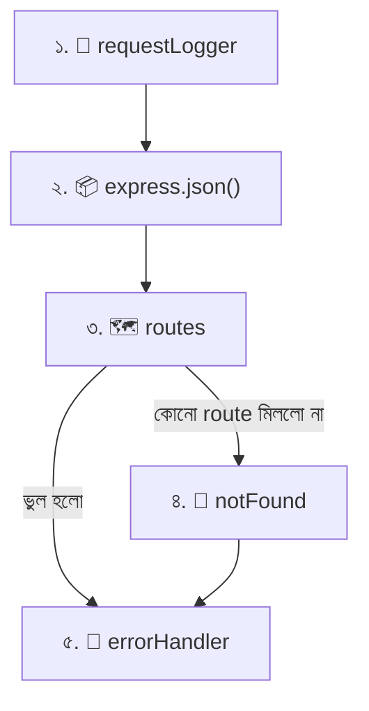

### ২) সবসময় হয় `next()` ডাকুন, নয় response পাঠান — দুটোর একটাও না করলে request ঝুলবে

```javascript
// ❌ কিছুই করা হলো না — Client অনন্তকাল অপেক্ষা করবে
export const bad = (req, res, next) => {
  console.log('hello');
};

// ✅ কাজ শেষে next()
export const good = (req, res, next) => {
  console.log('hello');
  next();
};
```

### ৩) response পাঠালে `return` করুন

```javascript
// ❌ response পাঠিয়েও next() চলে যায় → পরে আবার response → ক্র্যাশ
if (!token) { res.status(401).json({ message: 'no token' }); }
next();

// ✅
if (!token) return res.status(401).json({ message: 'no token' });
next();
```

### ৪) এক middleware = এক কাজ (Single Responsibility)

| ❌ একসাথে সব | ✅ আলাদা আলাদা |
|---|---|
| `doEverything` (লগ + auth + validation) | `requestLogger`, `requireApiKey`, `validateMenuBody` |

ছোট ছোট middleware অন্য route-এও আবার ব্যবহার করা যায়, আলাদা টেস্ট করা যায়, আর ভাঙলে কোথায় ভাঙলো বোঝা সহজ।

### ৫) কনফিগার করার জন্য "Middleware Factory"

একই ধরনের middleware একটু বদলে বারবার লাগলে — ফাংশন ফেরত দেওয়া ফাংশন বানান:

```javascript
// ফাইল: src/middlewares/requireFields.middleware.js
import ApiError from '../utils/ApiError.js';

export const requireFields = (...fields) => {
  // requireFields = "কারখানা"। ...fields = rest parameter: যত খুশি নাম নিতে পারে, Array হয়ে জমা হয় ('name','price')
  return (req, res, next) => {
    // এটাই আসল middleware (কারখানা থেকে বেরিয়ে আসা পাহারাদার), যে fields মনে রাখে (closure)
    const missing = fields.filter((f) => req.body?.[f] === undefined);
    // missing = যেসব ফিল্ড body-তে নেই তাদের তালিকা
    // req.body?.[f] = ?. মানে req.body undefined হলেও ক্র্যাশ করবে না (Express 5-এ body না থাকলে undefined আসে)
    if (missing.length) return next(new ApiError(400, `Missing fields: ${missing.join(', ')}`));
    next();
  };
};
// ব্যবহার: router.post('/', requireFields('name', 'price', 'category'), createMenuItem);
```

### ৬) কোথায় বসাবেন — সীমানা ছোট রাখুন

| Middleware | কোথায় |
|---|---|
| Logger, `express.json()`, `cors`, `helmet` | **Global** (`app.use`) |
| Auth, Role-check | **Router** বা **Route**-level (যেখানে দরকার) |
| Validation | **Route**-level (প্রতিটা route-এর নিজস্ব নিয়ম) |
| `notFound`, `errorHandler` | **Global, সবার শেষে** |

### ৭) নিজে না বানিয়ে পরীক্ষিত Third-party ব্যবহার করুন

| প্যাকেজ | কাজ | গল্পে |
|---|---|---|
| `cors` | ভিন্ন origin-এর ফ্রন্টএন্ডকে (React `localhost:5173`) অনুমতি | "বাইরের অতিথিদের অনুমতি-পত্র" |
| `helmet` | নিরাপদ HTTP header বসায় | "দরজা-জানালায় তালা" |
| `morgan` | তৈরি করা সুন্দর লগার | "ভাড়া করা খাতা-লেখক" |
| `express-rate-limit` | একজন অতিমাত্রায় বেশি অনুরোধ পাঠাতে পারবে না | "লাইনে এক ব্যক্তি এক-দুইবার" |
| `cookie-parser` | কুকি পড়ে | "টোকেন-পাঠক" |

```bash
npm install cors helmet morgan     # ইনস্টল
```

```javascript
import cors from 'cors';
import helmet from 'helmet';
app.use(helmet());   // helmet() = কল করলে একটা middleware ফেরত দেয়; app.use তাকে বসিয়ে দেয়
app.use(cors());     // শুরুতে সবার অনুমতি; প্রোডাকশনে cors({ origin: 'https://your-site.com' }) দিন
```

### ৮) ভারী কাজ ও ব্লকিং এড়ান

Middleware প্রতিটা অনুরোধে চলে। এর ভেতরে লম্বা `for` লুপ বা সিঙ্ক্রোনাস ভারী কাজ (যেমন `fs.readFileSync` বড় ফাইলে) রাখলে **সব গ্রাহক আটকে যায়** (Node.js একটা থ্রেডে চলে)। ধীর কাজ হলে `async/await` ব্যবহার করুন।

### ৯) middleware নিয়ে ছোট চেকলিস্ট

- [ ] ক্রম ঠিক? (logger → parser → routes → notFound → errorHandler)
- [ ] সব path-এ হয় `next()` নয় `res`/`next(err)` আছে?
- [ ] `res` পাঠালে `return` আছে?
- [ ] Error-handler-এ ঠিক ৪টা প্যারামিটার?
- [ ] গোপন মান `.env`-এ, কোডে নয়?

---

## ১১. পুরো প্রজেক্ট একসাথে — পদ্মা রেস্তোরাঁ API

এবার সব টুকরো জোড়া লাগাই। ফাইলগুলো ভেতর থেকে বাইরের দিকে (ছোট নির্ভরতা আগে) সাজানো, যাতে টাইপ করার সময় কোনো `import`-এ ফাইল না-পাওয়া সমস্যা না হয়।

### ১) `.env` আর `.gitignore`

```bash
# ফাইল: .env  (⚠️ GitHub-এ যাবে না)
PORT=5000
# PORT = সার্ভার কোন port-এ চলবে
API_KEY=padma-secret-123
# API_KEY = লেখার route-গুলো (POST/PUT/DELETE) রক্ষার গোপন চাবি। আসল প্রজেক্টে লম্বা র‍্যান্ডম মান দিন
```

```bash
# ফাইল: .env.example  (GitHub-এ যাবে — শুধু নমুনা, আসল মান ছাড়া)
PORT=5000
API_KEY=your-secret-key-here
```

```bash
# ফাইল: .gitignore
node_modules/
.env
```

### ২) `src/utils/ApiError.js` — নিজস্ব Error ক্লাস

```javascript
class ApiError extends Error {
  // class = ছাঁচ। extends Error = JavaScript-এর বিল্ট-ইন Error-এর সব ক্ষমতা পাবে (message, stack)
  constructor(statusCode, message, errors = []) {
    // constructor = নতুন ApiError বানানোর সময় যে ফাংশন চলে
    // statusCode = কোন HTTP স্টিকার (404, 400 ...)
    // message = সংক্ষিপ্ত কারণ
    // errors = বিস্তারিত তালিকা (ডিফল্ট খালি Array) — validation-এ একাধিক ভুল দেখাতে
    super(message);
    // super(message) = মূল Error ক্লাসকে message দিয়ে দেওয়া (এটা না করলে err.message ফাঁকা)
    this.statusCode = statusCode;   // this.xxx = এই অবজেক্টের নিজস্ব ফিল্ড, যা errorHandler পড়বে
    this.errors = errors;
  }
}

export default ApiError;
```

### ৩) `src/data/menu.data.js` — ভাঁড়ারের খাতা

```javascript
export const menu = [
  // menu = আপাতত ডাটাবেসের বদলে একটা Array। সার্ভার রিস্টার্ট দিলে ডেটা আবার প্রথম অবস্থায় ফিরে যাবে
  // ⚠️ export const-কে অন্য ফাইল থেকে নতুন মান দিয়ে "পুনর্নির্ধারণ (reassign)" করা যায় না,
  //    তাই অন্য ফাইলে push/splice/index-এ বসানো করবো — Array-র ভেতরটা বদলাবো, ভেরিয়েবলটা নয়
  { id: 1, name: 'Kacchi Biryani',   price: 350, category: 'main',    isAvailable: true },
  { id: 2, name: 'Chicken Roast',    price: 180, category: 'main',    isAvailable: true },
  { id: 3, name: 'Vegetable Samosa', price: 30,  category: 'starter', isAvailable: true },
  { id: 4, name: 'Firni',            price: 90,  category: 'dessert', isAvailable: false },
  { id: 5, name: 'Borhani',          price: 50,  category: 'drink',   isAvailable: true },
  // id = প্রতিটা আইটেমের ইউনিক পরিচয়; name = নাম; price = টাকায় দাম (সংখ্যা)
  // category = starter / main / dessert / drink (ফিল্টারে কাজে লাগবে); isAvailable = এখন পাওয়া যাচ্ছে কি না
];
```

### ৪) `src/middlewares/` — পাহারাদাররা

```javascript
// ===== ফাইল: src/middlewares/logger.middleware.js =====
export const requestLogger = (req, res, next) => {
  const start = Date.now();                      // start = অনুরোধ ঢোকার সময়
  res.on('finish', () => {                       // 'finish' = response পাঠানো শেষ হলে
    const duration = Date.now() - start;         // duration = মোট কত ms লাগলো
    console.log(`${req.method} ${req.originalUrl} → ${res.statusCode} (${duration}ms)`);
  });
  next();                                        // পরের ধাপে যাও
};
```

```javascript
// ===== ফাইল: src/middlewares/apiKey.middleware.js =====
import ApiError from '../utils/ApiError.js';

export const requireApiKey = (req, res, next) => {
  const clientKey = req.get('x-api-key');        // clientKey = Client যে চাবি পাঠালো (Header থেকে)
  const serverKey = process.env.API_KEY;         // serverKey = আমাদের গোপন চাবি (.env থেকে)
  if (!clientKey || clientKey !== serverKey) {
    return next(new ApiError(401, 'Invalid or missing API key'));   // 401 = পরিচয় নেই
  }
  next();
};
```

```javascript
// ===== ফাইল: src/middlewares/validateMenu.middleware.js =====
import ApiError from '../utils/ApiError.js';

const ALLOWED_CATEGORIES = ['starter', 'main', 'dessert', 'drink'];
// ALLOWED_CATEGORIES = গ্রহণযোগ্য ধরনের তালিকা। বড় হাতের নাম = "এটা ধ্রুবক (constant), বদলাবে না" — প্রচলিত রীতি

export const validateMenuBody = (req, res, next) => {
  const { name, price, category, isAvailable } = req.body ?? {};
  // req.body ?? {} = Express 5-এ body না এলে req.body = undefined; ?? {} দিয়ে সেক্ষেত্রে খালি অবজেক্ট ধরি, যাতে destructuring ক্র্যাশ না করে
  // name, price, category, isAvailable = Client-এর পাঠানো চারটা ফিল্ড (নাও থাকতে পারে → undefined)

  const errors = [];
  // errors = সব ভুল জমা রাখার Array। একটা ভুল পেয়েই থামি না — Client যেন একবারে সব ভুল জানতে পারে

  if (typeof name !== 'string' || name.trim() === '') {
    errors.push('name is required and must be a non-empty string');
    // trim() = দুই পাশের ফাঁকা জায়গা সরায়, যাতে "   " (শুধু স্পেস) চলে না যায়
  }
  if (typeof price !== 'number' || Number.isNaN(price) || price <= 0) {
    errors.push('price is required and must be a positive number');
    // typeof price !== 'number' → "350" (string) আটকে দেয়; NaN-ও typeof 'number', তাই আলাদা পরীক্ষা
  }
  if (!ALLOWED_CATEGORIES.includes(category)) {
    errors.push(`category must be one of: ${ALLOWED_CATEGORIES.join(', ')}`);
    // includes = Array-র ভেতরে মান আছে কি না (true/false)
  }
  if (isAvailable !== undefined && typeof isAvailable !== 'boolean') {
    errors.push('isAvailable must be true or false when provided');
    // isAvailable ঐচ্ছিক — দিলে অবশ্যই boolean হতে হবে
  }

  if (errors.length > 0) {
    return next(new ApiError(400, 'Validation failed', errors));   // 400 = Client-এর ভুল; errors তালিকাসহ
  }
  next();   // সব ঠিক → controller-এ যাও
};
```

```javascript
// ===== ফাইল: src/middlewares/notFound.middleware.js =====
import ApiError from '../utils/ApiError.js';

export const notFound = (req, res, next) => {
  next(new ApiError(404, `Route not found: ${req.method} ${req.originalUrl}`));
  // নিজে response না দিয়ে error বানিয়ে errorHandler-এর কাছে পাঠাচ্ছি — ফলে সব error একই ছাঁচে বেরোবে
};
```

```javascript
// ===== ফাইল: src/middlewares/error.middleware.js =====
export const errorHandler = (err, req, res, next) => {
  // ৪টা প্যারামিটার আবশ্যক — Express এভাবেই error-handler চেনে

  if (err.type === 'entity.parse.failed') {
    // entity.parse.failed = express.json() যখন ভাঙা JSON (যেমন শেষ কমা, সিঙ্গল কোটেশন) পায় তখনকার error-type
    return res.status(400).json({ success: false, message: 'Invalid JSON in request body', errors: [] });
  }

  const statusCode = err.statusCode || 500;                                    // না থাকলে অপ্রত্যাশিত বাগ = 500
  const message = statusCode === 500 ? 'Internal Server Error' : err.message;  // 500-এ ভেতরের কথা লুকাই
  if (statusCode === 500) console.error(err);                                  // শুধু সার্ভারের লগে আসল কারণ

  res.status(statusCode).json({ success: false, message, errors: err.errors ?? [] });
};
```

### ৫) `src/controllers/menu.controller.js` — শেফ

```javascript
import { menu } from '../data/menu.data.js';   // menu = ডেটার Array (named import, তাই { })
import ApiError from '../utils/ApiError.js';   // ApiError = default import (ব্রেস নেই)

// ---------- ১) সব মেনু (ফিল্টারসহ): GET /api/v1/menu ----------
export const getAllMenu = (req, res) => {
  const { category, maxPrice } = req.query;
  // category, maxPrice = URL-এর ? এর পরের ঐচ্ছিক ফিল্টার (দুটোই string বা undefined)

  let result = menu;
  // result = শুরুতে পুরো মেনু। let কারণ নিচে ফিল্টার করে নতুন Array দিয়ে বদলাবো (const হলে বদলানো যেত না)

  if (category) {
    result = result.filter((item) => item.category === category);
    // filter = শর্ত মেলা আইটেমগুলো নিয়ে একটা নতুন Array বানায় (মূল menu অক্ষত থাকে)
    // item = প্রতিটা আইটেমের অস্থায়ী নাম
  }
  if (maxPrice) {
    result = result.filter((item) => item.price <= Number(maxPrice));
    // Number(maxPrice) = "300" (string) → 300। না করলেও JS নিজে বদলে নেয়, কিন্তু স্পষ্ট লেখাই ভালো
  }

  res.status(200).json({
    success: true,
    message: 'Menu fetched successfully',
    count: result.length,   // count = ফিল্টারের পর কয়টা আইটেম বাকি
    data: result,           // data = আসল তালিকা (খালি হলেও [])
  });
};

// ---------- ২) একটা আইটেম: GET /api/v1/menu/:id ----------
export const getMenuById = (req, res) => {
  const id = Number(req.params.id);
  // id = URL-এর :id অংশ, সংখ্যায় বদলানো (params সবসময় string)
  if (Number.isNaN(id)) throw new ApiError(400, 'id must be a number');
  // "abc" দিলে NaN আসে; সেটা 404 নয়, Client-এর ভুল ইনপুট, তাই 400

  const item = menu.find((i) => i.id === id);
  // item = মেলা আইটেম অথবা undefined। find = প্রথম মেলা একটাই ফেরত দেয়
  if (!item) throw new ApiError(404, 'Menu item not found');

  res.status(200).json({ success: true, data: item });
};

// ---------- ৩) নতুন আইটেম: POST /api/v1/menu ----------
export const createMenuItem = (req, res) => {
  const { name, price, category, isAvailable } = req.body;
  // body-র শুধু প্রয়োজনীয় ফিল্ড তুলে নিচ্ছি (Whitelist)। validateMenuBody আগেই এগুলো যাচাই করে গেছে

  const nextId = menu.length > 0 ? Math.max(...menu.map((i) => i.id)) + 1 : 1;
  // nextId = নতুন আইডি = বর্তমান সবচেয়ে বড় id + ১ (খালি হলে ১)
  // menu.map(i => i.id) = শুধু id-গুলোর Array; ...(spread) = Array-র মানগুলো আলাদা আলাদা আর্গুমেন্ট করে Math.max-এ দেওয়া
  // ⚠️ menu.length + 1 ব্যবহার করলে মাঝের আইটেম মুছে গেলে ডুপ্লিকেট id হতে পারে

  const newItem = { id: nextId, name: name.trim(), price, category, isAvailable: isAvailable ?? true };
  // newItem = খাতায় তোলার নতুন আইটেম। name.trim() = দুই পাশের স্পেস কেটে সংরক্ষণ
  // isAvailable ?? true = না দিলে ডিফল্ট true (দিলে false-ও ঠিকঠাক থাকে)

  menu.push(newItem);
  // push = Array-র শেষে যোগ। (menu নিজে const — কিন্তু ভেতরের জিনিস বদলানো যায়)

  res.status(201).json({ success: true, message: 'Menu item created', data: newItem });
  // 201 = Created
};

// ---------- ৪) আপডেট: PUT /api/v1/menu/:id ----------
export const updateMenuItem = (req, res) => {
  const id = Number(req.params.id);
  if (Number.isNaN(id)) throw new ApiError(400, 'id must be a number');

  const index = menu.findIndex((i) => i.id === id);
  // index = Array-তে আইটেমটা কত নম্বর ঘরে (পাওয়া না গেলে -1)। findIndex = find-এর মতো, কিন্তু আইটেম নয়, ঘরের নম্বর দেয়
  if (index === -1) throw new ApiError(404, 'Menu item not found');

  const { name, price, category, isAvailable } = req.body;
  menu[index] = {
    ...menu[index],                       // ...menu[index] = পুরোনো আইটেমের সব ফিল্ড আগে ঢালো (id সহ)
    name: name.trim(),                    // তারপর নতুন মান দিয়ে নাম, দাম... বদলাও
    price,
    category,
    isAvailable: isAvailable ?? menu[index].isAvailable,   // না দিলে পুরোনোটাই থাকুক
  };
  // id আমরা body থেকে নিচ্ছি না — Client যেন id বদলাতে না পারে

  res.status(200).json({ success: true, message: 'Menu item updated', data: menu[index] });
};

// ---------- ৫) মুছা: DELETE /api/v1/menu/:id ----------
export const deleteMenuItem = (req, res) => {
  const id = Number(req.params.id);
  if (Number.isNaN(id)) throw new ApiError(400, 'id must be a number');

  const index = menu.findIndex((i) => i.id === id);
  if (index === -1) throw new ApiError(404, 'Menu item not found');

  const [deletedItem] = menu.splice(index, 1);
  // splice(index, 1) = index ঘর থেকে ১টা আইটেম কেটে বের করে (মূল Array থেকেই সরে যায়) আর কাটা অংশকে Array হিসেবে ফেরত দেয়
  // [deletedItem] = সেই Array-র প্রথম (একমাত্র) জিনিসটা তুলে নেওয়া (array destructuring)
  // menu = menu.filter(...) লেখা যেত না, কারণ import করা const-কে নতুন মান দেওয়া যায় না

  res.status(200).json({ success: true, message: 'Menu item deleted', data: deletedItem });
  // চাইলে res.sendStatus(204) দিয়ে বডি ছাড়াও পাঠানো যায়; আমরা শেখার জন্য মুছে-যাওয়া আইটেমটা ফেরত দিচ্ছি
};
```

### ৬) `src/routes/` — ম্যানেজাররা

```javascript
// ===== ফাইল: src/routes/menu.routes.js =====
import { Router } from 'express';
import {
  getAllMenu, getMenuById, createMenuItem, updateMenuItem, deleteMenuItem,
} from '../controllers/menu.controller.js';
import { requireApiKey } from '../middlewares/apiKey.middleware.js';
import { validateMenuBody } from '../middlewares/validateMenu.middleware.js';

const router = Router();   // router = মেনু বিভাগের মিনি-ম্যানেজার

// পড়া (GET) সবার জন্য খোলা — কোনো চাবি লাগে না
router.get('/', getAllMenu);
router.get('/:id', getMenuById);

// লেখা (POST/PUT/DELETE) — আগে চাবি, তারপর (দরকারে) validation, সবশেষে controller। বাঁ থেকে ডানে চলে
router.post('/', requireApiKey, validateMenuBody, createMenuItem);
router.put('/:id', requireApiKey, validateMenuBody, updateMenuItem);
router.delete('/:id', requireApiKey, deleteMenuItem);   // delete-এ body নেই, তাই validateMenuBody লাগে না

export default router;
```

```javascript
// ===== ফাইল: src/routes/index.js =====
import { Router } from 'express';
import menuRoutes from './menu.routes.js';

const router = Router();
router.use('/menu', menuRoutes);   // '/menu' দিয়ে শুরু সব অনুরোধ menuRoutes-এ
export default router;
```

### ৭) `src/app.js` — রেস্তোরাঁর সাজসজ্জা

```javascript
import express from 'express';
import routes from './routes/index.js';
import { requestLogger } from './middlewares/logger.middleware.js';
import { notFound } from './middlewares/notFound.middleware.js';
import { errorHandler } from './middlewares/error.middleware.js';

const app = express();   // app = আমাদের Express অ্যাপ

// ---------- ১) Global middleware (ক্রম গুরুত্বপূর্ণ!) ----------
app.use(requestLogger);                      // সবার আগে: প্রতিটা অনুরোধ লগ
app.use(express.json({ limit: '10kb' }));    // JSON body → req.body; limit = ১০ কিলোবাইটের বেশি হলে 413 error (বিশাল প্যাকেট আটকানো)

// ---------- ২) Health-check route: সার্ভার বেঁচে আছে কি না দেখার ছোট route ----------
app.get('/', (req, res) => {
  res.status(200).json({ success: true, message: 'পদ্মা রেস্তোরাঁর API চালু আছে 🍽️' });
});

// ---------- ৩) আসল API route ----------
app.use('/api/v1', routes);                  // সব route-এর সামনে /api/v1 উপসর্গ

// ---------- ৪) সবার শেষে: 404 আর error handler ----------
app.use(notFound);                           // কোনো route না মিললে
app.use(errorHandler);                       // যেকোনো জায়গা থেকে আসা error সামলাতে

export default app;
// export default app = server.js (আর ভবিষ্যতের টেস্ট) এই app-কে import করে ব্যবহার করবে
```

### ৮) `src/server.js` — মূল দরজা

```javascript
import app from './app.js';   // app = সাজানো রেস্তোরাঁ

const PORT = process.env.PORT || 5000;
// process.env.PORT = .env ফাইল থেকে আসা মান (node --env-file দিয়ে লোড হয়)। না পেলে || দিয়ে ডিফল্ট 5000
// ⚠️ process.env-এর সব মান string; listen-এ দিলে সমস্যা নেই

app.listen(PORT, () => {
  // এই callback সার্ভার সফলভাবে চালু হলে একবার চলে
  console.log(`🍽️ পদ্মা রেস্তোরাঁ চালু: http://localhost:${PORT}`);
});
```

### ৯) চালু করুন

```bash
npm run dev
# আউটপুট: 🍽️ পদ্মা রেস্তোরাঁ চালু: http://localhost:5000
```

### একটা POST অনুরোধের পুরো যাত্রা (শেষ বড় ছবি)

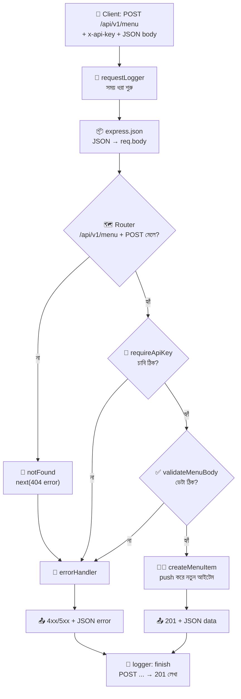

---

## ১২. চালিয়ে পরীক্ষা করা (curl / Postman)

> 💡 Postman ব্যবহার করলে: Method বেছে URL দিন → **Headers** ট্যাবে `Content-Type: application/json` আর `x-api-key: padma-secret-123` → **Body → raw → JSON** এ ডেটা লিখুন।

### ১) সব মেনু

```bash
curl http://localhost:5000/api/v1/menu
```

```json
{
  "success": true,
  "message": "Menu fetched successfully",
  "count": 5,
  "data": [
    { "id": 1, "name": "Kacchi Biryani", "price": 350, "category": "main", "isAvailable": true }
  ]
}
```
*(সংক্ষেপে প্রথম আইটেম দেখানো হলো; বাস্তবে ৫টাই আসবে)*

### ২) ফিল্টার

```bash
curl "http://localhost:5000/api/v1/menu?category=main&maxPrice=200"
# কোটেশন দিতে হবে, নইলে টার্মিনাল & চিহ্নকে আলাদা কমান্ড ভেবে ভুল করে
# ফলাফল: শুধু "Chicken Roast" (id 2) — কারণ main আর দাম ≤ 200
```

### ৩) একটা আইটেম আর 404

```bash
curl http://localhost:5000/api/v1/menu/2        # ✅ 200
curl http://localhost:5000/api/v1/menu/99       # ❌ 404
curl http://localhost:5000/api/v1/menu/abc      # ❌ 400
```

```json
{ "success": false, "message": "Menu item not found", "errors": [] }
```

### ৪) নতুন আইটেম (চাবিসহ)

```bash
curl -X POST http://localhost:5000/api/v1/menu \
  -H "Content-Type: application/json" \
  -H "x-api-key: padma-secret-123" \
  -d '{"name":"Beef Tehari","price":280,"category":"main"}'
# -X POST = method; -H = header; -d = body (এটাই req.body হবে)
```

```json
{
  "success": true,
  "message": "Menu item created",
  "data": { "id": 6, "name": "Beef Tehari", "price": 280, "category": "main", "isAvailable": true }
}
```

### ৫) ভুল পরীক্ষা

```bash
# চাবি ছাড়া → 401
curl -X POST http://localhost:5000/api/v1/menu -H "Content-Type: application/json" \
  -d '{"name":"X","price":10,"category":"main"}'

# ভুল ডেটা → 400 (দাম string, category ভুল)
curl -X POST http://localhost:5000/api/v1/menu \
  -H "Content-Type: application/json" -H "x-api-key: padma-secret-123" \
  -d '{"name":"","price":"abc","category":"snack"}'
```

```json
{
  "success": false,
  "message": "Validation failed",
  "errors": [
    "name is required and must be a non-empty string",
    "price is required and must be a positive number",
    "category must be one of: starter, main, dessert, drink"
  ]
}
```

### ৬) আপডেট ও ডিলিট

```bash
curl -X PUT http://localhost:5000/api/v1/menu/6 \
  -H "Content-Type: application/json" -H "x-api-key: padma-secret-123" \
  -d '{"name":"Beef Tehari Special","price":320,"category":"main","isAvailable":false}'

curl -X DELETE http://localhost:5000/api/v1/menu/6 -H "x-api-key: padma-secret-123"
```

### ৭) অজানা route

```bash
curl http://localhost:5000/api/v1/pizza
```

```json
{ "success": false, "message": "Route not found: GET /api/v1/pizza", "errors": [] }
```

### টার্মিনালে লগ কেমন দেখাবে

```
GET /api/v1/menu → 200 (3ms)
POST /api/v1/menu → 201 (2ms)
POST /api/v1/menu → 401 (1ms)
GET /api/v1/pizza → 404 (1ms)
```

---

## ১৩. সাধারণ ভুল আর সমাধান

| সমস্যা / Error | সাধারণ কারণ | সমাধান |
|---|---|---|
| `Cannot use import statement outside a module` | `package.json`-এ `"type": "module"` নেই | `"type": "module"` যোগ করুন |
| `ERR_MODULE_NOT_FOUND` / `Cannot find module './app'` | ESM-এ `.js` লেখা হয়নি | `import app from './app.js'` — শেষে `.js` আবশ্যক |
| `does not provide an export named 'xxx'` | Named export-কে ব্রেস ছাড়া import করেছেন (বা উল্টো) | `export const a` → `import { a }`; `export default a` → `import a` |
| `req.body` হচ্ছে `undefined` | `express.json()` বসাননি বা route-এর **পরে** বসিয়েছেন; বা Postman-এ `Content-Type` দেননি | route-এর **আগে** `app.use(express.json())`; Header ঠিক রাখুন |
| `Cannot destructure property 'name' of 'req.body' as it is undefined` | Express 5-এ body না এলে `undefined` | `const { name } = req.body ?? {};` |
| Postman-এ অনুরোধ চলছেই, উত্তর আসে না | middleware-এ `next()` বা `res` কিছুই ডাকা হয়নি | সব পথে `next()` / `res.json()` নিশ্চিত করুন |
| `Cannot set headers after they are sent to the client` | একই request-এ দুইবার response | `return res.json(...)` ব্যবহার করুন |
| `/menu/special` চলছে না, `:id`-তে ধরা পড়ছে | dynamic route আগে বসেছে | static route আগে, `/:id` পরে |
| 404 error JSON না দিয়ে HTML দিচ্ছে | `notFound` middleware বসানো হয়নি | সব route-এর পরে `app.use(notFound)` |
| Error-handler কাজই করছে না | ৪টা প্যারামিটার দেননি, বা সবার **আগে** বসিয়েছেন | `(err, req, res, next)` লিখুন; সবার **শেষে** বসান |
| `req.params.id === 5` সবসময় মিথ্যা | params সবসময় string | `Number(req.params.id)` |
| `.env`-এর মান `undefined` | `--env-file=.env` দেননি, বা ফাইলের নামে ভুল, বা Node পুরোনো | `npm run dev` দিয়ে চালান; Node ≥ 20.6 |
| `Assignment to constant variable` (`menu = ...`) | import করা/`const` Array-কে নতুন মান দেওয়ার চেষ্টা | `push`, `splice`, `menu[index] = ...` ব্যবহার করুন |
| Express 5-এ `app.get('*', ...)` crash করছে | Express 5-এ wildcard সিনট্যাক্স বদলেছে | `'/*splat'` লিখুন, বা path ছাড়া `app.use(...)` |
| `PayloadTooLargeError` | body ১০kb-এর বেশি | ইচ্ছাকৃত সীমা; দরকারে `limit` বাড়ান |
| `.env` GitHub-এ চলে গেছে | `.gitignore`-এ নেই | সাথে সাথে সব key বদলে ফেলুন (শুধু ফাইল মুছলে history-তে থেকে যায়) |

> 🔑 **তিনটা মনে-রাখার-ছড়া:**
> - **Router** = "কোথায়" (Path ও Method মেলায়)
> - **Controller** = "কী" (কাজ করে, উত্তর দেয়)
> - **Middleware** = "মাঝপথে" (যাচাই করে, তারপর `next()`)

---

## ১৪. সারসংক্ষেপ ও Practice আইডিয়া

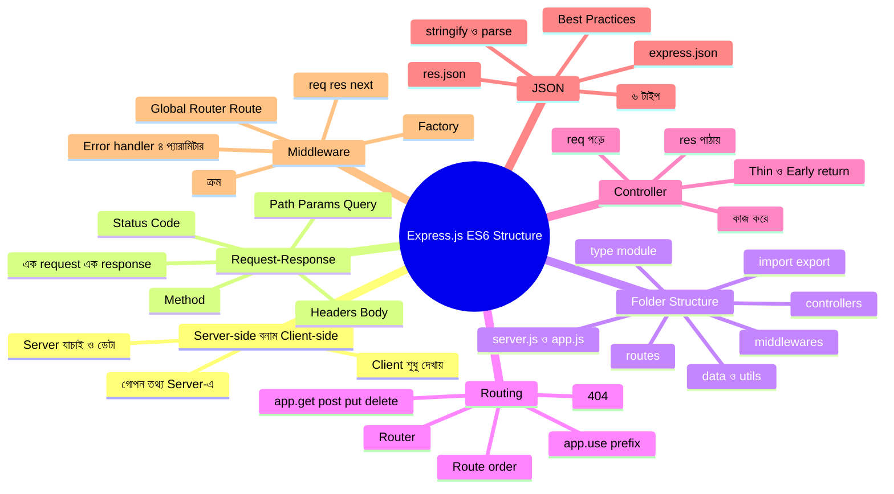

### গল্পের অভিধান — গল্পের কোনটা মানে কী

| গল্পে | টেকনিক্যাল নাম |
|---|---|
| ডাইনিং হল | Client-side |
| রান্নাঘর | Server-side |
| অর্ডার-স্লিপ | HTTP Request |
| পরিবেশন করা প্লেট | HTTP Response |
| স্লিপের ধরন (দেখাও/দাও/ফেলো) | HTTP Method |
| স্লিপের নম্বর (`/menu/5`) | Route Param (`req.params`) |
| ফিল্টারের নোট (`?category=main`) | Query String (`req.query`) |
| স্লিপের ভেতরের লেখা | Request Body (`req.body`) |
| প্লেটের গায়ের স্টিকার | Status Code |
| স্ট্যান্ডার্ড প্যাকেট | JSON |
| প্যাকেট খোলা | `express.json()` / `JSON.parse` |
| প্যাকেটে ভরা | `res.json()` / `JSON.stringify` |
| মূল দরজা | `server.js` |
| রেস্তোরাঁর সাজসজ্জা | `app.js` |
| কাউন্টারের ম্যানেজার | Router (`express.Router()`) |
| শেফ | Controller |
| গেটের পাহারাদার | Middleware |
| "এগিয়ে যাও" | `next()` |
| "গোলমাল, দুর্ঘটনা দলকে ডাকো" | `next(error)` |
| দুর্ঘটনা সামলানো দল | Error-handling Middleware (`err, req, res, next`) |
| ভাড়া করা এক্সপার্ট পাহারাদার | Third-party Middleware (`cors`, `helmet`, `morgan`) |
| ভাঁড়ারের খাতা | Data / Database |
| টুলবক্স | `utils/` |
| পাহারাদার বানানোর কারখানা | Middleware Factory |

### Practice-এর জন্য আইডিয়া

১. **পুরোটা নিজে হাতে টাইপ করে চালানো** — কপি-পেস্ট নয়। প্রথমে ছোট `server.js` (সেকশন ২), তারপর ফোল্ডারে ভাগ করুন।
২. **Params বনাম Query:** `GET /menu/3` আর `GET /menu?category=drink` — দুটোর `req.params` ও `req.query` `console.log` করে দেখুন।
৩. **Route-এর ক্রম:** `/special` route-টা `/:id`-এর **পরে** বসিয়ে ভুলটা নিজের চোখে দেখুন, তারপর ঠিক করুন।
৪. **নতুন Controller:** `GET /menu/available` যোগ করুন — শুধু `isAvailable: true` আইটেম ফেরত দেবে।
৫. **PATCH:** `PATCH /menu/:id` বানান, যেখানে শুধু পাঠানো ফিল্ডগুলো বদলাবে (সব ফিল্ড আবশ্যক নয়)।
৬. **Logger উন্নত করুন:** লগে কারেন্ট সময়ও ছাপান (`new Date().toISOString()`)।
৭. **Middleware ক্রম পরীক্ষা:** `requestLogger`-কে `notFound`-এর পরে বসিয়ে দেখুন — 404 লগ হচ্ছে কি না, আর কেন।
৮. **Middleware Factory:** `requireFields('name', 'price')` (সেকশন ১০) দিয়ে `validateMenuBody`-র একটা সরল রূপ বানান।
৯. **Pagination:** `?page=1&limit=2` সমর্থন করুন, আর response-এ `pagination` অবজেক্ট (সেকশন ৭) পাঠান।
১০. **sendResponse:** `utils/sendResponse.js` বানিয়ে সব controller-এ `res.status().json()`-এর জায়গায় ব্যবহার করুন।
১১. **দ্বিতীয় বিভাগ:** `orders` (route + controller + data) বানিয়ে `routes/index.js`-এ `router.use('/orders', orderRoutes)` যোগ করুন।
১২. **Error পরীক্ষা:** Postman-এ ভাঙা JSON (শেষে বাড়তি কমা) পাঠিয়ে `errorHandler`-এর `entity.parse.failed` অংশ চালান।
১৩. **Third-party:** `npm i cors morgan` করে `morgan('dev')` বসান, আমাদের নিজের logger-এর সাথে আউটপুট মেলান।
১৪. **এরপর:** MongoDB + Mongoose জুড়ে `data/` ফোল্ডারের জায়গায় `models/` আনুন, আর Controller থেকে ডাটাবেস লজিক `services/`-এ সরান।

---

