# 🏰 পদ্মা রেস্তোরাঁর নিরাপত্তা ও গতির গল্প: Express.js — DDoS, Rate Limiting, Cookies, CDN ও Load Balancing

> এই ফাইলে আমরা রেস্তোরাঁকে বানাবো **নিরাপদ** (Security) আর **দ্রুত** (Performance)।
> আজকের গল্পের মূল প্রশ্ন: **আমাদের Express সার্ভারকে আক্রমণ থেকে কীভাবে বাঁচাবো, গ্রাহকের লগইন-টোকেন (Cookie) কীভাবে নিরাপদ রাখবো, আর হাজার হাজার গ্রাহক এলে সার্ভার কীভাবে সামলাবো?**
> 📌 এই ফাইলটা আগের ফাইলের (`express-js-es6-folder-structure-routing-controllers-and-json.md`) **পরের ধাপ**। ওই প্রজেক্টের উপরেই নতুন ফাইল/পরিবর্তন বসবে। **Node.js 20.6+** আর **Express 5** ধরে লেখা।

---

## 📚 সূচিপত্র (Table of Contents)

0. [ভূমিকা: গল্পের নতুন চরিত্র + আজকের লক্ষ্য](#ভূমিকা-গল্পের-নতুন-চরিত্র--আজকের-লক্ষ্য)
1. [DoS ও DDoS Attack — দরজা আটকানোর ষড়যন্ত্র](#১-dos-ও-ddos-attack--দরজা-আটকানোর-ষড়যন্ত্র)
2. [Rate Limiting — "এক ব্যক্তি, সীমিত অর্ডার"](#২-rate-limiting--এক-ব্যক্তি-সীমিত-অর্ডার)
3. [Cookies — গ্রাহকের টোকেন-কার্ড](#৩-cookies--গ্রাহকের-টোকেন-কার্ড)
4. [HTTP-Only Cookies — কাচের বাক্সে রাখা কার্ড](#৪-http-only-cookies--কাচের-বাক্সে-রাখা-কার্ড)
5. [Cookie Hijacking — টোকেন-কার্ড চুরি](#৫-cookie-hijacking--টোকেন-কার্ড-চুরি)
6. [CDN — শহরে শহরে শাখা-রান্নাঘর](#৬-cdn--শহরে-শহরে-শাখা-রান্নাঘর)
7. [Load Balancing — ভিড়ের রিসেপশনিস্ট](#৭-load-balancing--ভিড়ের-রিসেপশনিস্ট)
8. [পুরো প্রজেক্টে যা যা যোগ/বদল হলো](#৮-পুরো-প্রজেক্টে-যা-যা-যোগবদল-হলো)
9. [চালিয়ে পরীক্ষা করা (curl / Postman)](#৯-চালিয়ে-পরীক্ষা-করা-curl--postman)
10. [সাধারণ ভুল আর সমাধান](#১০-সাধারণ-ভুল-আর-সমাধান)
11. [সারসংক্ষেপ ও Practice আইডিয়া](#১১-সারসংক্ষেপ-ও-practice-আইডিয়া)

---

## ভূমিকা: গল্পের নতুন চরিত্র + আজকের লক্ষ্য

পদ্মা রেস্তোরাঁর নাম ছড়িয়ে পড়েছে। কিন্তু একদিন সকালে:

- 🚪 এক লোক দরজার সামনে দাঁড়িয়ে সারাদিন একই অর্ডার দিয়ে যাচ্ছে, আসল গ্রাহক ঢুকতেই পারছে না।
- 🚪🚪🚪 তারপর হাজার হাজার ভুয়া গ্রাহক একসাথে ঢুকে পড়লো — সবাই কিছু একটা চাইছে, কেউ আসলে খাবে না।
- 🎫 এক গ্রাহকের টোকেন-কার্ড চুরি করে আরেকজন তার নামে বিল ঝুলিয়ে রাখছে।
- 🍳 আবার ঈদের আগের দিন এত ভিড় যে একটা রান্নাঘর আর টানতে পারছে না।

প্রতিটা সমস্যার সমাধান আছে। এই ফাইলে আমরা সেগুলো একে একে শিখবো।

### 🎭 গল্পের নতুন চরিত্র (আগের চরিত্রগুলো আগের মতোই আছে)

| গল্পে | টেকনিক্যাল নাম |
|---|---|
| এক লোক দরজা আটকে আছে | **DoS** attack (এক উৎস থেকে) |
| হাজার ভুয়া গ্রাহকের দল | **DDoS** attack (অনেক উৎস থেকে) |
| "এক ব্যক্তি, ১৫ মিনিটে সর্বোচ্চ ১০০ অর্ডার" নিয়ম | **Rate Limiting** (`express-rate-limit`) |
| গ্রাহকের পকেটে থাকা টোকেন-কার্ড | **Cookie** |
| কাচের বাক্সে তালা-দেওয়া কার্ড (গ্রাহক নিজেও খুলতে পারে না, শুধু রেস্তোরাঁ পড়ে) | **HttpOnly Cookie** |
| কার্ড চুরি করে নিজের পরিচয় দেওয়া | **Cookie Hijacking** |
| গ্রাহকের কার্ড মনে রাখার খাতা (রান্নাঘরের ভেতরে) | **Session Store** |
| শহরে শহরে ছোট শাখা-রান্নাঘর, যেখানে জনপ্রিয় খাবার আগেই রান্না করা থাকে | **CDN** (Edge Cache) |
| ভিড়ের রিসেপশনিস্ট ("আপনি ৩ নম্বর রান্নাঘরে যান") | **Load Balancer** (Nginx / Cloud LB) |
| একাধিক রান্নাঘর | একাধিক Server Instance |
| রান্নাঘর জীবিত কি না জিজ্ঞেস করা | **Health Check** (`/health`) |

### 🎯 আজকের শেষ ফলাফল

আগের প্রজেক্টে আমরা যোগ করবো:

| নতুন জিনিস | কী করবে |
|---|---|
| `globalLimiter` | সব API-তে সাধারণ গতিসীমা |
| `authLimiter` | লগইনে কড়া সীমা (পাসওয়ার্ড অনুমান ঠেকাতে) |
| `helmet` + `cors` | নিরাপদ header + নির্দিষ্ট ফ্রন্টএন্ডকে অনুমতি |
| `cookie-parser` | `req.cookies` পড়া |
| `POST /auth/login` / `GET /auth/me` / `POST /auth/logout` | HttpOnly cookie-ভিত্তিক session |
| `cacheFor()` middleware | CDN/ব্রাউজারের জন্য `Cache-Control` |
| `GET /health` | Load balancer-এর জন্য |
| `cluster.js` + Nginx config | একাধিক instance চালানো |

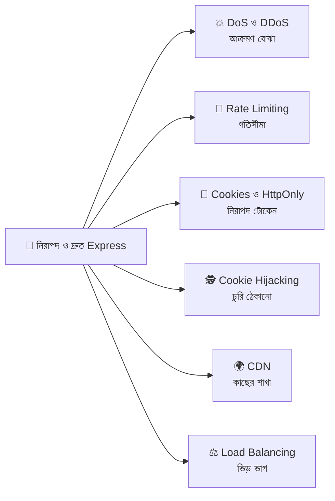

---

## ১. DoS ও DDoS Attack — দরজা আটকানোর ষড়যন্ত্র

### গল্প

পদ্মা রেস্তোরাঁর একটাই দরজা, ভেতরে ৫০টা চেয়ার। এক শত্রু-প্রতিদ্বন্দ্বী ঠিক করলো রেস্তোরাঁ বন্ধ করে দেবে — কিন্তু আগুন লাগানোর সাহস নেই! তাই সে কী করলো?

**ঘটনা ১ (DoS):** সে নিজে দরজার সামনে দাঁড়িয়ে সারাদিন অর্ডার দিতেই থাকলো — "এটা দাও... না, ওটা... না, আবার এটা...।" ওয়েটার তাকে নিয়ে ব্যস্ত, আসল গ্রাহক ঢুকতে পারছে না। **এক জন** মানুষ, কিন্তু রেস্তোরাঁ অচল। এটাই **DoS (Denial of Service — সেবা অস্বীকার)**।

পদ্মা রেস্তোরাঁর ম্যানেজার চালাক। সে বললো, "এই লোকটাকে চিনে ফেলেছি, ওকে বের করে দাও!" — এক জনকে ঠেকানো সহজ।

**ঘটনা ২ (DDoS):** পরদিন শত্রু ভাড়া করলো **১০,০০০ লোক** (আসলে হ্যাক করা ভুয়া কম্পিউটারের দল — **Botnet**)। সবাই দুনিয়ার বিভিন্ন জায়গা থেকে একসাথে ঢুকে অর্ডার দিতে লাগলো। ম্যানেজার কাকে বের করবে? **কে আসল আর কে ভুয়া** চেনার উপায় নেই। এটাই **DDoS (Distributed DoS — ছড়ানো DoS)**।

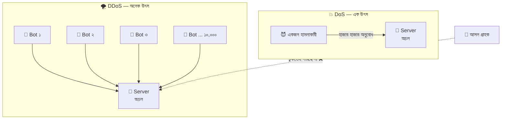

### DoS বনাম DDoS

| বিষয় | DoS | DDoS |
|---|---|---|
| হামলা আসে | **একটা** উৎস (একটা IP) থেকে | **হাজার/লক্ষ** উৎস থেকে (Botnet) |
| গল্পে | এক লোক দরজা আটকে আছে | ১০,০০০ ভুয়া গ্রাহক |
| ঠেকানো | সহজ — ওই IP-কে block করলেই হয় | কঠিন — কে আসল চেনা যায় না |
| একা Express কি পারবে? | অনেকটা পারে (Rate Limit) | না — CDN / WAF / ISP লেভেলের সাহায্য লাগে |

### আক্রমণের ধরন (কোন স্তরে হামলা)

| ধরন | গল্পে | কীভাবে | কে ঠেকাবে |
|---|---|---|---|
| **Volumetric** (পরিমাণের হামলা) | রাস্তা জুড়ে এত লোক যে রেস্তোরাঁ পর্যন্ত পৌঁছানোই যায় না | নেটওয়ার্কের bandwidth ভরে দেয় (UDP flood) | ক্লাউড/ISP, CDN |
| **Protocol** (নিয়মের হামলা) | দরজায় কড়া নেড়ে পালিয়ে যায়, ওয়েটার দরজা খুলে খুলে ক্লান্ত | `SYN flood` — connection অর্ধেক খুলে রেখে দেয় | ফায়ারওয়াল, Load Balancer |
| **Application Layer** (অ্যাপের হামলা) | ওয়েটারকে এমন অর্ডার দেয় যা বানাতে ঘণ্টা লাগে | `HTTP flood`, ভারী query বারবার, বিশাল JSON, **Slowloris** (খুব ধীরে ধীরে অনুরোধ পাঠানো) | **আমাদের Express কোড** + Rate Limit |

> 💡 **মনে রাখুন:** Express অ্যাপ শুধু **Application Layer (L7)** হামলা সামলাতে পারে। বড় Volumetric হামলা Express পর্যন্ত পৌঁছালেই হেরে গেছেন — সেটা **CDN/Cloud (Cloudflare, AWS Shield)** ঠেকায়। তাই নিরাপত্তা হয় **স্তরে স্তরে**।

### প্রতিরক্ষার স্তর (Defense in Depth) — রেস্তোরাঁর কয়েক স্তরের পাহারা

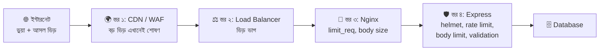

### Express-এ Application-layer সুরক্ষার চেকলিস্ট

| হামলা | সুরক্ষা | কোথায় আছে |
|---|---|---|
| একই IP থেকে অতিরিক্ত অনুরোধ | **Rate Limiting** | সেকশন ২ |
| বিশাল JSON পাঠিয়ে মেমরি ভরানো | `express.json({ limit: '10kb' })` | আগের ফাইলে করেছি ✅ |
| Slowloris (ধীর অনুরোধ) | সার্ভারের timeout সেট করা | নিচে |
| ভারী ডাটাবেস query বারবার | Pagination (`limit` সীমা), index, cache | সেকশন ৬ |
| খারাপ Regex দিয়ে CPU আটকানো (**ReDoS**) | ইউজারের ইনপুটে জটিল Regex এড়ানো | সাধারণ নিয়ম |
| জানা দুর্বলতা | `helmet`, প্যাকেজ আপডেট (`npm audit`) | সেকশন ৮ |

### Slowloris ঠেকাতে সার্ভারের Timeout

```javascript
// ফাইল: src/server.js (এর একটা অংশ)
const server = app.listen(PORT, () => console.log(`চালু: ${PORT}`));
// server = app.listen() একটা Node.js http.Server অবজেক্ট ফেরত দেয়। এখন এর timeout-গুলো আমরা বদলাতে পারি

server.headersTimeout = 15_000;
// headersTimeout = Client-কে সর্বোচ্চ কতক্ষণে (ms) অনুরোধের Header পাঠানো শেষ করতে হবে। ১৫_০০০ = ১৫ সেকেন্ড
// _ (আন্ডারস্কোর) শুধু সংখ্যা পড়তে সুবিধার জন্য, মান একই। Slowloris একটা একটা করে অক্ষর পাঠিয়ে সময় নষ্ট করে — এটা তাকে কাটবে

server.requestTimeout = 30_000;
// requestTimeout = পুরো অনুরোধ (Body সহ) আসতে সর্বোচ্চ কতক্ষণ। ৩০ সেকেন্ড পেরোলে Node connection বন্ধ করে দেয়
// নিয়ম: headersTimeout অবশ্যই requestTimeout-এর চেয়ে ছোট বা সমান রাখুন

server.keepAliveTimeout = 5_000;
// keepAliveTimeout = উত্তর পাঠানোর পর অব্যবহৃত connection কতক্ষণ খোলা থাকবে (ms)। অকারণে খোলা connection জমতে দেওয়া ঠিক না
```

---

## ২. Rate Limiting — "এক ব্যক্তি, সীমিত অর্ডার"

### গল্প

ম্যানেজার একটা নিয়ম বানালো, দরজায় বড় করে টাঙিয়ে দিলো:

> 📜 **"এক ব্যক্তি ১৫ মিনিটে সর্বোচ্চ ১০০টা অর্ডার দিতে পারবেন। সীমা পার হলে — ১৫ মিনিট বাইরে অপেক্ষা করুন!"**

দরজার পাশে একজন স্টাফ **খাতায় দাগ কাটে**: কার নামে কয়টা অর্ডার। ১০১ নম্বর অর্ডারে সে বলে — **"দুঃখিত, এখন আর না!"** (`429 Too Many Requests`)।

আর **ক্যাশিয়ার কাউন্টারে** (লগইন) নিয়ম আরও কড়া: **"ভুল পাসওয়ার্ড ১৫ মিনিটে মাত্র ৫ বার।"** কারণ কেউ পাসওয়ার্ড অনুমান করতে করতে (Brute Force) হাজারবার চেষ্টা করলে ঠেকানো দরকার।

**এই "কে কতবার অনুরোধ করলো গুনে সীমা পার হলে ঠেকানো"-ই Rate Limiting।**

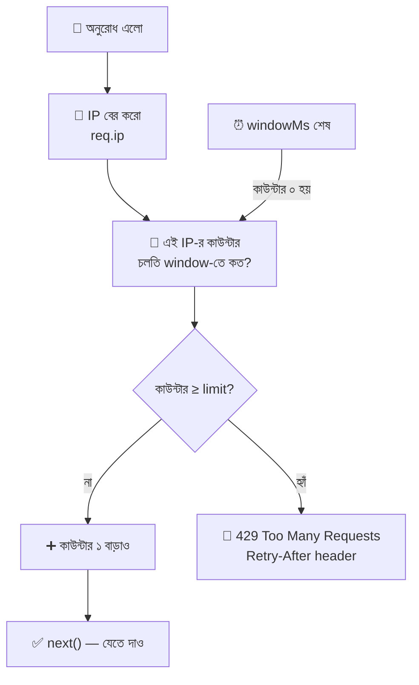

### Rate Limiting-এর ৪টা পদ্ধতি (Algorithm) — ছোট পরিচয়

| পদ্ধতি | গল্পে | ধারণা |
|---|---|---|
| **Fixed Window** (স্থির জানালা) | "প্রতি ১৫ মিনিটের ঘণ্টায় ১০০টা", ১৫ মিনিট পার হলেই খাতা সাদা | সহজ, কিন্তু জানালার সীমানায় দ্বিগুণ অনুরোধ ঢুকে যেতে পারে |
| **Sliding Window** (চলমান জানালা) | "গত ১৫ মিনিটে কয়টা?" — প্রতি মুহূর্তে হিসাব | বেশি নিখুঁত, বেশি মেমরি |
| **Token Bucket** | বালতিতে ১০০টা টোকেন, প্রতি অর্ডারে ১টা খরচ, ধীরে ধীরে নতুন টোকেন জমে | হঠাৎ ভিড় (burst) সামলায় |
| **Leaky Bucket** | ফুটো বালতি — যত জলই ঢালো, একই গতিতে বেরোয় | অনুরোধ মসৃণ গতিতে পাঠায় |

> `express-rate-limit` ডিফল্টে **Fixed Window** ব্যবহার করে — শুরুর জন্য যথেষ্ট।

### ইনস্টল

```bash
npm install express-rate-limit
```

### সবচেয়ে ছোট উদাহরণ

```javascript
import rateLimit from 'express-rate-limit';
// rateLimit = একটা ফাংশন, যা কল করলে একটা middleware ফেরত দেয় (আগের ফাইলের "Middleware Factory"-র মতো)

const limiter = rateLimit({
  windowMs: 15 * 60 * 1000,
  // windowMs = "জানালার" দৈর্ঘ্য মিলিসেকেন্ডে। ১৫ মিনিট × ৬০ সেকেন্ড × ১০০০ ms
  limit: 100,
  // limit = এক জানালায় একই client (IP) সর্বোচ্চ কয়টা অনুরোধ পারবে। (পুরোনো ভার্সনে নাম ছিল max)
  standardHeaders: 'draft-7',
  // standardHeaders = response-এ আধুনিক মানক RateLimit-* header পাঠাবে, যাতে Client জানতে পারে আর কয়টা বাকি
  legacyHeaders: false,
  // legacyHeaders = পুরোনো ধাঁচের X-RateLimit-* header বন্ধ (দুটো একসাথে পাঠানোর দরকার নেই)
});

app.use(limiter);   // app.use = সব route-এ প্রয়োগ। শুধু একটা route-এ চাইলে router.post('/login', limiter, handler)
```

### আমাদের প্রজেক্টের জন্য — ছাঁচ-মেনে লিখি

আগের ফাইলে আমাদের সব error একটা ছাঁচে বেরোয় (`{ success, message, errors }`)। Rate limit-এর উত্তরও সেই ছাঁচে দেবো।

```javascript
// ফাইল: src/middlewares/rateLimit.middleware.js
import rateLimit from 'express-rate-limit';

const createLimiter = ({ windowMs, limit, message, skipSuccessfulRequests = false }) =>
  // createLimiter = limiter বানানোর কারখানা। বারবার একই বিন্যাস লিখতে হবে না (DRY)
  // skipSuccessfulRequests = true হলে সফল (status < 400) অনুরোধ গোনা হবে না — শুধু ব্যর্থ চেষ্টা গোনা হবে
  rateLimit({
    windowMs,
    limit,
    standardHeaders: 'draft-7',
    legacyHeaders: false,
    skipSuccessfulRequests,
    handler: (req, res) => {
      // handler = সীমা পার হলে কী উত্তর যাবে। (req, res) আমাদের চেনা জিনিস
      res.status(429).json({ success: false, message, errors: [] });
      // 429 = Too Many Requests। আমাদের নিজস্ব JSON ছাঁচে উত্তর
    },
  });

export const globalLimiter = createLimiter({
  windowMs: 15 * 60 * 1000,   // ১৫ মিনিট
  limit: 100,                 // সাধারণ API-তে ১০০ অনুরোধ
  message: 'Too many requests. Please try again after 15 minutes.',
});

export const authLimiter = createLimiter({
  windowMs: 15 * 60 * 1000,   // ১৫ মিনিট
  limit: 5,                   // লগইনে শুধু ৫টা চেষ্টা
  skipSuccessfulRequests: true,   // সফল লগইন গোনা হবে না — ভুল চেষ্টাগুলোই গুনবে, তাই আসল ইউজার আটকাবে না
  message: 'Too many login attempts. Please try again after 15 minutes.',
});
```

### কোথায় বসাবেন — ক্রম আবার গুরুত্বপূর্ণ

```javascript
// ফাইল: src/app.js (অংশবিশেষ)
app.use(requestLogger);                         // ১) লগ
app.use(globalLimiter);                         // ২) rate limit — express.json()-এর আগে! (নিচে কারণ)
app.use(express.json({ limit: '10kb' }));       // ৩) body parse
// ...
// auth.routes.js-এ: router.post('/login', authLimiter, login);   ← লগইনে অতিরিক্ত কড়া সীমা
```

> 🔑 **কেন `express.json()`-এর আগে?** যে অনুরোধ সীমা পার করেছে, তার body পড়ে JSON parse করার কোনো মানে নেই — সেটা শুধু CPU নষ্ট। তাই আগে "ঢুকতে দেবো কি না" ঠিক করি, তারপর প্যাকেট খুলি।

### ⚠️ Proxy-র পেছনে থাকলে `trust proxy`

Load Balancer / Nginx / Cloudflare-র পেছনে আমাদের Express থাকলে প্রতিটা অনুরোধ আসে **ওই proxy-র IP থেকে**, আসল ব্যবহারকারীর IP থেকে নয়। ফল: **সব গ্রাহক একই IP** মনে হয়, আর একজনের ভিড়ে সবাই block হয়ে যায়!

```javascript
app.set('trust proxy', 1);
// 'trust proxy' = Express-কে বলা: "আমার সামনে কয়টা proxy আছে, তাদের X-Forwarded-For header বিশ্বাস করো"
// 1 = সামনে ঠিক ১টা proxy (যেমন একটা Nginx বা একটা Load Balancer)। তখন req.ip = আসল ব্যবহারকারীর IP
// ⚠️ true লিখবেন না — তাহলে হ্যাকার নিজে X-Forwarded-For header বানিয়ে ভুয়া IP দিয়ে সীমা এড়াতে পারে
// ⚠️ proxy ছাড়া সরাসরি চালালে এটা সেট করবেন না, নইলে কেউ header জাল করে সীমা এড়াতে পারবে
```

### সীমা ও ঠিক কত রাখবো?

| Endpoint | সাধারণ সীমা | কারণ |
|---|---|---|
| সাধারণ GET API | ১০০–৩০০ / ১৫ মিনিট | স্বাভাবিক ব্যবহার সামলাবে |
| লগইন / পাসওয়ার্ড রিসেট | ৫–১০ / ১৫ মিনিট | Brute force ঠেকাতে |
| নিবন্ধন / OTP / ইমেইল পাঠানো | ৩–৫ / ঘণ্টা | স্প্যাম ও খরচ ঠেকাতে |
| ভারী রিপোর্ট / সার্চ | ১০–২০ / ১৫ মিনিট | ডাটাবেস বাঁচাতে |

### 🔑 Rate Limiting-এর সীমাবদ্ধতা (সৎ কথা)

| সীমাবদ্ধতা | মানে | সমাধান |
|---|---|---|
| ডিফল্ট Store = **সার্ভারের মেমরি** | সার্ভার রিস্টার্ট দিলে কাউন্টার শূন্য; **একাধিক instance** থাকলে প্রত্যেকের আলাদা কাউন্টার (৩টা সার্ভারে ৩× সুযোগ!) | **Redis store** (`rate-limit-redis`) — সব instance একই কাউন্টার ব্যবহার করে |
| IP দিয়ে চেনা | একই অফিস/কলেজের সবাই এক IP (NAT); আবার হামলাকারী IP বদলাতে পারে | লগইন করা ইউজারের ক্ষেত্রে user id দিয়ে `keyGenerator`; DDoS-এ CDN/WAF |
| বড় DDoS | Express পর্যন্ত পৌঁছানোর পর অনেক দেরি | Cloudflare / AWS Shield (সেকশন ১, ৬) |

> 💡 Nginx লেভেলেও rate limit দেওয়া যায় — সেটা Express পর্যন্ত অনুরোধ পৌঁছানোর **আগেই** ঠেকায়, তাই আরও কম খরচ (সেকশন ৭-এ দেখবো)।

---

## ৩. Cookies — গ্রাহকের টোকেন-কার্ড

### গল্প

পদ্মা রেস্তোরাঁয় নিয়ম হলো: **একবার লগইন (পরিচয়) করলে পরের প্রতিবার আর পরিচয় দিতে হবে না।** কীভাবে? ক্যাশিয়ার গ্রাহককে একটা **টোকেন-কার্ড** ধরিয়ে দেয়:

> 🎫 কার্ড নম্বর: `a91f...c7` — "এই কার্ড যার কাছে, সে কাল সকাল পর্যন্ত বৈধ গ্রাহক।"

গ্রাহক কার্ডটা **নিজের পকেটে** (ব্রাউজারে) রাখে। পরেরবার যখনই রেস্তোরাঁয় ঢোকে, **কিছু না বললেও নিজে নিজেই কার্ডটা দেখিয়ে দেয়**। রান্নাঘরের ভেতরে একটা খাতা (Session Store) আছে: "কার্ড নম্বর `a91f...c7` = করিম, admin।" কার্ড মিলিয়ে চিনে ফেলে।

**এই টোকেন-কার্ডটাই Cookie।** HTTP নিজে "স্মৃতিহীন" (Stateless) — প্রতিটা অনুরোধ আলাদা, আগের কথা মনে রাখে না। Cookie সেই স্মৃতির কাজ করে।

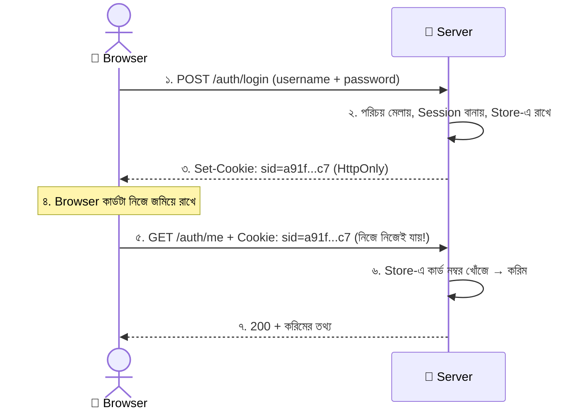

### Cookie কীভাবে কাজ করে — দুটো header

| দিক | Header | কে পাঠায় | গল্পে |
|---|---|---|---|
| Server → Browser | `Set-Cookie: sid=...; HttpOnly; ...` | Server | ক্যাশিয়ার কার্ড দিলো |
| Browser → Server | `Cookie: sid=...` | **Browser নিজে** (প্রতিটা অনুরোধে, ওই ডোমেইনে) | গ্রাহক নিজে কার্ড দেখালো |

### Cookie বনাম localStorage

| বিষয় | Cookie | localStorage |
|---|---|---|
| Server-এ যায় কীভাবে | **নিজে নিজে** প্রতিটা অনুরোধে | যায় না; JS দিয়ে হাতে লিখে পাঠাতে হয় |
| JS পড়তে পারে? | সাধারণ cookie → হ্যাঁ; **HttpOnly → না** | সবসময় হ্যাঁ (XSS হলে চুরি সহজ) |
| মেয়াদ | `Max-Age` / `Expires` দিয়ে ঠিক করা যায় | কখনো নিজে মেয়াদ শেষ হয় না |
| আকার | ছোট (~৪KB) | বড় (~৫MB) |
| উপযোগী | **লগইন session / token** | UI পছন্দ (dark mode), ক্যাশ |

### Cookie-র অ্যাট্রিবিউট (কার্ডের গায়ের নিয়মাবলি)

| অ্যাট্রিবিউট | কাজ | গল্পে |
|---|---|---|
| `Max-Age` / `Expires` | কার্ডের মেয়াদ। না দিলে ব্রাউজার বন্ধ করলেই শেষ (**Session cookie**) | "আজ রাত ১২টা পর্যন্ত বৈধ" |
| `Path` | কোন URL-পথে কার্ড পাঠানো হবে (`/` = সব জায়গায়) | "শুধু এই কাউন্টারে দেখাবেন" |
| `Domain` | কোন ডোমেইনে (সাবডোমেইনসহ) | "কোন কোন শাখায় চলবে" |
| `Secure` | শুধু **HTTPS**-এ পাঠানো হবে | "শুধু সিল-করা গাড়িতে পাঠানো হবে" |
| `HttpOnly` | **JavaScript পড়তে পারবে না** | "কাচের বাক্সে তালা" (সেকশন ৪) |
| `SameSite` | অন্য সাইট থেকে আসা অনুরোধে কার্ড যাবে কি না (**CSRF ঠেকায়**) | "শুধু আমাদের দরজা দিয়ে এলে কার্ড চলবে" |

### `SameSite`-এর তিন মান

| মান | আচরণ | কখন |
|---|---|---|
| `Strict` | অন্য সাইট থেকে আসা **কোনো** অনুরোধেই cookie যায় না | ব্যাংক-ধরনের সংবেদনশীল কাজ |
| `Lax` | অন্য সাইট থেকে সাধারণ লিংক-ক্লিকে (GET) যায়, কিন্তু অন্য সাইটের ফর্ম/POST-এ যায় না | **বেশিরভাগ অ্যাপে ভালো ডিফল্ট** |
| `None` | সব জায়গায় যায় — **`Secure` আবশ্যক** | ভিন্ন ডোমেইনের ফ্রন্টএন্ড-ব্যাকএন্ড (যেমন Vercel + Render) |

### Express-এ Cookie — `cookie-parser`

```bash
npm install cookie-parser
```

```javascript
import express from 'express';
import cookieParser from 'cookie-parser';
// cookieParser = ঢোকা অনুরোধের Cookie header পড়ে req.cookies অবজেক্ট বানায় (JSON পড়ার জন্য express.json()-এর মতো)

const app = express();
app.use(cookieParser());
// ⚠️ route-এর আগে বসাতে হবে। না বসালে req.cookies = undefined

// ---------- Cookie পাঠানো ----------
app.get('/set', (req, res) => {
  res.cookie('theme', 'dark', { maxAge: 1000 * 60 * 60 * 24 });
  // res.cookie(নাম, মান, অপশন) = Set-Cookie header বসিয়ে দেয়
  // 'theme' = cookie-র নাম, 'dark' = মান
  // maxAge = মেয়াদ মিলিসেকেন্ডে (এখানে ১ দিন)। ⚠️ Express-এ maxAge ms-এ, Cookie header-এ Max-Age সেকেন্ডে — Express নিজে বদলে নেয়
  res.json({ message: 'cookie set' });
});

// ---------- Cookie পড়া ----------
app.get('/read', (req, res) => {
  const theme = req.cookies.theme;
  // req.cookies = { theme: 'dark', ... } — ব্রাউজার যা যা পাঠিয়েছে
  res.json({ theme });
});

// ---------- Cookie মুছা ----------
app.get('/clear', (req, res) => {
  res.clearCookie('theme');
  // clearCookie = ব্রাউজারকে বলে "এই cookie ফেলে দাও"
  // ⚠️ যদি cookie বানানোর সময় path/domain/secure/sameSite দিয়ে থাকেন, মুছার সময়ও হুবহু একই অপশন দিতে হবে, নইলে মুছবে না
  res.json({ message: 'cookie cleared' });
});
```

### Signed Cookie — জালিয়াতি ধরার সিল

```javascript
app.use(cookieParser('my-super-secret'));
// আর্গুমেন্টে secret দিলে signed cookie ব্যবহার করা যায় (secret অবশ্যই .env-এ রাখবেন)

res.cookie('plan', 'premium', { signed: true });
// signed: true = মানের সাথে একটা ডিজিটাল সিল (HMAC) জুড়ে দেয়। ব্রাউজারে দেখায়: plan=s%3Apremium.xxxxxx

const plan = req.signedCookies.plan;
// req.signedCookies = সিল মিললে আসল মান। কেউ মান বদলালে সিল ভেঙে যায় → মান false/undefined
// ⚠️ signed মানে "বদলানো যাবে না" — "লুকানো" নয়। মান তখনও পড়া যায়; গোপন কিছু cookie-তে সরাসরি রাখবেন না
```

---

## ৪. HTTP-Only Cookies — কাচের বাক্সে রাখা কার্ড

### গল্প

টোকেন-কার্ড চুরির একটা সহজ উপায় আছে। রেস্তোরাঁর ভেতরে এক দুষ্টু লোক গোপনে একটা **ছোট রোবট** (ক্ষতিকর JavaScript — **XSS attack**) ঢুকিয়ে দিলো। রোবটটা প্রতিটা গ্রাহকের পকেটে হাত ঢুকিয়ে কার্ড বের করে দুষ্টু লোকের কাছে পাঠিয়ে দেয়!

ম্যানেজার একটা বুদ্ধি বের করলো: **কার্ডটাকে কাচের বাক্সে তালা দিয়ে রাখো — রেস্তোরাঁ নিজে (browser → server) চাবি-লাগানো গেট দিয়ে বাক্সটা পাঠাবে, কিন্তু কোনো রোবট (JavaScript) বাক্সটা খুলতে পারবে না।**

এটাই **`HttpOnly` Cookie**: ব্রাউজার cookie-টা **Server-কে পাঠাবে** ঠিকই (প্রতিটা অনুরোধে), কিন্তু **JavaScript-এ `document.cookie` দিয়ে পড়া যাবে না।**

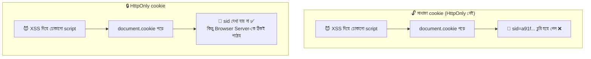

### ব্রাউজারে পরীক্ষা (DevTools Console)

```javascript
// সাধারণ cookie (HttpOnly নেই) থাকলে:
document.cookie;
// 'theme=dark; sid=a91f...c7'   ← sid দেখা যাচ্ছে, তাই script চুরি করতে পারবে

// HttpOnly cookie হলে:
document.cookie;
// 'theme=dark'                  ← sid নেই! script দেখতেই পায় না
// (DevTools → Application → Cookies ট্যাবে HttpOnly কলামে ✓ দেখা যাবে)
```

### লগইন cookie-র সঠিক অপশন

```javascript
res.cookie('sid', sessionId, {
  httpOnly: true,
  // httpOnly = JavaScript পড়তে পারবে না। XSS দিয়ে cookie চুরি ঠেকায় ← সবচেয়ে গুরুত্বপূর্ণ
  secure: process.env.NODE_ENV === 'production',
  // secure = শুধু HTTPS-এ পাঠানো হবে। প্রোডাকশনে true; লোকাল (http) ডেভেলপমেন্টে false না হলে টেস্ট কঠিন হয়
  sameSite: 'lax',
  // sameSite = অন্য সাইট থেকে আসা POST অনুরোধে cookie যাবে না — CSRF-এর বিরুদ্ধে সুরক্ষা
  maxAge: 60 * 60 * 1000,
  // maxAge = মেয়াদ ১ ঘণ্টা (ms)। ছোট মেয়াদ = চুরি হলেও ক্ষতি সীমিত
  path: '/',
  // path = সব URL-এ পাঠাবে
});
```

### তিনটা অপশনের আলাদা কাজ (গুলিয়ে ফেলবেন না!)

| অপশন | কিসের বিরুদ্ধে সুরক্ষা |
|---|---|
| `httpOnly` | **XSS দিয়ে cookie চুরি** (JS পড়তে পারে না) |
| `secure` | **নেটওয়ার্কে আড়ি পাতা** (HTTP-তে cookie উড়ে যেত) |
| `sameSite` | **CSRF** (অন্য সাইট থেকে তোমার নামে অনুরোধ পাঠানো) |

> ⚠️ **HttpOnly সব বাঁচায় না!** XSS হলে হামলাকারী cookie পড়তে না পারলেও ভিকটিমের ব্রাউজার দিয়েই অনুরোধ পাঠাতে পারে (ব্রাউজার নিজেই cookie জুড়ে দেয়)। তাই **XSS-ই যেন না হয়** — ইনপুট escape করা, `helmet`-এর CSP, ইউজারের HTML বিশ্বাস না করা — এগুলোও লাগবে। HttpOnly একটা স্তর, পুরো প্রাচীর নয়।

### ফ্রন্টএন্ডের সাথে কাজ করতে (React → Express)

ফ্রন্টএন্ড (`localhost:5173`) আর ব্যাকএন্ড (`localhost:5000`) আলাদা origin হলে cookie পাঠাতে **দুই পাশেই** অনুমতি লাগে:

```javascript
// ===== ব্যাকএন্ড (Express) =====
import cors from 'cors';
app.use(cors({
  origin: 'http://localhost:5173',   // origin = কোন ফ্রন্টএন্ডকে অনুমতি। ⚠️ credentials: true হলে '*' চলে না, নির্দিষ্ট ঠিকানা দিতে হবে
  credentials: true,                 // credentials = cookie নিয়ে আসা-যাওয়ার অনুমতি
}));

// ===== ফ্রন্টএন্ড (React / fetch) =====
fetch('http://localhost:5000/api/v1/auth/me', {
  credentials: 'include',            // include = ভিন্ন origin-এও cookie পাঠাও/গ্রহণ করো (এটা ছাড়া cookie যাবেই না)
});
// axios-এ: axios.get(url, { withCredentials: true })
```

---

## ৫. Cookie Hijacking — টোকেন-কার্ড চুরি

### গল্প

পদ্মা রেস্তোরাঁর গ্রাহক করিমের কার্ড (`a91f...c7`) যদি কেউ চুরি করে ফেলে, সে রান্নাঘরে গিয়ে কার্ড দেখালেই সবাই ভাববে **"ইনি তো করিম!"** — পাসওয়ার্ড লাগেনি, লগইন করতে হয়নি, সরাসরি করিমের নামে বিল! এটাই **Cookie Hijacking (Session Hijacking)** — চুরি করা session cookie দিয়ে অন্যের পরিচয়ে ঢোকা।

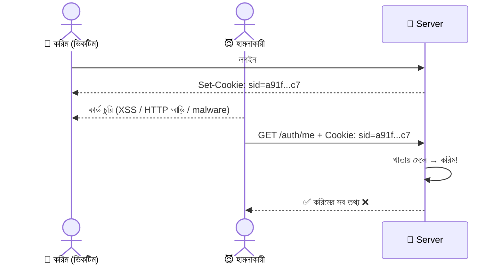

### কীভাবে চুরি হয়?

| উপায় | গল্পে | কীভাবে | প্রতিরোধ |
|---|---|---|---|
| **XSS** | রেস্তোরাঁয় লুকানো রোবট পকেটে হাত দেয় | সাইটে ক্ষতিকর script ঢুকে `document.cookie` পড়ে পাঠায় | `HttpOnly`, ইনপুট escape, CSP |
| **Network Sniffing** | গাড়িতে পাঠানো কার্ড রাস্তায় কেউ দেখে নেয় | HTTP-তে (HTTPS নয়) cookie ফাঁকা টেক্সটে যায়, পাবলিক Wi-Fi-তে ধরা পড়ে | `Secure` + HTTPS + HSTS |
| **Session Fixation** | হামলাকারী আগে থেকেই একটা কার্ড বানিয়ে করিমকে ধরিয়ে দেয়, করিম ওটা দিয়ে লগইন করে | লগইনের আগের session ID লগইনের পরেও একই থাকে | **লগইনের সময় নতুন session ID** |
| **অনুমানযোগ্য ID** | কার্ডে নম্বর ১, ২, ৩... — যে কেউ অনুমান করে | সহজ/ক্রমিক session ID | লম্বা, র‍্যান্ডম ID (`crypto.randomBytes`) |
| **Malware / Shared PC** | পাবলিক কম্পিউটারে লগআউট না করে চলে যাওয়া | ব্রাউজারে cookie থেকে যায় | সংক্ষিপ্ত মেয়াদ, লগআউটে Server-এও session মুছা |

### সুরক্ষা — আমাদের কোডে যা যা করছি

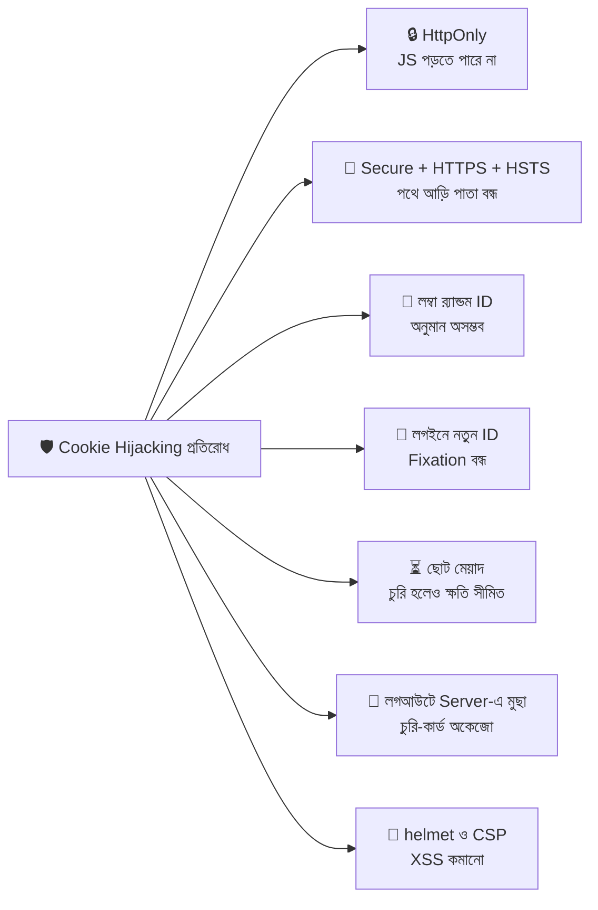

### Session Store — রান্নাঘরের খাতা

```javascript
// ফাইল: src/data/session.store.js
export const sessions = new Map();
// sessions = কার্ড নম্বর → গ্রাহকের তথ্য, এই জোড়া রাখার খাতা
// Map = key-value রাখার JS-এর বিল্ট-ইন কাঠামো (সাধারণ অবজেক্টের চেয়ে বারবার add/delete-এ ভালো)
// ⚠️ এটা সার্ভারের মেমরিতে — রিস্টার্ট দিলে সবাই লগআউট হয়ে যাবে, আর একাধিক সার্ভারে (সেকশন ৭) আলাদা খাতা হবে।
//    আসল প্রজেক্টে এর জায়গায় Redis বা ডাটাবেস (connect-redis / JWT) ব্যবহার হয়
// গঠন: sessions.set('a91f...c7', { userId: 1, role: 'admin', createdAt: 1730000000000 })

export const SESSION_TTL_MS = 60 * 60 * 1000;
// SESSION_TTL_MS = session কতক্ষণ বৈধ (১ ঘণ্টা, ms-এ)। cookie-র maxAge-র সাথে একই রাখি
// TTL = Time To Live (বেঁচে থাকার সময়)। বড় হাতের নাম = ধ্রুবক
```

### লগইন, `me`, লগআউট — Controller

```javascript
// ফাইল: src/controllers/auth.controller.js
import { randomBytes } from 'node:crypto';
// randomBytes = Node-এর বিল্ট-ইন crypto মডিউল থেকে নিরাপদ র‍্যান্ডম বাইট বানানোর ফাংশন
// 'node:' উপসর্গ = বোঝায় এটা Node-এর নিজস্ব মডিউল, npm প্যাকেজ নয়
import ApiError from '../utils/ApiError.js';
import { sessions, SESSION_TTL_MS } from '../data/session.store.js';

const USERS = [{ id: 1, username: 'admin', password: 'padma123', role: 'admin' }];
// USERS = ডেমোর জন্য একজন নকল ব্যবহারকারী
// ⚠️ পাসওয়ার্ড সাধারণ টেক্সটে রাখা **শুধু শেখার জন্য**। আসল প্রজেক্টে ডাটাবেসে bcrypt/argon2 দিয়ে hash করা পাসওয়ার্ড রাখতে হয়

const cookieOptions = {
  httpOnly: true,                                   // JS পড়তে পারবে না
  secure: process.env.NODE_ENV === 'production',    // প্রোডাকশনে শুধু HTTPS
  sameSite: 'lax',                                  // CSRF-এর বিরুদ্ধে সুরক্ষা
  path: '/',                                        // সব path-এ
};
// cookieOptions = login আর logout দুই জায়গায় একই অপশন লাগে (clearCookie-তেও মিলতে হয়), তাই একবারই লিখে রাখলাম

export const login = (req, res) => {
  const { username, password } = req.body ?? {};
  // username, password = Client-এর পাঠানো দুটো ফিল্ড। ?? {} = body না এলে ক্র্যাশ ঠেকাতে

  const user = USERS.find((u) => u.username === username && u.password === password);
  // user = মিলে গেলে ব্যবহারকারী, নইলে undefined
  if (!user) throw new ApiError(401, 'Invalid username or password');
  // ⚠️ "username ভুল" বা "password ভুল" আলাদা করে বলবেন না — হামলাকারী বুঝে যাবে কোন username আছে। একই বার্তা

  const oldSid = req.cookies?.sid;
  // oldSid = ব্রাউজারে আগে থেকে থাকা session ID (থাকলে)। ?. = req.cookies না থাকলেও ক্র্যাশ না করা
  if (oldSid) sessions.delete(oldSid);
  // পুরোনো ID মুছে ফেলি — হামলাকারীর বানানো/জানা কার্ড লগইনের পর আর কাজ করবে না (Session Fixation প্রতিরোধ)

  const sessionId = randomBytes(32).toString('hex');
  // sessionId = ৩২ বাইট (২৫৬ বিট) র‍্যান্ডম সংখ্যা, hex string-এ রূপান্তর → ৬৪ অক্ষরের অনুমান-অসম্ভব কার্ড নম্বর
  // ⚠️ Math.random() দিয়ে বানাবেন না — সেটা নিরাপদ র‍্যান্ডম নয়, অনুমান করা যায়

  sessions.set(sessionId, { userId: user.id, role: user.role, createdAt: Date.now() });
  // খাতায় তোলা: কার্ড নম্বর → { কে, কী role, কখন তৈরি }। createdAt দিয়ে পরে মেয়াদ শেষ হয়েছে কি না মেলাবো

  res.cookie('sid', sessionId, { ...cookieOptions, maxAge: SESSION_TTL_MS });
  // cookie পাঠাই। 'sid' = cookie-র নাম (session id)। ...cookieOptions = ওপরের অপশনগুলো ঢেলে দিয়ে maxAge যোগ

  res.status(200).json({
    success: true,
    message: 'Logged in',
    data: { id: user.id, username: user.username, role: user.role },   // password পাঠাচ্ছি না (JSON best practice)
  });
};

export const me = (req, res) => {
  res.status(200).json({ success: true, data: req.user });
  // req.user = requireSession middleware বসিয়ে দিয়েছে (নিচে)। এখানে শুধু পাঠাচ্ছি
};

export const logout = (req, res) => {
  const sid = req.cookies?.sid;
  if (sid) sessions.delete(sid);
  // Server-এর খাতা থেকেও মুছি — তাহলে কেউ কার্ড চুরি করলেও লগআউটের পর সেটা অকেজো
  // ⚠️ শুধু ব্রাউজারের cookie মুছলে চলবে না, হামলাকারীর কাছে কপি থাকলে সে তখনও ঢুকতে পারবে

  res.clearCookie('sid', cookieOptions);
  // ব্রাউজার থেকেও cookie সরাই। মনে আছে? বানানোর সময়ের মতো একই অপশন দিতে হয়
  res.status(200).json({ success: true, message: 'Logged out' });
};
```

### Session যাচাইকারী Middleware (পরিচয়-পাহারাদার, cookie সংস্করণ)

```javascript
// ফাইল: src/middlewares/session.middleware.js
import ApiError from '../utils/ApiError.js';
import { sessions, SESSION_TTL_MS } from '../data/session.store.js';

export const requireSession = (req, res, next) => {
  const sid = req.cookies?.sid;
  // sid = ব্রাউজার যে কার্ড দেখালো (নাও থাকতে পারে)

  const session = sid ? sessions.get(sid) : undefined;
  // session = খাতায় কার্ডের তথ্য। sid না থাকলে খোঁজারই দরকার নেই

  if (!session) return next(new ApiError(401, 'Please login first'));
  // কার্ড নেই বা খাতায় নেই (ভুয়া, বা লগআউট হয়ে গেছে) → ফিরিয়ে দাও

  if (Date.now() - session.createdAt > SESSION_TTL_MS) {
    // এখন − তৈরির সময় = কতক্ষণ আগে বানানো। মেয়াদের চেয়ে বেশি হলে বাতিল
    sessions.delete(sid);                                   // মেয়াদোত্তীর্ণ কার্ড খাতা থেকে ফেলে দিই
    return next(new ApiError(401, 'Session expired. Please login again'));
  }

  req.user = { id: session.userId, role: session.role };
  // req-এর গায়ে ইউজারের তথ্য জুড়ে দিই — পরের middleware/controller req.user পড়তে পারবে

  next();
};
```

### Route আর কোথায় কোন সুরক্ষা

```javascript
// ফাইল: src/routes/auth.routes.js
import { Router } from 'express';
import { login, me, logout } from '../controllers/auth.controller.js';
import { requireSession } from '../middlewares/session.middleware.js';
import { authLimiter } from '../middlewares/rateLimit.middleware.js';
import { noStore } from '../middlewares/cache.middleware.js';

const router = Router();

router.use(noStore);
// noStore = এই router-এর সব উত্তরে "Cache-Control: no-store" বসায়। লগইন/ব্যক্তিগত তথ্য কখনো CDN বা ব্রাউজারে জমা থাকা চলবে না

router.post('/login', authLimiter, login);
// authLimiter আগে (কড়া সীমা), তারপর login controller। ৫ বার ভুলের পর ১৫ মিনিট আটকে যাবে

router.get('/me', requireSession, me);          // শুধু লগইন করা ইউজার
router.post('/logout', requireSession, logout); // লগআউটও শুধু লগইন করা অবস্থায়

export default router;
```

### আরও কিছু শক্তিশালী প্রতিরক্ষা (ছোট পরিচয়)

| প্রতিরক্ষা | কাজ |
|---|---|
| **HTTPS + HSTS** (`helmet` HSTS header পাঠায়) | ব্রাউজারকে বলে "এই সাইটে সবসময় HTTPS-এ যাও" — HTTP-তে নামানো যাবে না |
| **ছোট মেয়াদ + Refresh** | Access ছোট মেয়াদের, Refresh আলাদা — চুরি হলে ক্ষতির সময় কম |
| **Role/সংবেদনশীল কাজে পুনরায় পাসওয়ার্ড** | পাসওয়ার্ড বদল, টাকা পাঠানোর আগে আবার পরিচয় যাচাই |
| **অস্বাভাবিক আচরণ ধরা** | হঠাৎ ভিন্ন দেশ/ডিভাইস থেকে ঢোকা লক্ষ করা, ইউজারকে ইমেইল |
| **CSRF token** | `SameSite=None` লাগলে অতিরিক্ত সুরক্ষা |

---

## ৬. CDN — শহরে শহরে শাখা-রান্নাঘর

### গল্প

পদ্মা রেস্তোরাঁর একটাই রান্নাঘর — ঢাকায়। চট্টগ্রামের গ্রাহক সিঙ্গারা অর্ডার করলে সেটা ঢাকা থেকে আসতে সময় লাগে। আবার সবাই একই জনপ্রিয় আইটেম চাইলে ঢাকার রান্নাঘরে ভিড়।

ম্যানেজার ঠিক করলো: **শহরে শহরে ছোট শাখা-রান্নাঘর** খোলা হবে — চট্টগ্রামে, সিলেটে, রাজশাহীতে। জনপ্রিয় আইটেম (সিঙ্গারা, মেনু কার্ডের ছবি) **আগে থেকেই বানিয়ে ওই শাখায় রেখে দেওয়া** হবে। গ্রাহক কাছের শাখা থেকেই **সাথে সাথে** পেয়ে যাবে।

- শাখায় আইটেম **আছে** → সাথে সাথে দাও (**Cache HIT**) ✅
- শাখায় **নেই** → মূল ঢাকার রান্নাঘর থেকে এনে দাও, আর শাখায় একটা কপি রেখে দাও (**Cache MISS**) 🔄

এই শাখা-রান্নাঘরের নেটওয়ার্কই **CDN (Content Delivery Network)** — বিশ্বজুড়ে ছড়ানো **Edge Server**-এর জাল, যারা আপনার কনটেন্টের কপি **ব্যবহারকারীর কাছাকাছি** রাখে। উদাহরণ: **Cloudflare, AWS CloudFront, Fastly, Akamai, Bunny**।

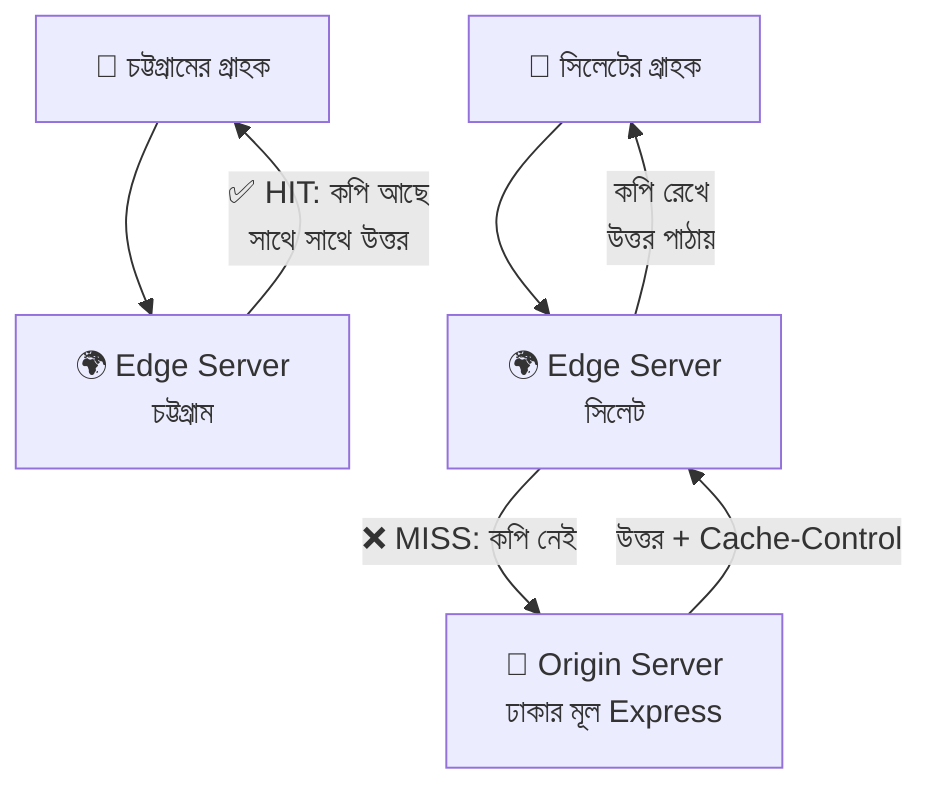

### CDN-এর উপকার

| উপকার | গল্পে | মানে |
|---|---|---|
| **কম Latency (দ্রুত)** | কাছের শাখা থেকে খাবার | ব্যবহারকারীর কাছের server থেকে উত্তর আসে |
| **Origin-এর চাপ কমে** | মূল রান্নাঘরে ভিড় কমে | অধিকাংশ অনুরোধ edge-এই শেষ |
| **DDoS শোষণ** | ভুয়া ভিড় শাখাগুলোতেই আটকে যায় | CDN-এর বিশাল ক্ষমতা হামলা শুষে নেয় (সেকশন ১-এর স্তর ১) |
| **Bandwidth খরচ কমে** | মূল রান্নাঘর থেকে কম মাল বেরোয় | |
| **অতিরিক্ত সুরক্ষা** | শাখা-গেটেই পরীক্ষা | WAF, bot সুরক্ষা, HTTPS |

### কী CDN-এ রাখবো, কী রাখবো না?

| ✅ রাখবো (সবার জন্য একই) | ❌ রাখবো না (ব্যক্তি-নির্দিষ্ট) |
|---|---|
| ছবি, CSS, JS, ফন্ট, ভিডিও | লগইন response, `/auth/me` |
| সবার জন্য একই `GET /menu` (অল্প সময়ের জন্য) | কার্টের তথ্য, ব্যক্তিগত অর্ডার |
| ডাউনলোডযোগ্য ফাইল, PDF | `Set-Cookie` সহ উত্তর |
| | যেকোনো POST/PUT/DELETE (সাধারণত cache হয় না) |

### Express কীভাবে CDN/ব্রাউজারকে বলবে "কতক্ষণ রাখো" — `Cache-Control`

CDN নিজে নিজে বুঝতে পারে না কোনটা কতক্ষণ রাখবে। আমরা response-এর `Cache-Control` header দিয়ে **নির্দেশ** দিই:

| Directive | মানে |
|---|---|
| `public` | যে কেউ (CDN, ব্রাউজার) জমা রাখতে পারবে |
| `private` | শুধু ব্যবহারকারীর নিজের ব্রাউজারে, CDN-এ না |
| `max-age=60` | ব্রাউজার ৬০ সেকেন্ড পর্যন্ত নতুন করে জিজ্ঞেস না করে কপি ব্যবহার করবে |
| `s-maxage=300` | **শুধু CDN/shared cache**-এর জন্য মেয়াদ (৩০০ সেকেন্ড), ব্রাউজারের `max-age`-কে ছাপিয়ে |
| `no-store` | কোথাও জমা রাখা যাবে না (সংবেদনশীল তথ্য) |
| `immutable` | ফাইল কখনো বদলাবে না — মেয়াদ থাকতে আর জিজ্ঞেসই করবে না (শুধু নাম-বদলানো hashed ফাইলে) |

```javascript
// ফাইল: src/middlewares/cache.middleware.js

export const cacheFor = (seconds, cdnSeconds = seconds) => (req, res, next) => {
  // cacheFor = কারখানা (factory)। seconds = ব্রাউজারের জন্য মেয়াদ (সেকেন্ডে)
  // cdnSeconds = CDN-এর জন্য মেয়াদ। না দিলে একই মান (default parameter)
  res.set('Cache-Control', `public, max-age=${seconds}, s-maxage=${cdnSeconds}`);
  // res.set(নাম, মান) = response header বসানো
  // public = সবাই জমা রাখতে পারবে; max-age = ব্রাউজারের মেয়াদ; s-maxage = CDN-এর মেয়াদ
  next();
};

export const noStore = (req, res, next) => {
  res.set('Cache-Control', 'no-store');
  // no-store = ব্যক্তিগত তথ্য কোথাও (CDN, ব্রাউজার, proxy) জমা করা যাবে না
  next();
};
```

```javascript
// ফাইল: src/routes/menu.routes.js (শুধু GET দুটো বদলালো)
import { cacheFor } from '../middlewares/cache.middleware.js';

router.get('/', cacheFor(30, 120), getAllMenu);
// মেনু সবার জন্য একই → ব্রাউজারে ৩০ সেকেন্ড, CDN-এ ২ মিনিট জমা থাকুক
router.get('/:id', cacheFor(30, 120), getMenuById);
// ⚠️ মেনুর দাম বদলালে সর্বোচ্চ ২ মিনিট পুরোনো তথ্য দেখাতে পারে — এই "টাটকা না-থাকার" দামটা মেনে নেওয়া যায় কি না আগে ভাবুন
```

```javascript
// ফাইল: src/app.js (একটা অংশ) — স্থির ফাইল (ছবি, CSS)
app.use('/static', express.static('public', { maxAge: '30d', immutable: true }));
// express.static('public') = public ফোল্ডারের ফাইল সরাসরি পরিবেশন করে (এগুলোর জন্য controller লাগে না)
// maxAge: '30d' = ৩০ দিন cache; immutable = এই সময়ে ব্রাউজার আর জিজ্ঞেসই করবে না
// ⚠️ immutable শুধু তখন, যখন ফাইলের নাম বদলে যায় (app.3f9a1c.js)। নইলে ফাইল আপডেট করলেও ইউজার পুরোনোটাই দেখবে
```

### CDN-এ সমস্যা: পুরোনো কপি (Stale) আর সমাধান

| সমস্যা | সমাধান |
|---|---|
| ছবি/JS বদলেছি কিন্তু ইউজার পুরোনোটা দেখছে | ফাইলের নামে hash বসান (`main.3f9a1c.js`) — Vite/Webpack নিজে করে |
| জরুরি আপডেট এখনই সবাইকে দেখাতে হবে | CDN-এর **Purge / Invalidate** সুবিধা (ড্যাশবোর্ড বা API দিয়ে কপি মুছে ফেলা) |
| সংবেদনশীল পেজ ভুলে cache হয়ে গেছে | `no-store`, আর response-এ `Set-Cookie` থাকলে CDN সাধারণত cache করে না — তবু স্পষ্ট করে `no-store` দিন |

> 💡 **ডেভেলপার টিপ:** Express নিজে ডিফল্টে `ETag` header পাঠায়। Client `If-None-Match` পাঠালে মিললে Express শুধু `304 Not Modified` (বডি ছাড়া) পাঠায় — ব্যান্ডউইথ বাঁচে।

---

## ৭. Load Balancing — ভিড়ের রিসেপশনিস্ট

### গল্প

ঈদের আগের দিন। একটা রান্নাঘরে আর কুলাচ্ছে না। ম্যানেজার **তিনটা রান্নাঘর** বানালো — K1, K2, K3। কিন্তু গ্রাহক কোন রান্নাঘরে যাবে? সামনের দরজায় একজন **রিসেপশনিস্ট** দাঁড় করানো হলো:

> 🧑‍💼 "আপনি K1-এ যান... আপনি K2-এ... আপনি K3-এ... পরের জন আবার K1-এ..."

আর যদি K2-র চুলা নষ্ট হয়ে যায়? রিসেপশনিস্ট প্রতি মিনিটে জিজ্ঞেস করে: **"K2, তুমি ঠিক আছো তো?"** উত্তর না এলে সে K2-তে আর গ্রাহক পাঠায় না (**Health Check**)। ঠিক হলে আবার পাঠায়।

এই রিসেপশনিস্টই **Load Balancer** — একাধিক সার্ভারের মধ্যে অনুরোধ **ভাগ করে দেয়**, আর মরা সার্ভার বাদ দেয়।

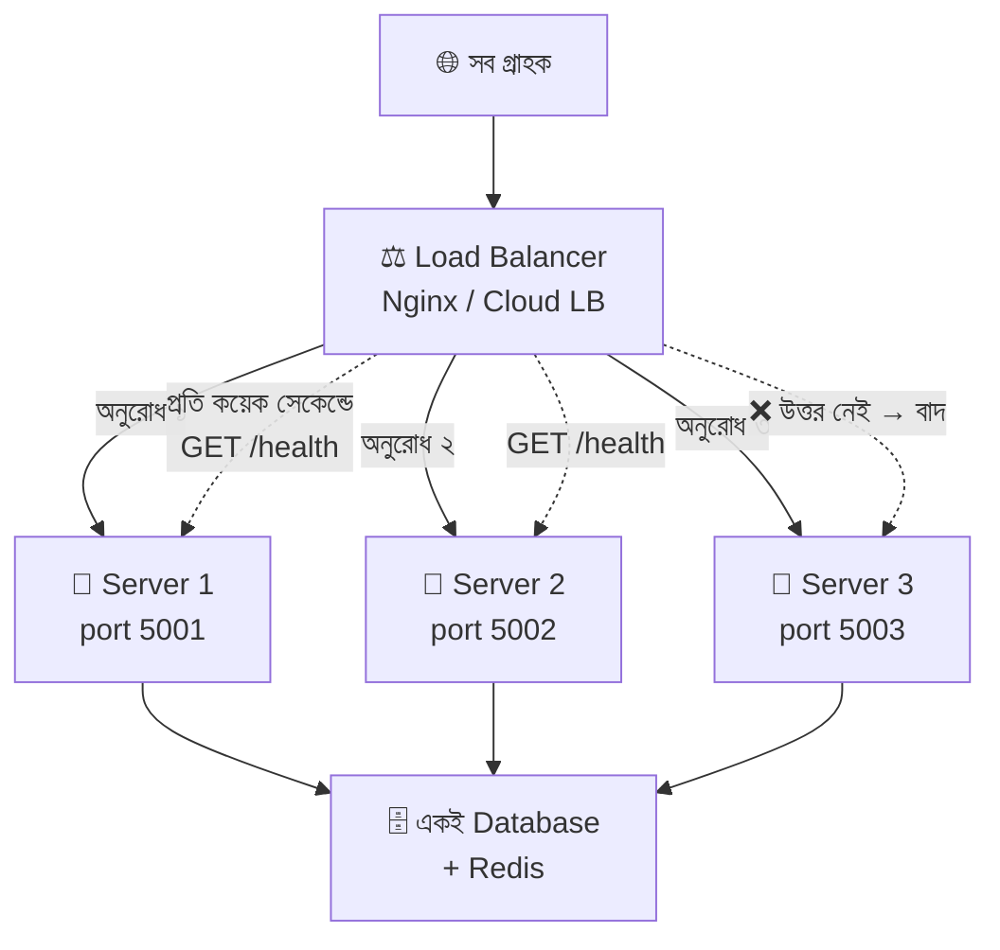

### Load Balancer-এর উপকার

| উপকার | গল্পে |
|---|---|
| **বেশি ভিড় সামলায়** (Scalability) | রান্নাঘর বাড়ালেই ক্ষমতা বাড়ে |
| **কখনো বন্ধ হয় না** (High Availability) | একটা রান্নাঘর বিকল হলেও বাকিগুলো চলে |
| **আপডেট বিনা-বন্ধে** | একটা একটা করে রান্নাঘর আপডেট করা যায় |
| **নিরাপত্তা** | রান্নাঘরের আসল ঠিকানা বাইরে ফাঁস হয় না, শুধু LB-র ঠিকানা জানা |

### বণ্টনের পদ্ধতি (Algorithm)

| পদ্ধতি | গল্পে | কখন ভালো |
|---|---|---|
| **Round Robin** | K1 → K2 → K3 → K1... পালা করে | সব সার্ভার সমান শক্তির হলে (সবচেয়ে সাধারণ) |
| **Weighted Round Robin** | বড় রান্নাঘর K3-তে ২ জন, বাকিতে ১ জন করে | সার্ভারের শক্তি আলাদা হলে |
| **Least Connections** | যার হাতে এখন সবচেয়ে কম অর্ডার, তাকে দাও | কিছু অনুরোধ ভারী, কিছু হালকা হলে |
| **IP Hash** | একই গ্রাহকের IP সবসময় একই রান্নাঘরে | **Sticky session** চাইলে (নিচে দেখুন) |

### Load Balancer হয় কয় রকম?

| ধরন | উদাহরণ |
|---|---|
| **Reverse proxy সফটওয়্যার** | Nginx, HAProxy, Caddy |
| **ক্লাউড-এর** | AWS ALB/ELB, Google Cloud LB, Azure LB |
| **PaaS-এ বিল্ট-ইন** | Render, Railway, Vercel, Heroku (আপনার জন্য নিজে করে দেয়) |

### Nginx দিয়ে হাতেকলমে

```nginx
# ফাইল: /etc/nginx/conf.d/padma.conf (ধরন বোঝার জন্য সংক্ষিপ্ত রূপ)

# ---------- ১) rate limit-এর "জোন" (http স্তরে, server-এর বাইরে) ----------
limit_req_zone $binary_remote_addr zone=api_zone:10m rate=10r/s;
# limit_req_zone = প্রতি IP-র অনুরোধ গুনতে মেমরির একটা অংশ ঠিক করা
# $binary_remote_addr = ক্লায়েন্টের IP (সংক্ষিপ্ত রূপে); zone=api_zone:10m = নাম "api_zone", ১০ মেগাবাইট মেমরি
# rate=10r/s = প্রতি সেকেন্ডে সর্বোচ্চ ১০টা অনুরোধ (r/s = requests per second)

# ---------- ২) রান্নাঘরের তালিকা ----------
upstream padma_backend {
    least_conn;                         # পদ্ধতি: যার কম connection তাকে দাও (না লিখলে ডিফল্ট Round Robin)
    server 127.0.0.1:5001;              # Server 1
    server 127.0.0.1:5002;              # Server 2
    server 127.0.0.1:5003 weight=2;     # Server 3 — weight=2 মানে এটা দ্বিগুণ অনুরোধ পাবে (শক্তিশালী মেশিন)
}

# ---------- ৩) রিসেপশন ----------
server {
    listen 80;                          # বাইরের দরজা: port 80 (প্রোডাকশনে 443 + HTTPS সার্টিফিকেট)
    client_max_body_size 1m;            # বডির সর্বোচ্চ আকার ১ মেগাবাইট — Express পর্যন্ত বিশাল অনুরোধ পৌঁছাতেই দেবে না

    location / {
        limit_req zone=api_zone burst=20 nodelay;
        # api_zone-এর নিয়ম প্রয়োগ। burst=20 = হঠাৎ ২০টা বাড়তি অনুরোধ সহ্য করবে; nodelay = দেরি না করে সাথে সাথে চালাবে, বেশি হলে ফিরিয়ে দেবে

        proxy_pass http://padma_backend;   # অনুরোধ upstream-এর কোনো একটা সার্ভারে পাঠাও
        proxy_set_header Host $host;                                        # আসল ডোমেইন নাম পাঠাও
        proxy_set_header X-Real-IP $remote_addr;                            # আসল ব্যবহারকারীর IP
        proxy_set_header X-Forwarded-For $proxy_add_x_forwarded_for;        # IP-র চেইন — Express-এর req.ip এটাই পড়বে (trust proxy চালু থাকলে)
        proxy_set_header X-Forwarded-Proto $scheme;                         # http না https — secure cookie-র জন্য জরুরি
    }
}
```

Express-এর দিকে এই দুটো লাগবে:

```javascript
// ফাইল: src/app.js
app.set('trust proxy', 1);   // সামনে ১টা proxy (Nginx) — তাই আসল IP পাওয়া যাবে (সেকশন ২-এর সতর্কতা মনে রাখুন)

app.get('/health', (req, res) => {
  // /health = Load Balancer-এর "তুমি ঠিক আছো তো?" প্রশ্নের উত্তর দেওয়ার route
  // ⚠️ এটাকে rate limiter, session, cache-এর বাইরে রাখুন (app.use(globalLimiter)-এর আগে বসান), নইলে LB-র নিজের প্রশ্নেই 429 আসবে!
  res.status(200).json({
    status: 'ok',
    pid: process.pid,          // pid = এই সার্ভার প্রসেসের নম্বর। বারবার curl করলে pid বদলাতে থাকবে = বোঝা যাবে LB ভাগ করছে
    uptime: process.uptime(),  // uptime = এই প্রসেস কত সেকেন্ড ধরে চলছে
  });
});
```

### একই মেশিনে একাধিক instance: `cluster`

Node.js **একটা CPU core**-ই ব্যবহার করে। ৮ core-এর মেশিনে ৭টা core বসে আছে! `cluster` মডিউল দিয়ে প্রতি core-এ একটা করে কপি চালানো যায়, আর Node নিজেই তাদের মধ্যে অনুরোধ ভাগ করে (ছোট আকারের Load Balancing)।

```javascript
// ফাইল: src/cluster.js
import cluster from 'node:cluster';
// cluster = Node-এর বিল্ট-ইন মডিউল; একটা "প্রধান" প্রসেস অনেকগুলো "কর্মী" প্রসেস বানায়
import { availableParallelism } from 'node:os';
// availableParallelism = এই মেশিনে কয়টা CPU core ব্যবহারযোগ্য (Node 18.14+)

const workerCount = availableParallelism();
// workerCount = কয়টা কর্মী বানাবো। এখানে core সংখ্যার সমান

if (cluster.isPrimary) {
  // isPrimary = এই প্রসেসটা কি প্রধান (manager)? প্রথমবার চালালে true; কর্মী প্রসেসে false
  console.log(`👑 প্রধান প্রসেস ${process.pid} চালু — ${workerCount}টা কর্মী বানাচ্ছি`);

  for (let i = 0; i < workerCount; i++) cluster.fork();
  // cluster.fork() = এই একই ফাইল আবার নতুন প্রসেসে চালায় (এবার isPrimary = false হবে)
  // i = লুপের গণনা (০ থেকে workerCount-১ পর্যন্ত)

  cluster.on('exit', (worker) => {
    // 'exit' = কোনো কর্মী ক্র্যাশ করলে বা বন্ধ হলে এই ফাংশন চলে
    console.log(`💀 কর্মী ${worker.process.pid} মারা গেছে — নতুন একটা বানাচ্ছি`);
    cluster.fork();
    // মরা কর্মীর জায়গায় নতুন কর্মী — সার্ভার চলতেই থাকে (self-healing)
  });
} else {
  await import('./server.js');
  // কর্মী প্রসেস হলে সার্ভার চালু করো। await import = এই লাইনটা চলার সময়ই ফাইলটা লোড হয় (ESM-এ top-level await চলে)
  // সব কর্মী একই port শোনে — Node ভেতরে অনুরোধ ভাগ করে দেয়
}
```

```json
"scripts": {
  "start": "node src/server.js",
  "start:cluster": "node src/cluster.js",
  "dev": "node --watch --env-file=.env src/server.js"
}
```

> 🔑 **বাস্তব নোট:** প্রোডাকশনে অনেকেই `cluster`-এর বদলে **PM2** (`pm2 start src/server.js -i max`) বা **Docker + Kubernetes** ব্যবহার করে; ধারণা একই।

### ⚠️ সবচেয়ে বড় সমস্যা: "মনে-রাখা" জিনিস একাধিক সার্ভারে ভাঙে

K1-এ লগইন করলাম → K1-এর খাতায় আমার কার্ড লেখা। পরের অনুরোধ গেল K2-তে → **K2-র খাতায় আমার কার্ড নেই → "আপনি কে?" (401)!**

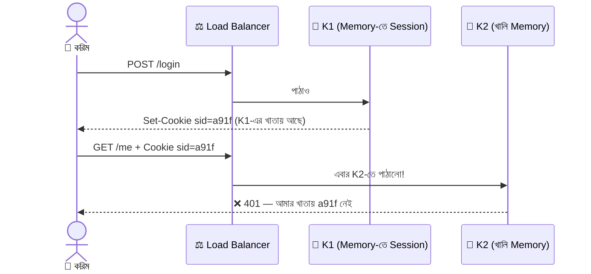

একই সমস্যা আমাদের `Map`-এ রাখা **session** আর মেমরি-ভিত্তিক **rate limit counter**-এর।

| সমাধান | কীভাবে | মন্তব্য |
|---|---|---|
| **১) Shared Store (সেরা)** | Session ও rate-limit counter **Redis**-এ রাখো — সব সার্ভার একই খাতা দেখে | সাধারণ আসল-প্রজেক্ট সমাধান |
| **২) Stateless Token (JWT)** | তথ্য cookie/টোকেনের ভেতরেই সিল-করা থাকে, সার্ভারকে মনে রাখতে হয় না | সামনের মডিউলে আসবে; তবে logout/revoke কঠিন |
| **৩) Sticky Session** | LB একই গ্রাহককে সবসময় একই সার্ভারে পাঠায় (IP Hash / cookie) | সহজ, কিন্তু সার্ভার মরলে session হারায়, ভিড় অসমভাবে ভাগ হয় |

### Graceful Shutdown — আপডেটের সময় ভদ্রভাবে বিদায়

```javascript
// ফাইল: src/server.js (শেষে যোগ)
process.on('SIGTERM', () => {
  // SIGTERM = Load Balancer/Docker/PM2 "এবার বন্ধ হও" বলার সংকেত
  console.log('🛑 বন্ধ হওয়ার সংকেত পেয়েছি, চলমান কাজ শেষ করছি...');
  server.close(() => {
    // server.close = নতুন connection নেওয়া বন্ধ, কিন্তু যেগুলো চলছে সেগুলো শেষ হতে দেয়। সব শেষ হলে callback চলে
    process.exit(0);   // 0 = সফলভাবে বন্ধ
  });
});
// গল্পে: রান্নাঘর বন্ধের আগে নতুন অর্ডার নেওয়া বন্ধ, কিন্তু চুলায় যা আছে তা রান্না শেষ করে তবেই তালা
```

---

## ৮. পুরো প্রজেক্টে যা যা যোগ/বদল হলো

### ইনস্টল

```bash
npm install express-rate-limit cookie-parser helmet cors
# express-rate-limit = গতিসীমা; cookie-parser = req.cookies; helmet = নিরাপদ header; cors = ফ্রন্টএন্ডকে অনুমতি
```

### `.env` ও `.env.example`-তে নতুন লাইন

```bash
# ফাইল: .env  (GitHub-এ যাবে না)
PORT=5000
API_KEY=padma-secret-123
NODE_ENV=development
# NODE_ENV = development / production। production হলে cookie-র secure: true চালু হবে
CLIENT_ORIGIN=http://localhost:5173
# CLIENT_ORIGIN = কোন ফ্রন্টএন্ড ঠিকানাকে (CORS) অনুমতি দেবো
TRUST_PROXY=0
# TRUST_PROXY = সামনে কয়টা proxy আছে। সরাসরি চালালে 0; Nginx-এর পেছনে হলে 1
```

```bash
# ফাইল: .env.example  (GitHub-এ যাবে)
PORT=5000
API_KEY=your-secret-key-here
NODE_ENV=development
CLIENT_ORIGIN=http://localhost:5173
TRUST_PROXY=0
```

### নতুন ফোল্ডার স্ট্রাকচার (🆕 = নতুন, ✏️ = বদলেছে)

```
📦 padma-restaurant-api
 ┣ 📂 src
 ┃ ┣ 📜 server.js                       ✏️ timeout + graceful shutdown
 ┃ ┣ 📜 cluster.js                      🆕 একাধিক core-এ চালানো
 ┃ ┣ 📜 app.js                          ✏️ helmet, cors, limiter, cookie-parser, /health
 ┃ ┣ 📂 routes
 ┃ ┃ ┣ 📜 index.js                      ✏️ auth route যোগ
 ┃ ┃ ┣ 📜 menu.routes.js                ✏️ cacheFor যোগ
 ┃ ┃ ┗ 📜 auth.routes.js                🆕
 ┃ ┣ 📂 controllers
 ┃ ┃ ┣ 📜 menu.controller.js
 ┃ ┃ ┗ 📜 auth.controller.js            🆕 login / me / logout
 ┃ ┣ 📂 middlewares
 ┃ ┃ ┣ 📜 rateLimit.middleware.js       🆕 globalLimiter, authLimiter
 ┃ ┃ ┣ 📜 session.middleware.js         🆕 requireSession
 ┃ ┃ ┣ 📜 cache.middleware.js           🆕 cacheFor, noStore
 ┃ ┃ ┗ (আগের ৫টা middleware অপরিবর্তিত)
 ┃ ┣ 📂 data
 ┃ ┃ ┣ 📜 menu.data.js
 ┃ ┃ ┗ 📜 session.store.js              🆕 Map-ভিত্তিক session খাতা
 ┃ ┗ 📂 utils
 ┃   ┗ 📜 ApiError.js
 ┣ 📂 deploy
 ┃ ┗ 📜 nginx.conf                      🆕 (সেকশন ৭-এর Nginx কনফিগ)
 ┣ 📜 .env  /  .env.example             ✏️
 ┗ 📜 package.json                      ✏️ start:cluster স্ক্রিপ্ট
```

### `src/app.js` — চূড়ান্ত রূপ

```javascript
import express from 'express';
import helmet from 'helmet';
import cors from 'cors';
import cookieParser from 'cookie-parser';
import routes from './routes/index.js';
import { requestLogger } from './middlewares/logger.middleware.js';
import { globalLimiter } from './middlewares/rateLimit.middleware.js';
import { notFound } from './middlewares/notFound.middleware.js';
import { errorHandler } from './middlewares/error.middleware.js';

const app = express();

// ---------- ০) Proxy-র পেছনে থাকলে আসল IP চেনা ----------
const trustProxyHops = Number(process.env.TRUST_PROXY || 0);
// trustProxyHops = .env থেকে পাওয়া proxy সংখ্যা (string → সংখ্যা)। না থাকলে 0
if (trustProxyHops > 0) app.set('trust proxy', trustProxyHops);
// শুধু proxy থাকলেই চালু করি — নইলে header জাল করে rate limit এড়ানো যায়

// ---------- ১) Health check — সবার আগে, limiter-এর বাইরে ----------
app.get('/health', (req, res) => {
  res.status(200).json({ status: 'ok', pid: process.pid, uptime: process.uptime() });
});

// ---------- ২) নিরাপত্তা ও গতিসীমা (ক্রম গুরুত্বপূর্ণ) ----------
app.use(requestLogger);                          // লগ
app.use(helmet());                               // helmet() = নিরাপদ HTTP header (HSTS, X-Content-Type-Options, CSP ইত্যাদি) একসাথে বসায়
app.use(cors({
  origin: process.env.CLIENT_ORIGIN || 'http://localhost:5173',   // শুধু এই ফ্রন্টএন্ড
  credentials: true,                                              // cookie আসা-যাওয়ার অনুমতি
}));
app.use(globalLimiter);                          // rate limit — body parse করার আগে

// ---------- ৩) Body ও Cookie পড়া ----------
app.use(express.json({ limit: '10kb' }));        // JSON → req.body
app.use(cookieParser());                         // Cookie → req.cookies

// ---------- ৪) স্থির ফাইল (ঐচ্ছিক) ----------
app.use('/static', express.static('public', { maxAge: '30d', immutable: true }));

// ---------- ৫) Home route ----------
app.get('/', (req, res) => {
  res.status(200).json({ success: true, message: 'পদ্মা রেস্তোরাঁর API চালু আছে 🍽️' });
});

// ---------- ৬) আসল API ----------
app.use('/api/v1', routes);

// ---------- ৭) সবার শেষে ----------
app.use(notFound);
app.use(errorHandler);

export default app;
```

### `src/routes/index.js` — auth যোগ

```javascript
import { Router } from 'express';
import menuRoutes from './menu.routes.js';
import authRoutes from './auth.routes.js';   // 🆕

const router = Router();
router.use('/menu', menuRoutes);
router.use('/auth', authRoutes);             // 🆕 /api/v1/auth/login, /me, /logout
export default router;
```

### `src/server.js` — চূড়ান্ত রূপ

```javascript
import app from './app.js';

const PORT = process.env.PORT || 5000;

const server = app.listen(PORT, () => {
  console.log(`🍽️ পদ্মা রেস্তোরাঁ চালু: http://localhost:${PORT} (pid: ${process.pid})`);
  // pid ছাপাচ্ছি যাতে একাধিক instance চালালে কোনটা কোনটা বোঝা যায়
});

server.headersTimeout = 15_000;    // Header ১৫ সেকেন্ডের মধ্যে আসতে হবে (Slowloris প্রতিরোধ)
server.requestTimeout = 30_000;    // পুরো অনুরোধ ৩০ সেকেন্ডের মধ্যে
server.keepAliveTimeout = 5_000;   // অব্যবহৃত connection ৫ সেকেন্ড পর বন্ধ
// ⚠️ AWS ALB-র পেছনে চালালে keepAliveTimeout ALB-র idle timeout (ডিফল্ট ৬০s)-এর চেয়ে বেশি (যেমন 65_000) রাখুন,
//    নইলে মাঝেমধ্যে অকারণ 502 error আসে

process.on('SIGTERM', () => {
  console.log('🛑 বন্ধ হওয়ার সংকেত পেয়েছি, চলমান কাজ শেষ করছি...');
  server.close(() => process.exit(0));
});
```

### একটা অনুরোধের যাত্রা (এখন আরও নিরাপদ)

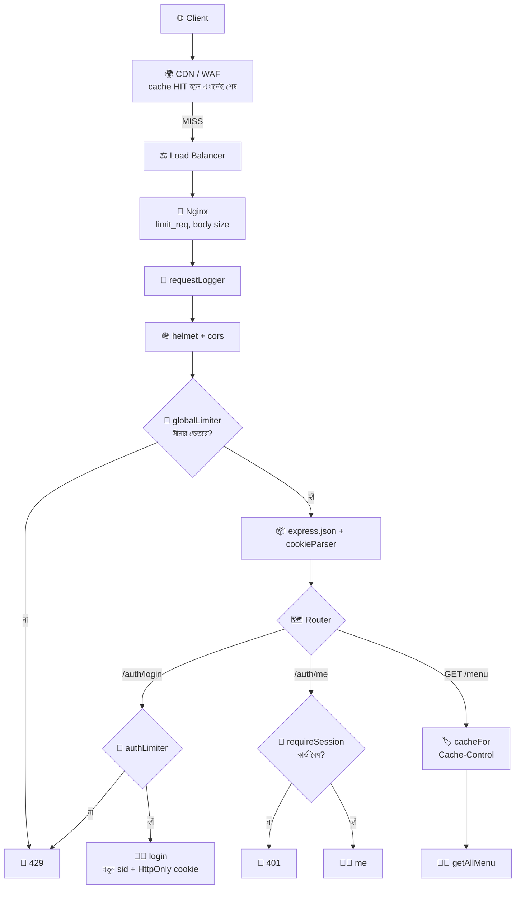

---

## ৯. চালিয়ে পরীক্ষা করা (curl / Postman)

> 💡 `curl`-এ cookie ধরে রাখতে: **`-c cookies.txt`** (পাওয়া cookie ফাইলে সেভ) আর **`-b cookies.txt`** (ফাইল থেকে পাঠানো)। `-i` দিলে response header-ও দেখা যায়।

### ১) Health আর কোন সার্ভার উত্তর দিলো

```bash
curl http://localhost:5000/health
# { "status": "ok", "pid": 12345, "uptime": 8.2 }
# cluster/একাধিক instance চালিয়ে বারবার curl করলে pid বদলাতে দেখবেন
```

### ২) লগইন — HttpOnly cookie পাওয়া

```bash
curl -i -c cookies.txt -X POST http://localhost:5000/api/v1/auth/login \
  -H "Content-Type: application/json" \
  -d '{"username":"admin","password":"padma123"}'
```

```
HTTP/1.1 200 OK
Cache-Control: no-store
Set-Cookie: sid=a91f3c...; Max-Age=3600; Path=/; Expires=...; HttpOnly; SameSite=Lax
...
{"success":true,"message":"Logged in","data":{"id":1,"username":"admin","role":"admin"}}
```

লক্ষ্য করুন: `HttpOnly`, `SameSite=Lax` আছে; আর `Cache-Control: no-store` আছে। (`Secure` আসবে না কারণ `NODE_ENV=development`।)

### ৩) cookie দিয়ে `me`

```bash
curl -b cookies.txt http://localhost:5000/api/v1/auth/me
# { "success": true, "data": { "id": 1, "role": "admin" } }

curl http://localhost:5000/api/v1/auth/me
# cookie ছাড়া → { "success": false, "message": "Please login first", "errors": [] }  (401)
```

### ৪) লগআউট এবং চুরি-কার্ড অকেজো হওয়া

```bash
cp cookies.txt stolen.txt                                        # "হামলাকারী" কার্ডের কপি রাখলো
curl -b cookies.txt -X POST http://localhost:5000/api/v1/auth/logout   # করিম লগআউট করলো
curl -b stolen.txt http://localhost:5000/api/v1/auth/me                # চুরি-কার্ড দিয়ে চেষ্টা
# ❌ 401 Please login first — কারণ Server-এর খাতা থেকেই session মুছে গেছে
```

### ৫) Rate limit পরীক্ষা (লগইনে ৬ বার ভুল)

```bash
for i in 1 2 3 4 5 6; do
  curl -s -o /dev/null -w "চেষ্টা $i → %{http_code}\n" -X POST http://localhost:5000/api/v1/auth/login \
    -H "Content-Type: application/json" -d '{"username":"admin","password":"wrong"}'
done
# for i in ... = ৬ বার লুপ; -s = চুপচাপ; -o /dev/null = বডি ফেলে দাও; -w = শুধু status code ছাপাও
```

```
চেষ্টা ১ → 401
চেষ্টা ২ → 401
চেষ্টা ৩ → 401
চেষ্টা ৪ → 401
চেষ্টা ৫ → 401
চেষ্টা ৬ → 429     ← সীমা পার! (ভুল ৫ বারের পর ৬ষ্ঠ চেষ্টায় আটকে গেল)
```

```json
{ "success": false, "message": "Too many login attempts. Please try again after 15 minutes.", "errors": [] }
```

### ৬) Cache-Control দেখা

```bash
curl -i http://localhost:5000/api/v1/menu
# Cache-Control: public, max-age=30, s-maxage=120
# ETag: W/"..."
```

```bash
curl -i -H 'If-None-Match: W/"copy-the-etag-here"' http://localhost:5000/api/v1/menu
# মান মিললে → 304 Not Modified (বডি ছাড়া)
```

### ৭) Helmet-এর header দেখা

```bash
curl -I http://localhost:5000/health
# Strict-Transport-Security: max-age=31536000; includeSubDomains
# X-Content-Type-Options: nosniff
# (X-Powered-By header নেই — helmet লুকিয়ে ফেলেছে, যাতে হ্যাকার জানতে না পারে আমরা Express ব্যবহার করছি)
```

### ৮) Load balancing পরীক্ষা (অপশনাল)

```bash
PORT=5001 node --env-file=.env src/server.js &    # & = পেছনে চালু রাখো
PORT=5002 node --env-file=.env src/server.js &
PORT=5003 node --env-file=.env src/server.js &
# তারপর Nginx চালু করে (সেকশন ৭-এর কনফিগ দিয়ে) বারবার curl localhost/health দিন — pid বদলাতে থাকবে
```

---

## ১০. সাধারণ ভুল আর সমাধান

| সমস্যা / Error | সাধারণ কারণ | সমাধান |
|---|---|---|
| `req.cookies` হচ্ছে `undefined` | `cookie-parser` বসাননি, বা route-এর **পরে** বসিয়েছেন | `app.use(cookieParser())` route-এর আগে |
| Cookie ব্রাউজারে সেভই হচ্ছে না (React → Express) | `credentials: true` (cors) বা `credentials: 'include'` (fetch) নেই; অথবা CORS `origin: '*'` | দুই পাশেই credentials চালু; origin নির্দিষ্ট ঠিকানা |
| `SameSite=None` দিয়েও cookie যাচ্ছে না | `None` হলে `Secure` আবশ্যক, আর ওটা শুধু HTTPS-এ চলে | HTTPS চালু + `secure: true` |
| `clearCookie` কাজ করছে না | বানানোর সময়ের `path/domain/secure/sameSite`-এর সাথে মিলছে না | একই `cookieOptions` ব্যবহার করুন |
| Production-এ cookie যাচ্ছে না (proxy-র পেছনে) | Express ভাবছে অনুরোধ HTTP-তে এসেছে, তাই `secure` cookie পাঠাতে অস্বীকার | `app.set('trust proxy', 1)` আর proxy থেকে `X-Forwarded-Proto` পাঠান |
| Rate limit সবাইকে একসাথে আটকে দিচ্ছে | proxy-র পেছনে `trust proxy` নেই, সবার IP এক | `trust proxy` সঠিক সংখ্যায় দিন |
| `ERR_ERL_PERMISSIVE_TRUST_PROXY` (express-rate-limit সতর্কবার্তা) | `trust proxy` = `true` দিয়েছেন | সংখ্যা (`1`) বা নির্দিষ্ট subnet দিন |
| একাধিক instance-এ লগইনের পর 401 | Session মেমরিতে (প্রতি সার্ভারের আলাদা) | Redis store / JWT / sticky session (সেকশন ৭) |
| Load Balancer সার্ভারকে "মৃত" ভাবছে | `/health` rate limit বা auth-এর ভেতরে পড়ে 429/401 দিচ্ছে | `/health` সবার আগে, limiter-এর বাইরে |
| CDN পুরোনো কনটেন্ট দেখাচ্ছে | `max-age` অনেক বড় আর ফাইলের নাম একই | hashed ফাইলনাম; Purge; ছোট `s-maxage` |
| ব্যক্তিগত তথ্য CDN-এ cache হয়ে গেছে (!) | `no-store`/`private` দেননি | ব্যক্তিগত route-এ `no-store`, `Set-Cookie` সহ উত্তর cache-যোগ্য রাখবেন না |
| `PayloadTooLargeError` (413) | `express.json({ limit })` সীমা পেরিয়েছে | ইচ্ছাকৃত সুরক্ষা; প্রয়োজনে সীমা বাড়ান |
| Slowloris-এ সার্ভার আটকাচ্ছে | timeout সেট নেই | `headersTimeout`, `requestTimeout` |
| `Secure` cookie লোকাল `http://localhost`-এ ঝামেলা | `secure: true` ডেভেলপমেন্টেও চালু | `secure: process.env.NODE_ENV === 'production'` |
| `.env`-এ গোপন মান GitHub-এ চলে গেছে | `.gitignore`-এ নেই | সাথে সাথে সব key/secret বদলান |

> 🔑 **তিনটা মনে-রাখার-ছড়া:**
> - **DDoS** = অনেক ভুয়া ভিড় → **স্তরে স্তরে** ঠেকাও (CDN → LB → Nginx → Express)
> - **Cookie** = `HttpOnly` (JS পড়বে না) + `Secure` (শুধু HTTPS) + `SameSite` (অন্য সাইট থেকে নয়)
> - **একাধিক সার্ভার** = **কিছুই মেমরিতে রেখো না** — Session/Counter রাখো Redis-এ

---

## ১১. সারসংক্ষেপ ও Practice আইডিয়া

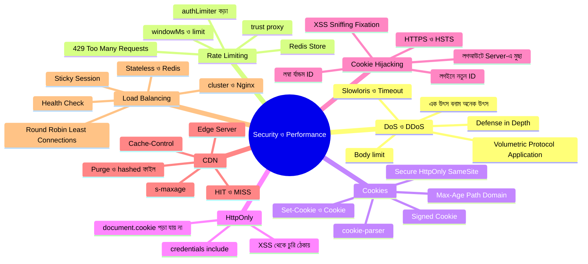

### গল্পের অভিধান — গল্পের কোনটা মানে কী

| গল্পে | টেকনিক্যাল নাম |
|---|---|
| এক লোক দরজা আটকে | DoS |
| ১০,০০০ ভুয়া গ্রাহক | DDoS / Botnet |
| ধীরে ধীরে কথা বলে ওয়েটারের সময় নষ্ট | Slowloris |
| বাইরে-ভেতরে কয়েক স্তরের পাহারা | Defense in Depth |
| "১৫ মিনিটে ১০০ অর্ডার" নিয়ম | Rate Limiting (`windowMs`, `limit`) |
| "এখন আর না" | `429 Too Many Requests` |
| ক্যাশিয়ারের কড়া নিয়ম | `authLimiter` |
| রিসেপশনের সামনের প্রতিনিধি (আসল গ্রাহকের ঠিকানা না, প্রতিনিধির ঠিকানা দেখা) | Proxy / `trust proxy` |
| টোকেন-কার্ড | Cookie |
| কার্ড নম্বরের খাতা | Session Store |
| কার্ডের মেয়াদ | `maxAge` / `Expires` |
| সিল-করা গাড়িতে পাঠানো | `Secure` |
| কাচের বাক্সে তালা | `HttpOnly` |
| "আমাদের দরজা দিয়ে এলে তবেই কার্ড চলবে" | `SameSite` |
| পকেটে হাত দেওয়া রোবট | XSS |
| কার্ড চুরি করে অন্যের পরিচয়ে ঢোকা | Cookie / Session Hijacking |
| আগে থেকে বানানো কার্ড ধরিয়ে দেওয়া | Session Fixation |
| লগইনে নতুন কার্ড দেওয়া | Session ID regenerate |
| শহরে শহরে শাখা-রান্নাঘর | CDN / Edge Server |
| শাখায় আইটেম আছে / নেই | Cache HIT / MISS |
| "এই আইটেম কতক্ষণ রাখো" | `Cache-Control` (`max-age`, `s-maxage`) |
| "এটা কোথাও রেখো না" | `no-store` |
| শাখার পুরোনো আইটেম ফেলে দেওয়া | CDN Purge / Invalidate |
| ভিড়ের রিসেপশনিস্ট | Load Balancer |
| "K2, তুমি ঠিক আছো তো?" | Health Check (`/health`) |
| পালা করে পাঠানো | Round Robin |
| যার কম কাজ তাকে দাও | Least Connections |
| একই গ্রাহক সবসময় একই রান্নাঘরে | Sticky Session / IP Hash |
| সব রান্নাঘরের একই খাতা | Redis (Shared Store) |
| প্রতি CPU core-এ একটা রান্নাঘর | `cluster` / PM2 |
| বন্ধের আগে চলমান রান্না শেষ | Graceful Shutdown (`SIGTERM`) |

### Practice-এর জন্য আইডিয়া

১. **পুরোটা নিজে হাতে টাইপ করে চালানো** — আগের প্রজেক্টের উপর একটা একটা করে নতুন ফাইল যোগ করুন।
২. **Rate limit খেলা:** `globalLimiter`-এর `limit`-কে ৩ করে `GET /menu` পরপর ৪ বার চালান; response header-এ `RateLimit` তথ্য দেখুন।
৩. **`skipSuccessfulRequests`:** এটা `false` করে আবার ৬ বার ভুল-লগইন চালান — পার্থক্য কী?
৪. **DevTools দিয়ে HttpOnly পরীক্ষা:** একটা HTML পেজে `document.cookie` প্রিন্ট করুন; `httpOnly: true` আর `false` দিয়ে দুইবার চালিয়ে পার্থক্য দেখুন।
৫. **Cookie-র মেয়াদ:** `SESSION_TTL_MS` ১০ সেকেন্ড করে লগইনের পর ১০ সেকেন্ড অপেক্ষা করে `/me` ডাকুন — `Session expired` আসে কি?
৬. **Session Fixation পরীক্ষা:** `oldSid` মুছার লাইনটা সরিয়ে ভাবুন — ঠিক কোন আক্রমণটা সম্ভব হতো?
৭. **Signed cookie:** `cookieParser('secret')` দিয়ে একটা `signed: true` cookie বানান, তারপর ব্রাউজারে মান নিজে বদলে `req.signedCookies` দেখুন।
৮. **Cache-Control:** `cacheFor(5)` দিয়ে `GET /menu`-তে মেনু আপডেট করে ৫ সেকেন্ডের আগে-পরে ব্রাউজারে দেখুন (DevTools → Network → "disk cache").
৯. **ETag/304:** একই GET দুইবার চালিয়ে দ্বিতীয়বার `If-None-Match` দিয়ে `304` আনুন।
১০. **Cluster:** `npm run start:cluster` চালিয়ে `/health` বারবার curl করুন — `pid` বদলায় কি? একটা worker `kill` করে দেখুন নতুনটা তৈরি হয় কি না।
১১. **Nginx:** Docker-এ Nginx চালিয়ে তিনটা instance-এ Round Robin আর `least_conn`-এর পার্থক্য লক্ষ করুন।
১২. **Session-এর সমস্যা নিজের চোখে দেখুন:** দুটো instance চালিয়ে একটায় লগইন করে অন্যটায় `/me` ডাকুন — 401 আসবে। এরপর ভাবুন Redis কীভাবে সমাধান করবে।
১৩. **`npm audit`:** প্রজেক্টে `npm audit` চালিয়ে দুর্বল প্যাকেজ আছে কি না দেখুন।
১৪. **এরপর:** JWT (Access + Refresh), `bcrypt` দিয়ে পাসওয়ার্ড hash, CSRF token, Redis (`connect-redis`, `rate-limit-redis`), আর Docker দিয়ে সব একসাথে চালানো শিখুন।

---
