# 🛡️ ট্রাভেলো অফিসের নিরাপত্তা ও পূর্ণাঙ্গ API-র গল্প: Complete REST API + Debug/Refactor with Claude Code

> এই ডকুমেন্টটা আগের ফাইলগুলোর মতোই **গল্প আকারে** লেখা, যাতে concept গুলো মুখস্থ না হয়ে মাথায় গেঁথে যায়।
> **মডিউল:** Claude Code + Travello Backend  |  **এই টপিক:** Complete REST API + Debug/Refactor with Claude Code
> আগের টপিকে ([backend-foundation-with-claude-code.md](backend-foundation-with-claude-code.md)) আমরা ট্রাভেলো অফিসের **ভিত, পাইপলাইন, ফাইল-কেবিনেট (Model) আর রিসেপশন-ম্যানেজার-গার্ড কাঠামো** বানিয়েছিলাম। কিন্তু সেই অফিসের **দরজায় কোনো তালা ছিল না**। যে কেউ ঢুকে ট্যুর বদলে দিতে পারতো!
> আজকের গল্পে আমরা অফিসে বসাবো **পরিচয়পত্র যাচাই (Authentication), প্রবেশপত্র (JWT), পূর্ণাঙ্গ কাউন্টার সেবা (CRUD API)**, আর শেষে ইনস্পেক্টর ক্লডকে দিয়ে **ভুল খোঁজা, কোড গোছানো ও পরীক্ষা** করাবো।
> আজকের গল্পের মূল প্রশ্ন: **কে ঢুকবে, কে কী করতে পারবে, সব কাজ (তৈরি, দেখা, বদল, মোছা) কীভাবে নিরাপদে করবো, আর ভুল হলে Claude Code দিয়ে কীভাবে ধরবো?**
> 📌 এই ফাইলের সব কোডে প্রতিটা ভেরিয়েবল কেন ব্যবহার করা হয়েছে, তা **কমেন্ট আকারে** লেখা আছে।

---

## 📚 সূচিপত্র (Table of Contents)

0. [ভূমিকা: গল্পের শুরু](#ভূমিকা-গল্পের-শুরু)
1. [Authentication-এর বড় ছবি](#১-authentication-এর-বড়-ছবি)
2. [Password Hashing](#২-password-hashing)
3. [JWT Token](#৩-jwt-token)
4. [Register ও Login API](#৪-register-ও-login-api)
5. [Middleware: Auth Protect, Error Handling, Validation](#৫-middleware-auth-protect-error-handling-validation)
6. [CRUD APIs: Destination, Tour, Booking](#৬-crud-apis-destination-tour-booking)
7. [Refactor: কোড গুছিয়ে নেওয়া](#৭-refactor-কোড-গুছিয়ে-নেওয়া)
8. [Claude Code দিয়ে Bug খোঁজা](#৮-claude-code-দিয়ে-bug-খোঁজা)
9. [Postman ও Thunder Client দিয়ে Test](#৯-postman-ও-thunder-client-দিয়ে-test)
10. [Claude Code-কে দেওয়ার প্রম্পটের ক্রম](#১০-claude-code-কে-দেওয়ার-প্রম্পটের-ক্রম)
11. [সাধারণ ভুল ও সমাধান](#১১-সাধারণ-ভুল-ও-সমাধান)
12. [সারসংক্ষেপ ও Practice আইডিয়া](#১২-সারসংক্ষেপ-ও-practice-আইডিয়া)

---

## ভূমিকা: গল্পের শুরু

ট্রাভেলো অফিসের উদ্বোধন হলো, `GET /api/v1/tours` কাজ করছে। আপনি খুশি। কিন্তু তিনদিন পর দেখলেন তিনটা সমস্যা:

- 😱 কোনো এক দুষ্টু লোক `POST /api/v1/tours`-এ ১ টাকার ট্যুর বানিয়ে রেখে গেছে। **কারণ দরজায় কোনো গার্ড নেই।**
- 😱 কাস্টমারদের পাসওয়ার্ড ডাটাবেসে যেমন-তেমন পড়ে আছে। **কারণ আমরা পাসওয়ার্ড লুকানোর ব্যবস্থা করিনি।**
- 😱 বুকিং করার API-ই নেই। ট্যুর বদলানো বা মোছারও উপায় নেই।

তাই আজ অফিসে নতুন তিনটা ব্যবস্থা:

1. **পরিচয়পত্র যাচাই ও প্রবেশপত্র** (Authentication + JWT): কে ঢুকছে চিনবো।
2. **পূর্ণাঙ্গ কাউন্টার সেবা** (CRUD API): ট্যুর, গন্তব্য, বুকিং তৈরি-দেখা-বদল-মোছা।
3. **ইনস্পেক্টর** (Claude Code): কাজ শেষে ভুল খুঁজবে, কোড গোছাবে, আর পরীক্ষা চালাবে।

### 🎭 গল্পের চরিত্র (পুরো ফাইলে এগুলোই ঘুরবে)

| গল্পে | টেকনিক্যাল নাম |
|---|---|
| কাস্টমারের নাম-ঠিকানা লেখা পরিচয়পত্র | `User` ডকুমেন্ট |
| পাসওয়ার্ডের **সিলগালা করা খাম** (খুলে ফেরানো যায় না) | Password Hash (`bcrypt`) |
| অফিসে ঢোকার **প্রবেশপত্র (Entry Pass)** | JWT Token |
| প্রবেশপত্রের গোপন সিলমোহর | `JWT_SECRET` |
| গেটের গার্ড (প্রবেশপত্র দেখে ঢুকতে দেয়) | `protect` middleware |
| VIP ঘরের দারোয়ান (শুধু অ্যাডমিনকে ঢুকতে দেয়) | `restrictTo('admin')` middleware |
| কাউন্টারের ফর্ম যাচাইকারী | Validation (`express-validator`) |
| দুর্ঘটনা ও অভিযোগ সামলানোর ডেস্ক | `errorHandler` + `AppError` |
| কাউন্টারের চার সেবা: নতুন খোলা, দেখা, বদলানো, বন্ধ করা | CRUD (`POST`, `GET`, `PATCH`, `DELETE`) |
| ইনস্পেক্টর ইঞ্জিনিয়ার | Claude Code (Debug/Refactor) |
| ছদ্মবেশী গ্রাহক, যে সব সেবা পরীক্ষা করে দেখে | Postman / Thunder Client |

### 🗺️ কোর্সের টপিক ও এই ফাইলের সেকশন

| কোর্সের টপিক | এই ফাইলের সেকশন |
|---|---|
| Authentication: register/login | [৪. Register ও Login API](#৪-register-ও-login-api) |
| Password hashing | [২. Password Hashing](#২-password-hashing) |
| JWT tokens | [৩. JWT Token](#৩-jwt-token) |
| CRUD APIs: tours, destinations, bookings (full) | [৬. CRUD APIs](#৬-crud-apis-destination-tour-booking) |
| Middleware: auth-protect, error handling, validation | [৫. Middleware](#৫-middleware-auth-protect-error-handling-validation) |
| Using Claude Code to find bugs | [৮. Claude Code দিয়ে Bug খোঁজা](#৮-claude-code-দিয়ে-bug-খোঁজা) |
| Refactor code | [৭. Refactor](#৭-refactor-কোড-গুছিয়ে-নেওয়া) |
| Test endpoints (Postman/Thunder Client) | [৯. Postman ও Thunder Client দিয়ে Test](#৯-postman-ও-thunder-client-দিয়ে-test) |

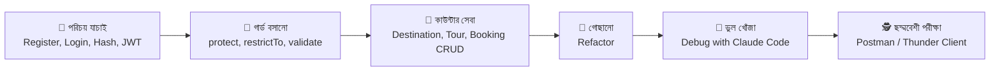

### 📦 নতুন যা যা লাগবে (একনজরে)

```bash
# তিনটা নতুন প্যাকেজ
npm install bcryptjs jsonwebtoken express-validator
```

| প্যাকেজ | গল্পে | কাজ |
|---|---|---|
| `bcryptjs` | সিলগালা করার মেশিন | পাসওয়ার্ড hash করে, আর লগইনের সময় মিলিয়ে দেখে |
| `jsonwebtoken` | প্রবেশপত্র ছাপার মেশিন | JWT তৈরি (`sign`) ও যাচাই (`verify`) করে |
| `express-validator` | ফর্ম যাচাইকারী | ইনপুটের নিয়ম (ইমেইল ঠিক কি না, দাম ০-র বেশি কি না) পরীক্ষা করে |

`.env` ফাইলে দুটো নতুন লাইন যোগ করুন (`.env.example`-এও আসল মান ছাড়া যোগ করুন):

```bash
# .env

# JWT_SECRET = প্রবেশপত্রের গোপন সিলমোহর। লম্বা, এলোমেলো আর কাউকে না জানানো লেখা
# বানানোর উপায়: node -e "console.log(require('crypto').randomBytes(48).toString('hex'))"
JWT_SECRET=paste_your_long_random_secret_here

# JWT_EXPIRES_IN = প্রবেশপত্র কতদিন বৈধ থাকবে (7d = ৭ দিন, 1h = ১ ঘণ্টা)
JWT_EXPIRES_IN=7d
```

> 🚨 `JWT_SECRET` ফাঁস হলে যে কেউ নিজের হাতে অ্যাডমিনের প্রবেশপত্র বানিয়ে ফেলতে পারবে। এটা **কখনো GitHub-এ যাবে না**।

---

## ১. Authentication-এর বড় ছবি

### গল্প

অফিসের গেটে দাঁড়িয়ে গার্ড দুটো আলাদা প্রশ্ন করে:

1. **"আপনি কে?"** (পরিচয় যাচাই, **Authentication**): পরিচয়পত্র দেখাতে হবে।
2. **"আপনি কী করতে পারেন?"** (অনুমতি, **Authorization**): সাধারণ কাস্টমার বুকিং করতে পারে, কিন্তু নতুন ট্যুর বানাতে পারে শুধু অ্যাডমিন।

| শব্দ | প্রশ্ন | আমাদের কোডে | ব্যর্থ হলে HTTP স্ট্যাটাস |
|---|---|---|---|
| **Authentication** | তুমি কে? | `login` + `protect` | **401** Unauthorized |
| **Authorization** | তোমার অনুমতি আছে? | `restrictTo('admin')`, মালিকানা-যাচাই | **403** Forbidden |

> 🧠 মনে রাখার সহজ উপায়: **401 = "তোমাকে চিনতে পারছি না"**, **403 = "চিনি, কিন্তু এই ঘরে তোমার ঢোকা মানা"**।

### পুরো যাত্রা এক নজরে

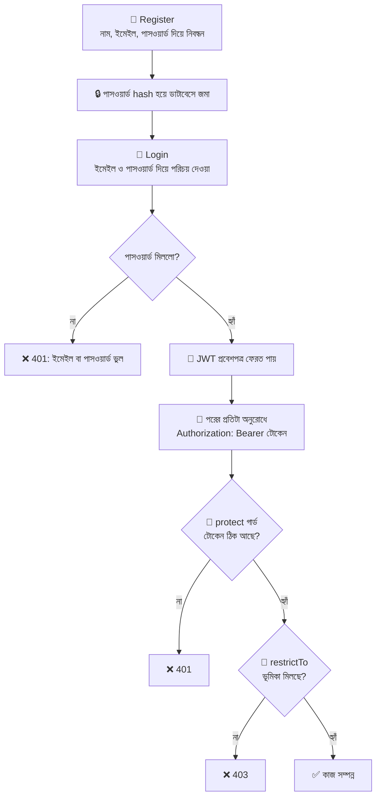

### 🍳 Hash বনাম Encryption: ডিমের গল্প

| | Encryption (এনক্রিপশন) | Hashing (হ্যাশিং) |
|---|---|---|
| গল্পে | তালা-চাবি। তালা মেরে রাখলে চাবি দিয়ে আবার খোলা যায় | **ডিম ভাজা।** একবার ভেজে ফেললে আর কাঁচা ডিম ফেরানো যায় না |
| ফেরত আনা যায়? | হ্যাঁ (চাবি থাকলে) | **না, কখনোই না** |
| পাসওয়ার্ডের জন্য? | ❌ নয় (চাবি চুরি হলে সব খোলা) | ✅ এটাই ঠিক |

লগইনের সময় আমরা সংরক্ষিত পাসওয়ার্ড "খুলে" দেখি না। বরং **ইউজারের দেওয়া পাসওয়ার্ডটা একই পদ্ধতিতে আবার "ভেজে"** দেখি, ফলাফল মিললে ঢুকতে দিই। ডাটাবেস চুরি হলেও চোর পায় শুধু ভাজা ডিম, আসল পাসওয়ার্ড নয়।

---

## ২. Password Hashing

### গল্প

`User` ফর্মে ইউজার পাসওয়ার্ড লিখলো `mySecret123`। এটা সরাসরি ডাটাবেসের খাতায় লেখা মানে খাতা খোলা পেলে সবার পাসওয়ার্ড জানা হয়ে যাওয়া। তাই **সেভ করার ঠিক আগে** একটা কর্মী (`pre('save')` হুক) পাসওয়ার্ডটা **সিলগালা খামে** ভরে দেবে। এই কাজে আমাদের মেশিন **bcrypt**।

### bcrypt-এর দুটো গোপন অস্ত্র

| অস্ত্র | গল্পে | কাজ |
|---|---|---|
| **Salt** (লবণ) | প্রতিটা ডিমে আলাদা মশলা | একই পাসওয়ার্ড দুইজন দিলেও দুটোর hash আলাদা হয়। তাই চোর "আগে থেকে বানানো তালিকা" মেলাতে পারে না |
| **Cost / Salt Rounds** (খরচ) | ডিম ভাজতে কতক্ষণ লাগবে | সংখ্যা যত বড়, hash করা তত ধীর। চোরের অনুমান করার গতিও তত কমে। সাধারণত ১০ থেকে ১২ রাখা হয় |

একটা bcrypt hash দেখতে এমন:

```text
$2a$12$N9qo8uLOickgx2ZMRZoMyeIjZAgcfl7p92ldGxad68LJZdL17lhWy
└┬─┘└┬┘└────────────┬───────────┘└──────────────┬─────────────┘
 │   │              │                            └─ আসল hash
 │   │              └─ salt (এই খামের নিজস্ব লবণ)
 │   └─ cost = 12
 └─ bcrypt-এর সংস্করণ
```

### কোড: `src/models/User.js` (আগের ফাইলে যা যা যোগ হবে)

ফাইলের উপরে `bcryptjs` আনুন, আর `module.exports`-এর ঠিক **আগে** এই দুটো অংশ বসান:

```javascript
// src/models/User.js (উপরের দিকে)
const mongoose = require('mongoose');

// bcrypt = পাসওয়ার্ড hash ও মেলানোর মেশিন
const bcrypt = require('bcryptjs');

// ... userSchema আগের মতোই থাকবে ...

// ---------- অংশ ১: সেভ করার আগে পাসওয়ার্ড সিলগালা করা ----------
// pre('save') = "ডাটাবেসে লেখার ঠিক আগে এই কাজটা করো"।
// ⚠️ সাধারণ function ব্যবহার করছি, arrow function নয়, কারণ this দিয়ে বর্তমান ইউজারকে ধরতে হবে
userSchema.pre('save', async function () {
  // isModified('password') = এই সেভে কি পাসওয়ার্ড বদলেছে?
  // না বদলালে (যেমন শুধু ফোন নম্বর বদলেছে) আবার hash করবো না।
  // এই লাইন না থাকলে hash-এর উপর আবার hash হয়ে লগইন চিরতরে ভেঙে যায়!
  if (!this.isModified('password')) return;

  // 12 = salt rounds (cost)। সংখ্যা বাড়ালে নিরাপত্তা বাড়ে, কিন্তু ধীর হয়
  this.password = await bcrypt.hash(this.password, 12);
});

// ---------- অংশ ২: লগইনের সময় পাসওয়ার্ড মেলানো ----------
// methods = প্রতিটা ইউজার-ডকুমেন্টের নিজস্ব কাজ। এখানে "পাসওয়ার্ড মিলছে কি না" বলার কাজ
// candidatePassword = ইউজার লগইন ফর্মে যে পাসওয়ার্ড লিখলো (সাধারণ লেখা)
userSchema.methods.comparePassword = async function (candidatePassword) {
  // this.password = ডাটাবেসে রাখা hash।
  // bcrypt.compare() লেখাটাকে একই salt দিয়ে আবার hash করে মিলিয়ে দেখে, ফল true বা false
  return bcrypt.compare(candidatePassword, this.password);
};

module.exports = mongoose.model('User', userSchema);
```

> 🔐 **`select: false` আর লগইন:** আগের টপিকে আমরা `password` ফিল্ডে `select: false` দিয়েছিলাম, তাই সাধারণ `User.findOne()` পাসওয়ার্ড ফেরত দেয় না। লগইনে মেলানোর জন্য hash দরকার, তাই সেখানে স্পষ্ট করে `.select('+password')` লিখতে হয় (সেকশন ৪-এ দেখবেন)।

---

## ৩. JWT Token

### গল্প

লগইন সফল হলে অফিস আপনাকে একটা **প্রবেশপত্র** ধরিয়ে দেয়। পরের প্রতিবার ঢুকতে আর ইমেইল-পাসওয়ার্ড দিতে হয় না, শুধু প্রবেশপত্র দেখালেই গার্ড ঢুকতে দেয়। এই প্রবেশপত্রের নাম **JWT (JSON Web Token)**।

আর অফিস কাউকে মনে রাখে না। গার্ডের কাছে "আজ কে কে এসেছে" নামের কোনো খাতা নেই। প্রবেশপত্রের সিলমোহর দেখেই সে বুঝে নেয় এটা আসল কি না। একে বলে **Stateless** (সার্ভার কিছু মনে রাখে না)।

### JWT-র তিন টুকরো

একটা JWT দেখতে `aaaa.bbbb.cccc`: তিনটা অংশ ডট দিয়ে জোড়া।

```text
eyJhbGciOiJIUzI1NiJ9 . eyJpZCI6IjY0YWIuLi4iLCJpYXQiOjE3MDAwMDAwMDB9 . 3k9Qx...
└──── Header ───────┘   └────────────── Payload ───────────────────┘   └ Signature ┘
```

| অংশ | গল্পে | ভেতরে কী থাকে |
|---|---|---|
| **Header** | খামের উপরের লেবেল | কোন পদ্ধতিতে সিল দেওয়া হয়েছে (`HS256`) |
| **Payload** | খামের ভেতরের তথ্য | ইউজারের `id`, `iat` (কখন ছাপা), `exp` (কখন মেয়াদ শেষ) |
| **Signature** | গোপন সিলমোহর | Header + Payload + `JWT_SECRET` মিলিয়ে বানানো। তথ্য বদলালে সিল আর মেলে না |

> ⚠️ **সবচেয়ে বড় ভুল ধারণা:** Payload **এনক্রিপ্ট করা নয়**, শুধু এনকোড করা। যে কেউ খুলে পড়তে পারে (<https://jwt.io>-তে পেস্ট করলেই দেখা যায়)। তাই Payload-এ **কখনো পাসওয়ার্ড বা গোপন তথ্য রাখবেন না**। শুধু `id` রাখুন। সিলমোহর শুধু এটা নিশ্চিত করে যে **কেউ তথ্য বদলায়নি**।

### sign ও verify: ছাপা আর যাচাই

```javascript
const jwt = require('jsonwebtoken'); // jwt = প্রবেশপত্র ছাপা ও যাচাইয়ের মেশিন

// ---- ছাপা (sign) ----
// token = ছাপা হওয়া প্রবেশপত্র (একটা লম্বা লেখা)
const token = jwt.sign(
  { id: '64ab12cd' },                // payload = ভেতরে কী লিখবো (শুধু ইউজারের id)
  process.env.JWT_SECRET,            // গোপন সিলমোহর
  { expiresIn: '7d' }                // মেয়াদ ৭ দিন, তারপর আর চলবে না
);

// ---- যাচাই (verify) ----
// decoded = সিল ঠিক থাকলে ভেতরের তথ্য ফেরত আসে: { id: '64ab12cd', iat: ..., exp: ... }
// সিল ভুল হলে JsonWebTokenError, মেয়াদ শেষ হলে TokenExpiredError ছুঁড়ে দেয়
const decoded = jwt.verify(token, process.env.JWT_SECRET);
```

### লগইন থেকে সুরক্ষিত রুটে ঢোকা: পুরো ঘটনাক্রম

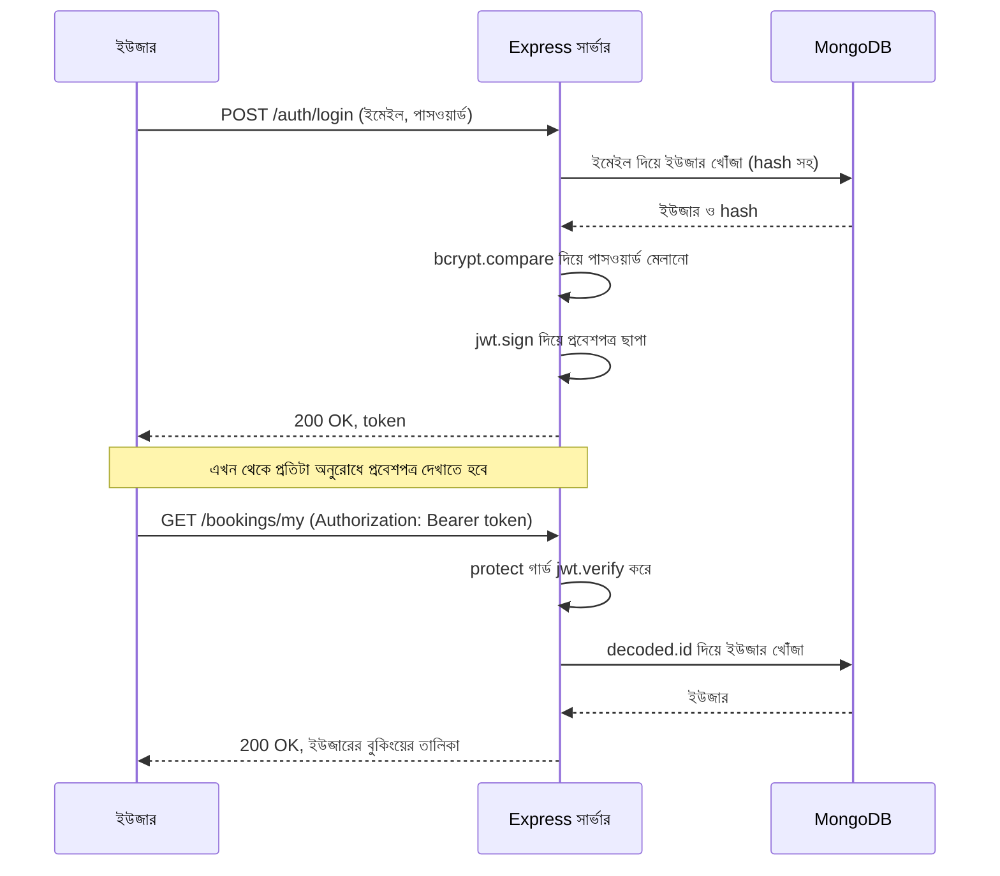

### কোড: `src/utils/generateToken.js`

প্রবেশপত্র ছাপার কাজ একাধিক জায়গায় লাগবে (register ও login দুটোতেই), তাই একটা ছোট ফাইলে আলাদা করে রাখছি:

```javascript
// src/utils/generateToken.js
const jwt = require('jsonwebtoken');

// userId = কার জন্য প্রবেশপত্র ছাপছি, তার ডাটাবেস-id
const generateToken = (userId) => {
  return jwt.sign(
    { id: userId },                                 // payload: শুধু id, গোপন কিছু নয়
    process.env.JWT_SECRET,                         // সিলমোহর .env থেকে আসছে, কোডে লেখা নেই
    { expiresIn: process.env.JWT_EXPIRES_IN || '7d' } // মেয়াদ .env-এ না থাকলে ডিফল্ট ৭ দিন
  );
};

module.exports = generateToken;
```

> 💡 **টোকেন কোথায় রাখে?** এখন Postman-এ আমরা নিজে টোকেন বসাবো। পরে Frontend বানানোর সময় টোকেন `localStorage`-এ বা `httpOnly cookie`-তে রাখার সিদ্ধান্ত নিতে হবে। `httpOnly cookie` সাধারণত বেশি নিরাপদ। সেটা Frontend-এর টপিকে দেখবো।

---

## ৪. Register ও Login API

### গল্প

অফিসে দুটো নতুন কাউন্টার খুলছে:

- **নিবন্ধন কাউন্টার (Register):** নতুন কাস্টমার নাম, ইমেইল, পাসওয়ার্ড দিয়ে পরিচয়পত্র বানায়। সাথে সাথে প্রবেশপত্রও পায়।
- **প্রবেশ কাউন্টার (Login):** পুরোনো কাস্টমার পরিচয় দেখিয়ে নতুন প্রবেশপত্র নেয়।

### 🧰 দুটো ছোট সহকারী (Utility)

**১) `AppError`: ভুলের একটাই ফর্ম।** আগের টপিকে আমরা `new Error()` বানিয়ে হাতে `statusCode` বসাতাম। এবার একটা ছোট ক্লাসে সেটা গুছিয়ে নিচ্ছি:

```javascript
// src/utils/AppError.js

// AppError = আমাদের নিজস্ব "ইচ্ছাকৃত ভুল"। কোনো নিয়ম ভাঙলে এটা ছুঁড়ে দেবো (throw)
// extends Error = JavaScript-এর সাধারণ Error-এর সব ক্ষমতা নিয়ে, সাথে নিজের কিছু যোগ
class AppError extends Error {
  // message = ক্লায়েন্টকে কী বলবো, statusCode = HTTP স্ট্যাটাস (400, 401, 404...)
  constructor(message, statusCode) {
    super(message);                // সাধারণ Error-কে বার্তা বুঝিয়ে দিলাম
    this.statusCode = statusCode;  // errorHandler এই সংখ্যা দেখেই স্ট্যাটাস বসাবে
    this.isOperational = true;     // true = এটা আমাদের জানা ভুল (যেমন "ইমেইল ভুল"), প্রোগ্রামের অজানা বাগ নয়
    Error.captureStackTrace(this, this.constructor); // ভুলটা কোডের কোন লাইনে হলো, তার পথ লিখে রাখে
  }
}

module.exports = AppError;
```

**২) `pick`: শুধু অনুমোদিত ফিল্ড তুলে নেওয়া।** আগের টপিকের সতর্কতাটা মনে আছে? `Tour.create(req.body)` মানে ক্লায়েন্ট যা পাঠাবে সবই ঢুকবে। এখানে যদি কেউ `"role": "admin"` পাঠিয়ে দেয়, সে নিজেই অ্যাডমিন হয়ে যাবে! তাই বাছাই-কর্মী:

```javascript
// src/utils/pick.js

// obj = আসা সব তথ্য (সাধারণত req.body)
// allowedFields = যেসব ফিল্ড আমরা অনুমতি দিচ্ছি, তার তালিকা। যেমন ['name', 'email']
const pick = (obj, allowedFields) => {
  // reduce = তালিকার প্রতিটা ফিল্ড ধরে ধরে একটা নতুন খালি বাক্স (result) ভরা
  return allowedFields.reduce((result, field) => {
    // শুধু যে ফিল্ড আসলেই এসেছে (undefined নয়), সেটাই নতুন বাক্সে তুলবো
    if (obj[field] !== undefined) {
      result[field] = obj[field];
    }
    return result; // ভরা বাক্স পরের ধাপে নিয়ে যাও
  }, {}); // {} = শুরুতে খালি বাক্স
};

module.exports = pick;
```

> 🛡️ এর নাম **Mass Assignment থেকে বাঁচা**। নতুন ইউজারের `role` সবসময় Schema-র `default: 'user'` থেকেই আসবে। অ্যাডমিন বানাতে হলে ডাটাবেসে নিজে হাতে বদলাতে হবে (সেকশন ৯-এ দেখাবো)।

### 📝 `src/controllers/auth.controller.js`

```javascript
// src/controllers/auth.controller.js

const User = require('../models/User');                 // User = পরিচয়পত্রের ফাইল-কেবিনেট
const AppError = require('../utils/AppError');          // AppError = নিজস্ব ভুলের ছাঁচ
const pick = require('../utils/pick');                  // pick = অনুমোদিত ফিল্ড বাছাইকারী
const generateToken = require('../utils/generateToken'); // generateToken = প্রবেশপত্র ছাপার ফাংশন

// sendTokenResponse = register ও login দুটোতেই একই জবাব যায়, তাই একবার লিখে দুই জায়গায় ব্যবহার
// user = সফল ইউজার, statusCode = 201 (নতুন তৈরি) বা 200 (লগইন), res = জবাব পাঠানোর হাতিয়ার
const sendTokenResponse = (user, statusCode, res) => {
  // token = এই ইউজারের জন্য ছাপা নতুন প্রবেশপত্র
  const token = generateToken(user._id);

  // জবাবে hash-সহ পাসওয়ার্ড পাঠাবো না। undefined করলে JSON-এ ফিল্ডটাই বাদ পড়ে যায়
  user.password = undefined;

  res.status(statusCode).json({
    success: true,
    token,        // Frontend/Postman এই টোকেন রেখে দেবে
    data: user,   // ইউজারের পাবলিক তথ্য (নাম, ইমেইল, role...)
  });
};

// ---------- POST /api/v1/auth/register ----------
const register = async (req, res) => {
  // data = শুধু অনুমোদিত চারটা ফিল্ড। role বা অন্য কিছু পাঠালেও বাদ যাবে
  const data = pick(req.body, ['name', 'email', 'password', 'phone']);

  // User.create() সেভ করার আগে pre('save') হুক নিজে পাসওয়ার্ড hash করে দেবে
  // একই ইমেইল আগে থাকলে MongoDB 11000 এরর দেবে, errorHandler সেটাকে 409 বানাবে
  const user = await User.create(data);

  sendTokenResponse(user, 201, res);
};

// ---------- POST /api/v1/auth/login ----------
const login = async (req, res) => {
  // email, password = ফর্মে ইউজার যা লিখেছে (validation আগেই যাচাই করে এসেছে)
  const { email, password } = req.body;

  // select('+password') = "সাধারণত লুকানো পাসওয়ার্ড-hash এবার আমার লাগবে, দাও"
  const user = await User.findOne({ email }).select('+password');

  // 🔒 নিরাপত্তার কৌশল: ইমেইল ভুল হোক বা পাসওয়ার্ড, একই বার্তা দিচ্ছি।
  // আলাদা বার্তা দিলে চোর বুঝে যায় "এই ইমেইলে সত্যিই একজন আছে"
  if (!user || !(await user.comparePassword(password))) {
    throw new AppError('ইমেইল বা পাসওয়ার্ড ভুল', 401);
  }

  sendTokenResponse(user, 200, res);
};

// ---------- GET /api/v1/auth/me ----------
// protect গার্ড আগেই req.user বসিয়ে দিয়েছে, তাই এখানে শুধু সেটা ফেরত দিলেই হয়
const getMe = async (req, res) => {
  res.status(200).json({ success: true, data: req.user });
};

module.exports = { register, login, getMe };
```

> ⚡ **Express 5-এ `throw` কাজ করে** (async ফাংশনের throw নিজে `errorHandler`-এ যায়)। কোর্সে Express 4 থাকলে `throw` না করে `return next(new AppError(...))` লিখুন, আর `async` ফাংশনগুলো `try/catch`-এ মুড়ুন।

### 🛎️ `src/routes/auth.routes.js`

```javascript
// src/routes/auth.routes.js
const express = require('express');
const { register, login, getMe } = require('../controllers/auth.controller');
const { protect } = require('../middleware/auth');           // গেটের গার্ড (সেকশন ৫)
const validate = require('../middleware/validate');           // ফর্ম যাচাইকারীর রায় (সেকশন ৫)
const { registerRules, loginRules } = require('../validators/auth.validators');

const router = express.Router();

// ক্রম খেয়াল করুন: নিয়ম (rules) -> রায় (validate) -> ম্যানেজার (controller)
router.post('/register', registerRules, validate, register);
router.post('/login', loginRules, validate, login);
router.get('/me', protect, getMe); // protect = প্রবেশপত্র না থাকলে এখানেই আটকে যাবে

module.exports = router;
```

`app.js`-এ নতুন রিসেপশন ডেস্কটা বসিয়ে দিন (`tourRoutes`-এর লাইনের কাছে):

```javascript
// src/app.js
const authRoutes = require('./routes/auth.routes');   // নতুন

app.use('/api/v1/auth', authRoutes);                  // নতুন: /api/v1/auth/... সব ঠিকানা এর হাতে
```

### ফলাফল: প্রত্যাশিত জবাব

```bash
curl -X POST http://localhost:5000/api/v1/auth/register \
  -H "Content-Type: application/json" \
  -d '{"name":"রাফি","email":"rafi@example.com","password":"secret1234"}'
```

```javascript
// স্ট্যাটাস 201
{
  "success": true,
  "token": "eyJhbGciOiJIUzI1NiIs...",   // এটা সংরক্ষণ করুন, পরে লাগবে
  "data": { "_id": "...", "name": "রাফি", "email": "rafi@example.com", "role": "user" }
  // লক্ষ্য করুন: password ফিল্ড নেই
}
```

---

## ৫. Middleware: Auth Protect, Error Handling, Validation

### গল্প

কাউন্টারে পৌঁছানোর আগে একজন অতিথিকে তিন জায়গায় থামতে হয়:

1. 📋 **ফর্ম যাচাইকারী (Validation):** ফর্ম ঠিকঠাক ভরা হয়েছে কি না।
2. 💂 **গেটের গার্ড (`protect`):** প্রবেশপত্র আছে কি না, আসল কি না।
3. 🚪 **VIP দারোয়ান (`restrictTo`):** এই ঘরে ঢোকার অনুমতি আছে কি না।

আর পথে যেকোনো জায়গায় সমস্যা হলে সবাইকে নিয়ে যাওয়া হয় **অভিযোগ-ডেস্কে (errorHandler)**।

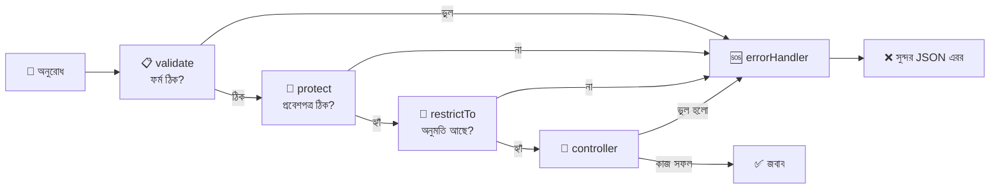

> 💡 **কোন গার্ড আগে বসবে?** সাধারণত `protect → restrictTo → validate → controller`। অর্থাৎ আগে পরিচয় ও অনুমতি, তারপর ফর্ম যাচাই। অচেনা লোকের ফর্ম যাচাই করে সময় নষ্ট করার দরকার নেই। (Register/Login-এ `protect` থাকে না, তাই সেখানে শুধু `validate`।)

### 💂 গেটের গার্ড: `src/middleware/auth.js`

```javascript
// src/middleware/auth.js

const jwt = require('jsonwebtoken');            // jwt = প্রবেশপত্র যাচাই করার মেশিন
const User = require('../models/User');         // User = ইউজার খোঁজার ফাইল-কেবিনেট
const AppError = require('../utils/AppError');  // AppError = ভুলের ছাঁচ

// ---------- গার্ড ১: protect (প্রবেশপত্র আছে কি না) ----------
const protect = async (req, res, next) => {
  // authHeader = অনুরোধের Authorization হেডার। দেখতে এমন: "Bearer eyJhbGci..."
  const authHeader = req.headers.authorization;

  // token = হেডার থেকে বের করা শুধু প্রবেশপত্রটুকু
  let token;

  // "Bearer " (শেষে একটা ফাঁকা জায়গা) দিয়ে শুরু হলে ফাঁকার পরের অংশটাই টোকেন
  if (authHeader && authHeader.startsWith('Bearer ')) {
    token = authHeader.split(' ')[1];
  }

  // টোকেনই নেই মানে প্রবেশপত্র না দেখিয়ে ঢুকতে চাইছে
  if (!token) {
    throw new AppError('এই কাজের জন্য লগইন করতে হবে', 401);
  }

  // decoded = সিল ঠিক থাকলে ভেতরের তথ্য ({ id, iat, exp })।
  // সিল নকল হলে বা মেয়াদ শেষ হলে verify নিজেই এরর ছুঁড়ে দেয়, errorHandler সেটা ধরবে
  const decoded = jwt.verify(token, process.env.JWT_SECRET);

  // user = টোকেনের id ধরে ডাটাবেসে ইউজার খুঁজছি।
  // কেন খুঁজি? টোকেন বৈধ হলেও ইউজার হয়তো এর মধ্যে মুছে গেছে বা তার role বদলেছে
  const user = await User.findById(decoded.id);

  if (!user) {
    throw new AppError('এই টোকেনের ইউজার আর নেই', 401);
  }

  // req.user = ইউজারকে অনুরোধের সাথে গেঁথে দিলাম। পরের সব গার্ড ও ম্যানেজার এটা পড়তে পারবে
  req.user = user;

  next(); // গার্ডের কাজ শেষ, পরের ধাপে যাও
};

// ---------- গার্ড ২: restrictTo (ভূমিকা মিলছে কি না) ----------
// ...roles = অনুমোদিত ভূমিকার তালিকা। restrictTo('admin') বা restrictTo('admin', 'staff')
// এটা একটা "ফাংশন যে ফাংশন বানায়" (middleware factory), তাই দুই স্তরে (roles) => (req, res, next)
const restrictTo = (...roles) => {
  return (req, res, next) => {
    // req.user.role = protect গার্ড যে ইউজার বসিয়েছে তার ভূমিকা
    if (!roles.includes(req.user.role)) {
      return next(new AppError('এই কাজ করার অনুমতি আপনার নেই', 403));
    }
    next();
  };
};

module.exports = { protect, restrictTo };
```

> ⚠️ **`restrictTo` সবসময় `protect`-এর পরে বসবে।** `protect` না চললে `req.user` তৈরিই হয় না, আর `req.user.role` পড়তে গিয়ে সার্ভার ভেঙে পড়বে।

### 📋 ফর্ম যাচাইকারী: `express-validator`

দুটো অংশ: **নিয়মের তালিকা (rules)** আর **রায় দেওয়ার কর্মী (`validate`)**।

**রায়ের কর্মী:** সব নিয়ম চলার পর ভুল জমা হলো কি না দেখে।

```javascript
// src/middleware/validate.js
const { validationResult } = require('express-validator'); // validationResult = জমা হওয়া ভুলের তালিকা বের করার ফাংশন
const AppError = require('../utils/AppError');

const validate = (req, res, next) => {
  // errors = এই অনুরোধে যতগুলো নিয়ম ভেঙেছে, তাদের সংগ্রহ
  const errors = validationResult(req);

  // ভুল না থাকলে নির্বিঘ্নে পরের ধাপে
  if (errors.isEmpty()) return next();

  // message = সব ভুলের বার্তা কমা দিয়ে জুড়ে একটা বার্তা। e.msg = প্রতিটা নিয়মের withMessage-এ দেওয়া লেখা
  const message = errors.array().map((e) => e.msg).join(', ');

  next(new AppError(message, 400)); // 400 = ক্লায়েন্টের পাঠানো ডেটা ভুল
};

module.exports = validate;
```

**Auth-এর নিয়ম:**

```javascript
// src/validators/auth.validators.js
const { body } = require('express-validator'); // body = অনুরোধের body-র কোনো ফিল্ডকে লক্ষ্য করার হাতিয়ার

// registerRules = নিবন্ধনের ফর্মের নিয়ম (একটা তালিকা)
const registerRules = [
  body('name')
    .trim()                                   // sanitizer: আগে-পিছের ফাঁকা কাটে
    .notEmpty().withMessage('নাম দেওয়া বাধ্যতামূলক')
    .isLength({ max: 60 }).withMessage('নাম ৬০ অক্ষরের বেশি হবে না'),

  body('email')
    .trim()
    .toLowerCase()                            // ইমেইল সবসময় ছোট হাতের, যাতে Login-এ মিলে যায়
    .isEmail().withMessage('সঠিক ইমেইল দিন'),

  body('password')
    .isLength({ min: 8 }).withMessage('পাসওয়ার্ড কমপক্ষে ৮ অক্ষরের হতে হবে'),
];

// loginRules = প্রবেশ ফর্মের নিয়ম। এখানে শুধু "ফাঁকা নয়" দেখলেই চলে
const loginRules = [
  body('email').trim().toLowerCase().isEmail().withMessage('সঠিক ইমেইল দিন'),
  body('password').notEmpty().withMessage('পাসওয়ার্ড দিন'),
];

module.exports = { registerRules, loginRules };
```

> 🔁 **Validation আর Schema-র validation দুটোই কেন?** `express-validator` হলো **গেটের ফর্ম যাচাই** (ডাটাবেসে পৌঁছানোর আগেই খারাপ ডেটা ফেরত)। আর Mongoose Schema হলো **ফাইল-কেবিনেটের নিজস্ব তালা** (শেষ প্রতিরক্ষা)। দুই স্তর থাকলে নিরাপত্তা শক্ত হয়।

### 🆘 `errorHandler`-এ নতুন দুটো এরর যোগ

আগের টপিকের `errorHandler`-এ (`CastError`-এর ঠিক পরে) টোকেনের দুই সমস্যা সামলানো যোগ করুন:

```javascript
// src/middleware/errorHandler.js (আগের ValidationError, CastError, 11000 ব্লকের পাশে নতুন ব্লক)

  // ৪) টোকেনের সিল নকল বা টোকেন ভাঙা। jwt.verify এই নামে এরর ছোঁড়ে
  if (err.name === 'JsonWebTokenError') {
    statusCode = 401;
    message = 'অবৈধ টোকেন। আবার লগইন করুন';
  }

  // ৫) টোকেনের মেয়াদ শেষ (expiresIn পার হয়ে গেছে)
  if (err.name === 'TokenExpiredError') {
    statusCode = 401;
    message = 'টোকেনের মেয়াদ শেষ। আবার লগইন করুন';
  }
```

| এরর | মানে | স্ট্যাটাস |
|---|---|---|
| `AppError` (আমাদের বানানো) | জানা ভুল, `statusCode` সাথেই আসে | যা দেওয়া হয়েছে |
| `ValidationError` | Mongoose Schema-র নিয়ম ভাঙা | 400 |
| `CastError` | ভুল ID বা ভুল ধরনের মান | 400 |
| `code 11000` | `unique` নিয়ম ভাঙা | 409 |
| `JsonWebTokenError` | নকল/ভাঙা টোকেন | 401 |
| `TokenExpiredError` | মেয়াদোত্তীর্ণ টোকেন | 401 |
| বাকি সব | আমাদের অজানা বাগ | 500 |

---

## ৬. CRUD APIs: Destination, Tour, Booking

### গল্প

অফিসের প্রতিটা তাকে (Collection) চারটা সেবা থাকে। একে বলে **CRUD**, আর প্রতিটার একটা করে HTTP ক্রিয়াপদ (Method) আছে:

| অক্ষর | সেবা | HTTP Method | সফল হলে স্ট্যাটাস | গল্পে |
|---|---|---|---|---|
| **C**reate | নতুন তৈরি | `POST` | 201 | নতুন ব্রোশিওর ছাপানো |
| **R**ead | দেখা | `GET` | 200 | তাক থেকে নামিয়ে দেখানো |
| **U**pdate | বদলানো | `PATCH` (আংশিক) / `PUT` (পুরো) | 200 | ব্রোশিওরের দাম কাটাকুটি করে বদলানো |
| **D**elete | মোছা | `DELETE` | 204 | তাক থেকে সরিয়ে ফেলা |

> 💡 **`PATCH` বনাম `PUT`:** `PATCH` মানে শুধু যে ফিল্ডগুলো পাঠালেন সেগুলোই বদলাবে (দাম বদলাতে শুধু `price` পাঠালেই হয়)। `PUT` মানে পুরো ডকুমেন্ট নতুন করে বসানো। আমরা সবখানে `PATCH` ব্যবহার করছি, কারণ বাস্তবে এটাই বেশি সুবিধাজনক।

### 🗺️ আমাদের পুরো API-র মানচিত্র

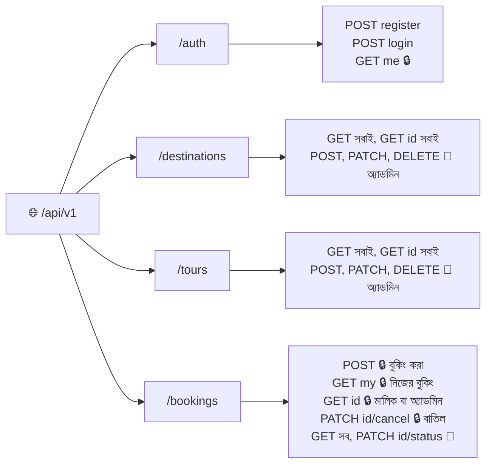

> 🔒 = লগইন লাগবে, 👑 = শুধু অ্যাডমিন।

| Method | URL | কে পারবে | কাজ |
|---|---|---|---|
| POST | `/auth/register` | সবাই | নিবন্ধন |
| POST | `/auth/login` | সবাই | লগইন |
| GET | `/auth/me` | লগইন করা ইউজার | নিজের তথ্য |
| GET | `/destinations` | সবাই | সব গন্তব্য |
| GET | `/destinations/:id` | সবাই | একটা গন্তব্য |
| POST | `/destinations` | 👑 অ্যাডমিন | নতুন গন্তব্য |
| PATCH | `/destinations/:id` | 👑 অ্যাডমিন | গন্তব্য বদল |
| DELETE | `/destinations/:id` | 👑 অ্যাডমিন | গন্তব্য মোছা |
| GET | `/tours` | সবাই | সব ট্যুর (ফিল্টার, পাতা) |
| GET | `/tours/:id` | সবাই | একটা ট্যুর |
| POST | `/tours` | 👑 অ্যাডমিন | নতুন ট্যুর |
| PATCH | `/tours/:id` | 👑 অ্যাডমিন | ট্যুর বদল |
| DELETE | `/tours/:id` | 👑 অ্যাডমিন | ট্যুর বন্ধ (soft delete) |
| POST | `/bookings` | 🔒 লগইন | নতুন বুকিং |
| GET | `/bookings/my` | 🔒 লগইন | নিজের সব বুকিং |
| GET | `/bookings` | 👑 অ্যাডমিন | সবার বুকিং |
| GET | `/bookings/:id` | 🔒 মালিক বা 👑 | একটা বুকিং |
| PATCH | `/bookings/:id/cancel` | 🔒 মালিক বা 👑 | বুকিং বাতিল |
| PATCH | `/bookings/:id/status` | 👑 অ্যাডমিন | অবস্থা বদল |

### 🧱 ধাপ ০: নকশায় একটা বদল (Destination আলাদা হলো)

আগের টপিকে আমরা গন্তব্যের তথ্য `Tour`-এর ভেতরে (`location`) রেখেছিলাম, আর বলে রেখেছিলাম ভবিষ্যতে আলাদা `Destination` বানাবো। সেই ভবিষ্যৎ এখনই! কারণ একই গন্তব্যে (যেমন সিলেট) অনেক ট্যুর হতে পারে (২ দিনের, ৩ দিনের, ফ্যামিলি প্যাকেজ)। প্রতিবার দেশ-শহর লেখার বদলে একবারই `Destination` বানিয়ে `ref` দিয়ে জুড়ে দেবো।

```javascript
// src/models/Destination.js
const mongoose = require('mongoose');

// destinationSchema = গন্তব্যের ব্রোশিওরের ছাঁচ
const destinationSchema = new mongoose.Schema(
  {
    // name = গন্তব্যের নাম, যেমন "সিলেট"। unique = একই নামের দুটো গন্তব্য নয়
    name: {
      type: String,
      required: [true, 'গন্তব্যের নাম দিন'],
      unique: true,
      trim: true,
    },
    // country = কোন দেশে
    country: {
      type: String,
      required: [true, 'দেশের নাম দিন'],
      trim: true,
    },
    // description = গন্তব্যের পরিচিতি
    description: { type: String, trim: true },
    // imageCover = প্রচ্ছদ ছবির ফাইল বা লিংক
    imageCover: { type: String },
  },
  { timestamps: true }
);

module.exports = mongoose.model('Destination', destinationSchema); // collection: "destinations"
```

এবার `Tour` model-এ `location` মুছে `destination` রেফারেন্স বসান। নিচে `-` মানে মুছে ফেলুন, `+` মানে যোগ করুন:

```diff
// src/models/Tour.js
-    location: {
-      country: { type: String, required: [true, 'দেশ দেওয়া বাধ্যতামূলক'], trim: true },
-      city: { type: String, required: [true, 'শহর বা এলাকার নাম দিন'], trim: true },
-    },
+    // destination = এই ট্যুর কোন গন্তব্যের। শুধু Destination-এর _id রাখছি
+    destination: {
+      type: mongoose.Schema.Types.ObjectId,
+      ref: 'Destination',                        // ref = "Destination" কেবিনেটের নম্বর
+      required: [true, 'গন্তব্য দিতে হবে'],
+    },
```

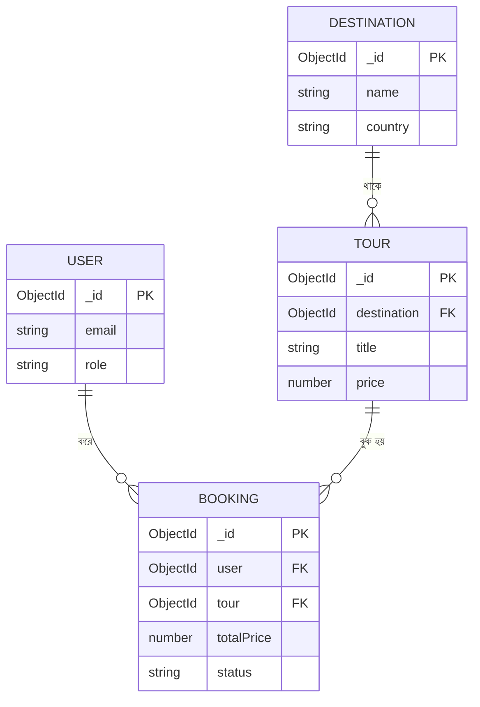

> 🧹 **আগের টেস্ট-ডেটার কী হবে?** পুরোনো ট্যুরে `location` আছে, `destination` নেই। শেখার প্রজেক্টে সবচেয়ে সহজ উপায়: পুরোনো `tours` collection মুছে ফেলে নতুন করে বানানো (`db.tours.deleteMany({})`)। আসল প্রজেক্টে এটাকে বলে **Data Migration**, যেখানে পুরোনো ডেটা সাবধানে নতুন গড়নে রূপান্তর করতে হয়।

### 📋 নতুন নিয়মের তালিকা (Validators)

```javascript
// src/validators/common.validators.js
const { param } = require('express-validator'); // param = URL-এর :id অংশকে লক্ষ্য করার হাতিয়ার

// idParam = URL-এর :id আসল MongoDB ObjectId কি না দেখে। ভুল হলে ডাটাবেস পর্যন্ত যাওয়ার আগেই ফেরত
const idParam = [param('id').isMongoId().withMessage('ID-র ফরম্যাট ঠিক নয়')];

module.exports = { idParam };
```

```javascript
// src/validators/destination.validators.js
const { body } = require('express-validator');

// createDestinationRules = নতুন গন্তব্য বানানোর নিয়ম
const createDestinationRules = [
  body('name').trim().notEmpty().withMessage('গন্তব্যের নাম দিন'),
  body('country').trim().notEmpty().withMessage('দেশের নাম দিন'),
];

// updateDestinationRules = বদলানোর নিয়ম। .optional() = ফিল্ডটা পাঠালে তবেই যাচাই করো
const updateDestinationRules = [
  body('name').optional().trim().notEmpty().withMessage('নাম ফাঁকা হতে পারবে না'),
  body('country').optional().trim().notEmpty().withMessage('দেশ ফাঁকা হতে পারবে না'),
];

module.exports = { createDestinationRules, updateDestinationRules };
```

```javascript
// src/validators/tour.validators.js
const { body } = require('express-validator');

// createTourRules = নতুন ট্যুরের নিয়ম
const createTourRules = [
  body('title').trim().notEmpty().withMessage('ট্যুরের নাম দিন'),
  body('destination').isMongoId().withMessage('সঠিক গন্তব্যের ID দিন'),
  body('price').isFloat({ min: 0 }).withMessage('দাম ০ বা তার বেশি হতে হবে'),       // isFloat = দশমিকসহ সংখ্যা
  body('durationDays').isInt({ min: 1 }).withMessage('মেয়াদ কমপক্ষে ১ দিন'),       // isInt = পূর্ণসংখ্যা
  body('maxGroupSize').isInt({ min: 1 }).withMessage('দলের আকার কমপক্ষে ১ জন'),
  body('startDates').optional().isArray().withMessage('startDates একটা তালিকা (array) হতে হবে'),
  body('startDates.*').optional().isISO8601().withMessage('তারিখ YYYY-MM-DD ফরম্যাটে দিন'), // .* = তালিকার প্রতিটা উপাদান
];

// updateTourRules = বদলানোর নিয়ম। সবগুলো optional, কিন্তু পাঠালে ঠিক হতে হবে
const updateTourRules = [
  body('title').optional().trim().notEmpty().withMessage('ট্যুরের নাম ফাঁকা হতে পারবে না'),
  body('destination').optional().isMongoId().withMessage('সঠিক গন্তব্যের ID দিন'),
  body('price').optional().isFloat({ min: 0 }).withMessage('দাম ০ বা তার বেশি হতে হবে'),
  body('durationDays').optional().isInt({ min: 1 }).withMessage('মেয়াদ কমপক্ষে ১ দিন'),
  body('maxGroupSize').optional().isInt({ min: 1 }).withMessage('দলের আকার কমপক্ষে ১ জন'),
  body('startDates.*').optional().isISO8601().withMessage('তারিখ YYYY-MM-DD ফরম্যাটে দিন'),
];

module.exports = { createTourRules, updateTourRules };
```

```javascript
// src/validators/booking.validators.js
const { body } = require('express-validator');

// createBookingRules = বুকিং ফর্মের নিয়ম।
// ⚠️ লক্ষ্য করুন totalPrice এখানে নেই! দাম ক্লায়েন্ট বলবে না, সার্ভার নিজে হিসাব করবে
const createBookingRules = [
  body('tour').isMongoId().withMessage('সঠিক ট্যুরের ID দিন'),
  body('startDate').isISO8601().withMessage('শুরুর তারিখ YYYY-MM-DD ফরম্যাটে দিন'),
  body('numberOfPeople').isInt({ min: 1 }).withMessage('কমপক্ষে ১ জন হতে হবে'),
];

module.exports = { createBookingRules };
```

### 🏝️ Destination: CRUD

```javascript
// src/controllers/destination.controller.js

const Destination = require('../models/Destination'); // গন্তব্যের কেবিনেট
const Tour = require('../models/Tour');               // মোছার আগে দেখবো কোনো ট্যুর এটা ব্যবহার করছে কি না
const AppError = require('../utils/AppError');
const pick = require('../utils/pick');

// DESTINATION_FIELDS = অনুমোদিত ফিল্ডের তালিকা। বাইরে থেকে অন্য কিছু ঢুকতে পারবে না (Mass Assignment থেকে সুরক্ষা)
const DESTINATION_FIELDS = ['name', 'country', 'description', 'imageCover'];

// ---------- R: সব গন্তব্য ----------
const getAllDestinations = async (req, res) => {
  // sort({ name: 1 }) = নাম অনুযায়ী ক-খ ক্রমে সাজানো
  const destinations = await Destination.find().sort({ name: 1 });
  res.status(200).json({ success: true, count: destinations.length, data: destinations });
};

// ---------- R: একটা গন্তব্য ----------
const getDestination = async (req, res) => {
  // req.params.id = URL-এর :id অংশ (যেমন /destinations/64ab...)
  const destination = await Destination.findById(req.params.id);
  if (!destination) throw new AppError('গন্তব্য পাওয়া যায়নি', 404);
  res.status(200).json({ success: true, data: destination });
};

// ---------- C: নতুন গন্তব্য ----------
const createDestination = async (req, res) => {
  const destination = await Destination.create(pick(req.body, DESTINATION_FIELDS));
  res.status(201).json({ success: true, data: destination });
};

// ---------- U: গন্তব্য বদল ----------
const updateDestination = async (req, res) => {
  const destination = await Destination.findByIdAndUpdate(
    req.params.id,                          // কোনটা বদলাবো
    pick(req.body, DESTINATION_FIELDS),     // কী বদলাবো (শুধু অনুমোদিত ফিল্ড)
    {
      new: true,            // new: true = বদলের পরের নতুন রূপটা ফেরত দাও (নাহলে পুরোনোটা আসে)
      runValidators: true,  // ⚠️ এটা না দিলে update-এ Schema-র নিয়ম (min, enum...) চলেই না!
    }
  );
  if (!destination) throw new AppError('গন্তব্য পাওয়া যায়নি', 404);
  res.status(200).json({ success: true, data: destination });
};

// ---------- D: গন্তব্য মোছা ----------
const deleteDestination = async (req, res) => {
  // inUse = এই গন্তব্যে কোনো ট্যুর আছে কি না (exists() হ্যাঁ/না জানায়, পুরো ডেটা আনে না)
  const inUse = await Tour.exists({ destination: req.params.id });
  if (inUse) {
    throw new AppError('এই গন্তব্যে ট্যুর আছে, আগে সেগুলো সরান', 400);
  }

  const destination = await Destination.findByIdAndDelete(req.params.id);
  if (!destination) throw new AppError('গন্তব্য পাওয়া যায়নি', 404);

  res.status(204).send(); // 204 = সফল, কিন্তু ফেরত দেওয়ার মতো কিছু নেই
};

module.exports = {
  getAllDestinations,
  getDestination,
  createDestination,
  updateDestination,
  deleteDestination,
};
```

```javascript
// src/routes/destination.routes.js
const express = require('express');
const c = require('../controllers/destination.controller'); // c = ম্যানেজারের সব কাজের সংক্ষিপ্ত নাম
const { protect, restrictTo } = require('../middleware/auth');
const validate = require('../middleware/validate');
const { idParam } = require('../validators/common.validators');
const { createDestinationRules, updateDestinationRules } = require('../validators/destination.validators');

const router = express.Router();

// সবার জন্য খোলা (পড়া)
router.get('/', c.getAllDestinations);
router.get('/:id', idParam, validate, c.getDestination);

// শুধু অ্যাডমিনের জন্য (লেখা): ক্রম = পরিচয় -> অনুমতি -> ফর্ম -> ম্যানেজার
router.post('/', protect, restrictTo('admin'), createDestinationRules, validate, c.createDestination);
router.patch('/:id', protect, restrictTo('admin'), idParam, updateDestinationRules, validate, c.updateDestination);
router.delete('/:id', protect, restrictTo('admin'), idParam, validate, c.deleteDestination);

module.exports = router;
```

### 🗺️ Tour: CRUD (পাতা ও ফিল্টারসহ)

```javascript
// src/controllers/tour.controller.js

const Tour = require('../models/Tour');
const Destination = require('../models/Destination');
const AppError = require('../utils/AppError');
const pick = require('../utils/pick');

// TOUR_FIELDS = অনুমোদিত ফিল্ড। isActive বা _id এখানে নেই, তাই ক্লায়েন্ট সরাসরি বদলাতে পারবে না
const TOUR_FIELDS = [
  'title', 'destination', 'description', 'price',
  'durationDays', 'maxGroupSize', 'startDates', 'imageCover',
];

// ---------- R: সব ট্যুর (ফিল্টার ও পাতাসহ) ----------
// উদাহরণ: GET /tours?destination=<id>&maxPrice=8000&page=2&limit=5
const getAllTours = async (req, res) => {
  // filter = ডাটাবেসে কী কী শর্তে খুঁজবো। শুরুতে শুধু "বিক্রির জন্য খোলা" ট্যুর
  const filter = { isActive: true };

  // গন্তব্য ধরে ফিল্টার। ভুল ID হলে Mongoose নিজেই CastError দেবে, errorHandler 400 বানাবে
  if (req.query.destination) filter.destination = req.query.destination;

  // maxPrice = সর্বোচ্চ দাম। $lte = "less than or equal" (এর চেয়ে কম বা সমান)
  if (req.query.maxPrice) {
    const maxPrice = Number(req.query.maxPrice); // URL থেকে সব মান লেখা হিসেবে আসে, তাই সংখ্যায় বদলাচ্ছি
    if (Number.isNaN(maxPrice)) throw new AppError('maxPrice একটা সংখ্যা হতে হবে', 400);
    filter.price = { $lte: maxPrice };
  }

  // ---- পাতা (Pagination) ----
  // page = কোন পাতা (কমপক্ষে ১)। Math.max দিয়ে ০ বা ঋণাত্মক পাতা ঠেকালাম
  const page = Math.max(parseInt(req.query.page, 10) || 1, 1);
  // limit = এক পাতায় কয়টা। ডিফল্ট ১০, সর্বোচ্চ ৫০ (কেউ যেন একবারে লাখ ডেটা না চায়)
  const limit = Math.min(parseInt(req.query.limit, 10) || 10, 50);
  // skip = কয়টা ছেড়ে শুরু করবো। পাতা ২, limit ১০ হলে প্রথম ১০টা ছেড়ে দেবো
  const skip = (page - 1) * limit;

  // total = এই শর্তে মোট কয়টা ট্যুর আছে (Frontend-এ "মোট পাতা" দেখাতে লাগে)
  const total = await Tour.countDocuments(filter);

  const tours = await Tour.find(filter)
    .populate('destination', 'name country') // populate = destination-এর নম্বরের জায়গায় আসল নাম-দেশ বসিয়ে দাও
    .sort({ createdAt: -1 })                 // নতুন আগে
    .skip(skip)
    .limit(limit);

  res.status(200).json({
    success: true,
    count: tours.length,                     // এই পাতায় কয়টা এলো
    total,                                   // সব মিলিয়ে কয়টা
    page,
    totalPages: Math.ceil(total / limit),    // Math.ceil = ভগ্নাংশ হলে উপরের পূর্ণসংখ্যা
    data: tours,
  });
};

// ---------- R: একটা ট্যুর ----------
const getTour = async (req, res) => {
  const tour = await Tour.findById(req.params.id).populate('destination', 'name country description');
  if (!tour || !tour.isActive) throw new AppError('ট্যুর পাওয়া যায়নি', 404);
  res.status(200).json({ success: true, data: tour });
};

// ---------- C: নতুন ট্যুর ----------
const createTour = async (req, res) => {
  const data = pick(req.body, TOUR_FIELDS);

  // গন্তব্য আসলেই আছে কি না আগে দেখি। ভুল ID দিয়ে "ভূতুড়ে গন্তব্যের" ট্যুর বানানো ঠেকালাম
  const destinationExists = await Destination.exists({ _id: data.destination });
  if (!destinationExists) throw new AppError('এই গন্তব্য পাওয়া যায়নি', 404);

  const tour = await Tour.create(data);
  res.status(201).json({ success: true, data: tour });
};

// ---------- U: ট্যুর বদল ----------
const updateTour = async (req, res) => {
  const data = pick(req.body, TOUR_FIELDS);

  // গন্তব্য বদলানো হলে নতুনটা আছে কি না দেখবো
  if (data.destination) {
    const destinationExists = await Destination.exists({ _id: data.destination });
    if (!destinationExists) throw new AppError('এই গন্তব্য পাওয়া যায়নি', 404);
  }

  const tour = await Tour.findByIdAndUpdate(req.params.id, data, {
    new: true,           // বদলের পরের রূপ ফেরত
    runValidators: true, // Schema-র নিয়ম চালু (দাম ঋণাত্মক হতে পারবে না ইত্যাদি)
  });
  if (!tour) throw new AppError('ট্যুর পাওয়া যায়নি', 404);

  res.status(200).json({ success: true, data: tour });
};

// ---------- D: ট্যুর বন্ধ (Soft Delete) ----------
// আসলে মুছছি না, শুধু isActive = false করছি। কারণ এই ট্যুরের নামে পুরোনো বুকিংয়ের রসিদ আছে।
// ব্রোশিওর ছিঁড়ে ফেললে রসিদ কীসের নামে থাকবে? তাই "বন্ধ" স্ট্যাম্প মারা হচ্ছে
const deleteTour = async (req, res) => {
  const tour = await Tour.findByIdAndUpdate(req.params.id, { isActive: false });
  if (!tour) throw new AppError('ট্যুর পাওয়া যায়নি', 404);
  res.status(204).send();
};

module.exports = { getAllTours, getTour, createTour, updateTour, deleteTour };
```

```javascript
// src/routes/tour.routes.js (আগের ফাইলের জায়গায় নতুন রূপ)
const express = require('express');
const c = require('../controllers/tour.controller');
const { protect, restrictTo } = require('../middleware/auth');
const validate = require('../middleware/validate');
const { idParam } = require('../validators/common.validators');
const { createTourRules, updateTourRules } = require('../validators/tour.validators');

const router = express.Router();

router.get('/', c.getAllTours);
router.get('/:id', idParam, validate, c.getTour);

router.post('/', protect, restrictTo('admin'), createTourRules, validate, c.createTour);
router.patch('/:id', protect, restrictTo('admin'), idParam, updateTourRules, validate, c.updateTour);
router.delete('/:id', protect, restrictTo('admin'), idParam, validate, c.deleteTour);

module.exports = router;
```

### 🎫 Booking: সবচেয়ে বুদ্ধিমান কাউন্টার

বুকিং হলো আমাদের অফিসের সবচেয়ে স্পর্শকাতর কাজ, কারণ এখানে **টাকা** আর **সিট** জড়িত। তাই কাউন্টারের কর্মী কয়েকটা নিয়ম কঠোরভাবে মানে:

| নিয়ম | কেন |
|---|---|
| **দাম ক্লায়েন্ট বলবে না, সার্ভার হিসাব করবে** | নইলে কেউ `totalPrice: 1` পাঠিয়ে লাখ টাকার ট্যুর কিনে ফেলবে |
| **ইউজার নেওয়া হবে টোকেন থেকে (`req.user`)** | নইলে কেউ অন্যের নামে বুকিং করে দিতে পারে |
| **তারিখ ট্যুরের `startDates`-এর মধ্যে থাকতে হবে** | যে তারিখে ট্যুরই নেই, সেই তারিখে বুকিং হয় না |
| **বাকি সিট দেখে তবেই বুকিং** | নইলে একই সিটে দুইজনকে কথা দেওয়া হবে, আমাদের গল্পের শুরুর সমস্যা! |
| **অন্যের বুকিং দেখা/বাতিল করা যাবে না** | মালিকানা যাচাই (Authorization) |

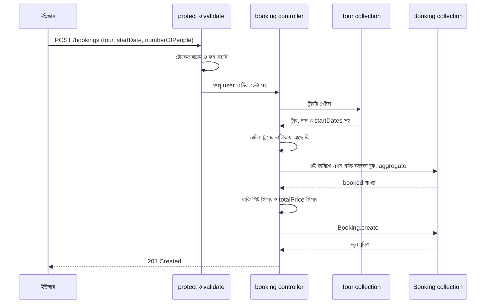

```javascript
// src/controllers/booking.controller.js

const Booking = require('../models/Booking');
const Tour = require('../models/Tour');
const AppError = require('../utils/AppError');
const pick = require('../utils/pick');

// isOwnerOrAdmin = এই বুকিংটা কি ওই ইউজারের নিজের, অথবা ইউজার অ্যাডমিন?
// booking.user = ডাটাবেসে রাখা ObjectId, তাই তুলনার আগে .toString() করে লেখায় বদলাচ্ছি (ObjectId সরাসরি === দিয়ে মেলে না)
const isOwnerOrAdmin = (booking, user) =>
  booking.user.toString() === user._id.toString() || user.role === 'admin';

// ---------- C: নতুন বুকিং ----------
const createBooking = async (req, res) => {
  // tourId = কোন ট্যুর, startDate = কোন তারিখ, numberOfPeople = কতজন (সবই ক্লায়েন্টের দেওয়া)
  // tour: tourId = destructuring-এ নাম বদল। বডির "tour" ফিল্ডটাকে tourId নামে নিলাম, যাতে নিচের tour ভেরিয়েবলের সাথে গুলিয়ে না যায়
  const { tour: tourId, startDate, numberOfPeople } = req.body;

  // tour = ডাটাবেস থেকে আনা আসল ট্যুর (দাম, সিট-সীমা আর তারিখের তালিকা এখান থেকেই)
  const tour = await Tour.findById(tourId);
  if (!tour || !tour.isActive) {
    throw new AppError('ট্যুরটি পাওয়া যায়নি বা এখন বন্ধ আছে', 404);
  }

  // requestedDay = ক্লায়েন্টের দেওয়া তারিখের শুধু "YYYY-MM-DD" অংশ। সময়ের ঝামেলা এড়াতে শুধু দিন মেলাচ্ছি
  const requestedDay = new Date(startDate).toISOString().slice(0, 10);

  // matchedDate = ট্যুরের তারিখের তালিকা থেকে যেটা ওই দিনের সাথে মেলে। না মিললে undefined
  const matchedDate = tour.startDates.find(
    (d) => d.toISOString().slice(0, 10) === requestedDay
  );
  if (!matchedDate) {
    throw new AppError('এই তারিখে ট্যুরটি চালু নেই', 400);
  }

  // ---- বাকি সিট হিসাব ----
  // aggregate = আগের MongoDB Aggregation ফাইলের কনভেয়ার বেল্ট!
  // $match: এই ট্যুর + এই তারিখ + বাতিল হয়নি এমন বুকিং
  // $group: _id: null মানে সবগুলোকে এক ঝুড়িতে ফেলে numberOfPeople-এর যোগফল (booked) বের করা
  // কোনো বুকিং না থাকলে ফল ফাঁকা তালিকা, তাই ডিফল্ট { booked: 0 } ধরে নিচ্ছি
  const [{ booked = 0 } = {}] = await Booking.aggregate([
    { $match: { tour: tour._id, startDate: matchedDate, status: { $ne: 'cancelled' } } },
    { $group: { _id: null, booked: { $sum: '$numberOfPeople' } } },
  ]);

  // seatsLeft = মোট সিট থেকে এ পর্যন্ত বুক হওয়া সিট বাদ দিলে বাকি কত
  const seatsLeft = tour.maxGroupSize - booked;
  if (numberOfPeople > seatsLeft) {
    throw new AppError(`এই তারিখে মাত্র ${seatsLeft}টি সিট বাকি আছে`, 400);
  }

  // totalPrice = জনপ্রতি দাম x জনসংখ্যা। হিসাবটা সার্ভারে, ক্লায়েন্টের কথায় নয়
  const totalPrice = tour.price * numberOfPeople;

  const booking = await Booking.create({
    user: req.user._id,        // কে বুক করছে: টোকেন থেকে পাওয়া ইউজার, বডি থেকে নয়
    tour: tour._id,
    startDate: matchedDate,    // ট্যুরের নিজস্ব তারিখটাই বসালাম, যাতে সবার তারিখ একই ফরম্যাটে থাকে
    numberOfPeople,
    totalPrice,                // দাম এখনই "ছবি তুলে" রাখলাম, পরে ট্যুরের দাম বাড়লেও এই রসিদ বদলাবে না
  });

  res.status(201).json({ success: true, data: booking });
};

// ---------- R: আমার বুকিংগুলো ----------
const getMyBookings = async (req, res) => {
  const bookings = await Booking.find({ user: req.user._id }) // শুধু নিজের
    .populate('tour', 'title price durationDays')              // রসিদে ট্যুরের নাম-দাম বসিয়ে দেখাও
    .sort({ createdAt: -1 });                                  // index থাকায় এটা দ্রুত চলে

  res.status(200).json({ success: true, count: bookings.length, data: bookings });
};

// ---------- R: সবার বুকিং (অ্যাডমিন) ----------
const getAllBookings = async (req, res) => {
  const bookings = await Booking.find()
    .populate('user', 'name email')
    .populate('tour', 'title')
    .sort({ createdAt: -1 });

  res.status(200).json({ success: true, count: bookings.length, data: bookings });
};

// ---------- R: একটা বুকিং ----------
const getBooking = async (req, res) => {
  const booking = await Booking.findById(req.params.id);
  if (!booking) throw new AppError('বুকিং পাওয়া যায়নি', 404);

  // মালিকানা যাচাই: অন্যের রসিদ দেখতে চাইলে 403
  if (!isOwnerOrAdmin(booking, req.user)) {
    throw new AppError('এই বুকিং দেখার অনুমতি আপনার নেই', 403);
  }

  // মালিকানা ঠিক থাকলে তবেই tour-এর তথ্য বসাচ্ছি (document-এ populate)
  await booking.populate('tour', 'title price');

  res.status(200).json({ success: true, data: booking });
};

// ---------- U: বুকিং বাতিল (মালিক বা অ্যাডমিন) ----------
const cancelBooking = async (req, res) => {
  const booking = await Booking.findById(req.params.id);
  if (!booking) throw new AppError('বুকিং পাওয়া যায়নি', 404);

  if (!isOwnerOrAdmin(booking, req.user)) {
    throw new AppError('এই বুকিং বাতিলের অনুমতি আপনার নেই', 403);
  }

  if (booking.status === 'cancelled') {
    throw new AppError('বুকিংটি আগেই বাতিল হয়ে আছে', 400);
  }

  booking.status = 'cancelled';

  // টাকা দেওয়া থাকলে অবস্থা "refunded" করে রাখছি। (আসল টাকা ফেরত আলাদা প্রক্রিয়া, এটা শুধু হিসাবের খাতা)
  if (booking.paymentStatus === 'paid') booking.paymentStatus = 'refunded';

  await booking.save(); // save() = বদলগুলো ডাটাবেসে লেখা

  res.status(200).json({ success: true, data: booking });
};

// ---------- U: অবস্থা বদল (শুধু অ্যাডমিন) ----------
const updateBookingStatus = async (req, res) => {
  // শুধু status আর paymentStatus বদলানো যাবে, অন্য কিছু (যেমন totalPrice) নয়
  const data = pick(req.body, ['status', 'paymentStatus']);

  const booking = await Booking.findByIdAndUpdate(req.params.id, data, {
    new: true,
    runValidators: true, // enum নিয়ম চালু: 'pending/confirmed/cancelled' ছাড়া অন্য মান দিলে এরর
  });
  if (!booking) throw new AppError('বুকিং পাওয়া যায়নি', 404);

  res.status(200).json({ success: true, data: booking });
};

module.exports = {
  createBooking,
  getMyBookings,
  getAllBookings,
  getBooking,
  cancelBooking,
  updateBookingStatus,
};
```

```javascript
// src/routes/booking.routes.js
const express = require('express');
const c = require('../controllers/booking.controller');
const { protect, restrictTo } = require('../middleware/auth');
const validate = require('../middleware/validate');
const { idParam } = require('../validators/common.validators');
const { createBookingRules } = require('../validators/booking.validators');

const router = express.Router();

// router.use(protect) = এই ফাইলের নিচের সব রুটে একসাথে গার্ড বসালাম। বুকিংয়ের সব কিছুতেই লগইন লাগে
router.use(protect);

router.post('/', createBookingRules, validate, c.createBooking);

// ⚠️ ক্রম গুরুত্বপূর্ণ: '/my' অবশ্যই '/:id'-এর আগে।
// নাহলে Express "my" শব্দটাকেই :id ভেবে ObjectId বানাতে গিয়ে CastError দেবে
router.get('/my', c.getMyBookings);
router.get('/', restrictTo('admin'), c.getAllBookings);

router.get('/:id', idParam, validate, c.getBooking);
router.patch('/:id/cancel', idParam, validate, c.cancelBooking);
router.patch('/:id/status', restrictTo('admin'), idParam, validate, c.updateBookingStatus);

module.exports = router;
```

### 🧩 `app.js`-এ সব রিসেপশন ডেস্ক বসানো

```javascript
// src/app.js (রুট বসানোর অংশ)
const authRoutes = require('./routes/auth.routes');
const destinationRoutes = require('./routes/destination.routes');
const tourRoutes = require('./routes/tour.routes');
const bookingRoutes = require('./routes/booking.routes');

app.use('/api/v1/auth', authRoutes);
app.use('/api/v1/destinations', destinationRoutes);
app.use('/api/v1/tours', tourRoutes);
app.use('/api/v1/bookings', bookingRoutes);

// এর পরে আগের মতোই: app.use(notFound); app.use(errorHandler);
```

### 📂 নতুন ফোল্ডার-কাঠামো

```
📦 travello-backend
 ┣ 📂 src
 ┃ ┣ 📂 config        ┗ 📜 db.js
 ┃ ┣ 📂 controllers
 ┃ ┃ ┣ 📜 auth.controller.js
 ┃ ┃ ┣ 📜 destination.controller.js
 ┃ ┃ ┣ 📜 tour.controller.js
 ┃ ┃ ┗ 📜 booking.controller.js
 ┃ ┣ 📂 middleware
 ┃ ┃ ┣ 📜 auth.js               ← protect, restrictTo
 ┃ ┃ ┣ 📜 validate.js
 ┃ ┃ ┣ 📜 notFound.js
 ┃ ┃ ┗ 📜 errorHandler.js
 ┃ ┣ 📂 models
 ┃ ┃ ┣ 📜 User.js, Destination.js, Tour.js, Booking.js
 ┃ ┣ 📂 routes
 ┃ ┃ ┣ 📜 auth.routes.js, destination.routes.js
 ┃ ┃ ┗ 📜 tour.routes.js, booking.routes.js
 ┃ ┣ 📂 utils                   ← নতুন: ছোট সহকারীরা
 ┃ ┃ ┣ 📜 AppError.js, pick.js
 ┃ ┃ ┗ 📜 generateToken.js
 ┃ ┣ 📂 validators              ← নতুন: ফর্মের নিয়মের তালিকা
 ┃ ┃ ┣ 📜 auth.validators.js, common.validators.js
 ┃ ┃ ┗ 📜 destination.validators.js, tour.validators.js, booking.validators.js
 ┃ ┣ 📜 app.js
 ┃ ┗ 📜 server.js
 ┣ 📜 .env, .env.example, .gitignore, CLAUDE.md, package.json
```

### 🔢 HTTP স্ট্যাটাস কোডের চিটশিট

| কোড | মানে | আমাদের কোথায় |
|---|---|---|
| **200** OK | সফল | GET, PATCH, login |
| **201** Created | নতুন কিছু তৈরি হয়েছে | register, create |
| **204** No Content | সফল, ফেরত দেওয়ার কিছু নেই | DELETE |
| **400** Bad Request | ক্লায়েন্টের ডেটা ভুল | validation ব্যর্থ, সিট নেই |
| **401** Unauthorized | তোমাকে চিনি না | টোকেন নেই/ভুল, ভুল পাসওয়ার্ড |
| **403** Forbidden | চিনি, কিন্তু অনুমতি নেই | সাধারণ ইউজার অ্যাডমিন-রুটে |
| **404** Not Found | জিনিসটা নেই | ভুল ID, অচেনা URL |
| **409** Conflict | আগেই আছে | একই ইমেইলে নিবন্ধন |
| **500** Server Error | আমাদের কোডেই বাগ | অজানা সমস্যা |

---

## ৭. Refactor: কোড গুছিয়ে নেওয়া

### গল্প

অফিস চালু, সব কাউন্টার কাজ করছে। কিন্তু একদিন আপনি স্টোররুমে ঢুকে দেখলেন, তাড়াহুড়োয় রাখা ফাইলে ঠাসা: একই কাগজের পাঁচটা কপি, কোনটা কোথায় বোঝা যায় না, নতুন কর্মী এলে মাথা চুলকায়। **কাজ বন্ধ না করে, ফলাফল না বদলিয়ে শুধু ভেতরটা গুছিয়ে ফেলার** নামই **Refactor**।

> 🧠 **Refactor-এর সোনার নিয়ম:** বাইরের আচরণ **একটুও বদলাবে না**। ভেতরটা শুধু পরিষ্কার, ছোট ও বোঝার মতো হবে। নতুন ফিচার যোগ করা আর Refactor একসাথে করবেন না। দুটো আলাদা কাজ।

### নিরাপদে Refactor-এর পাঁচ ধাপ

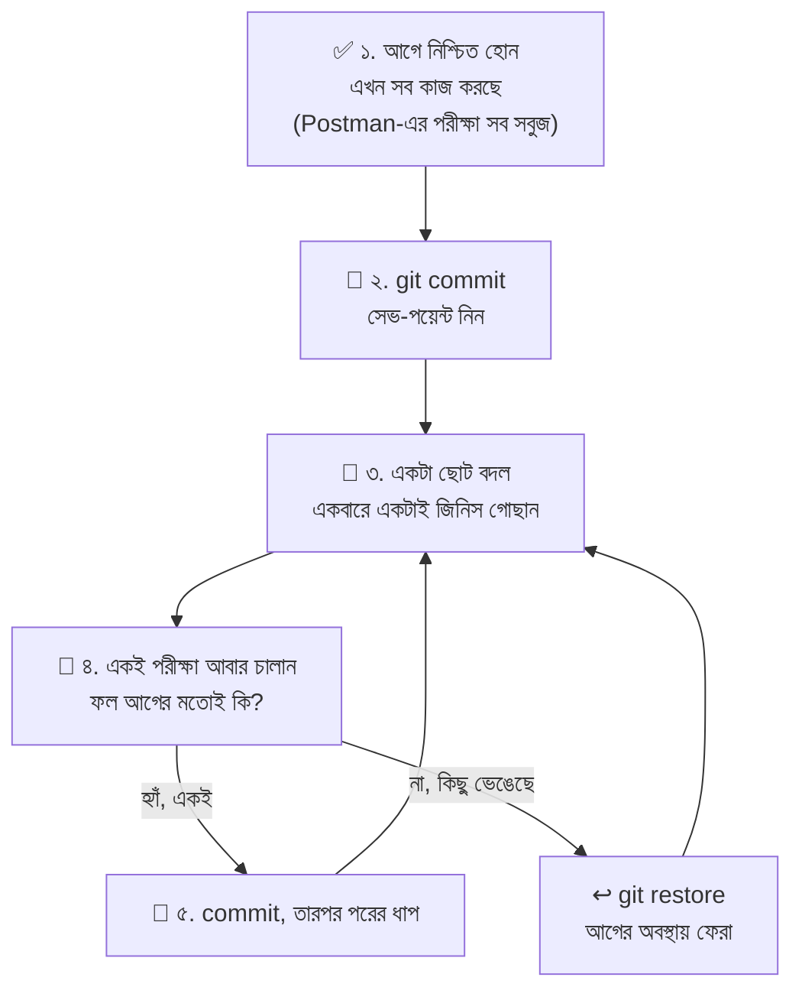

### 👃 কোড কখন "দুর্গন্ধ" ছড়ায়, আর কী করবেন

| লক্ষণ (Code Smell) | গল্পে | সমাধান |
|---|---|---|
| একই কোড দুই-তিন জায়গায় কপি-পেস্ট | একই কাগজের অনেক কপি | একটা ফাংশনে তুলে ডাকুন (`sendTokenResponse`) |
| `Model.create(req.body)` সরাসরি | দরজা খোলা রেখে বেরোনো | `pick` দিয়ে অনুমোদিত ফিল্ড বাছুন |
| প্রতিটা ফাংশনে `try/catch` + আলাদা `res.status(500)` | প্রতিটা ঘরে আলাদা অগ্নিনির্বাপক | একটা কেন্দ্রীয় `errorHandler` + `AppError` |
| জবাবের গড়ন একেক জায়গায় একেক রকম | একেক কাউন্টারে একেক ভাষা | সবখানে `{ success, data }` |
| এক ফাংশনে অনেক কাজ (৬০ লাইনের controller) | এক কর্মী সব বিভাগ চালাচ্ছে | ছোট ছোট সহায়ক ফাংশনে ভাঙুন |
| `console.log` ছড়ানো | কাজ শেষে ফেলে যাওয়া খালি কাগজ | সরান, নইলে সংরক্ষিত লগ-ব্যবস্থা ব্যবহার করুন |
| ম্যাজিক সংখ্যা (`12`, `50`) | কাউকে না বলা গোপন সংখ্যা | নাম দেওয়া ধ্রুবকে (constant) রাখুন |

### ✨ Refactor ১: "এলোমেলো" থেকে "গোছানো" (updateTour)

তাড়াহুড়োয় লেখা (বা প্রথমবার Claude Code-কে "একটা update ফাংশন লেখো" বলার পর পাওয়া) সংস্করণ:

```javascript
// ❌ আগের রূপ: কাজ করে, কিন্তু অনেক গলদ
const updateTour = async (req, res) => {
  try {
    const tour = await Tour.findByIdAndUpdate(req.params.id, req.body); // (১) req.body সরাসরি
    if (!tour) {
      return res.status(404).json({ message: 'not found' });           // (২) জবাবের গড়ন আলাদা
    }
    res.json(tour);                                                     // (৩) পুরোনো রূপ ফেরত যাচ্ছে
  } catch (e) {
    console.log(e);                                                     // (৪) console.log পড়ে আছে
    res.status(500).json({ message: 'error' });                         // (৫) সব ভুল 500 হয়ে যাচ্ছে
  }
};
```

| # | গলদ | ফল |
|---|---|---|
| ১ | `req.body` সরাসরি | কেউ `isActive`, `_id` বা আজেবাজে ফিল্ড ঢুকিয়ে দিতে পারে |
| ২ | নিজস্ব `{ message }` গড়ন | Frontend-কে একেক রুটে একেকভাবে পড়তে হয় |
| ৩ | `new: true` নেই | জবাবে **বদলের আগের** তথ্য ফেরত আসে, ভুল বোঝায় |
| ৪ | `runValidators` নেই | `price: -500` দিয়ে update করলে Schema-র `min` নিয়ম চলেই না |
| ৫ | `catch`-এ সব 500 | ভুল ID (400) বা validation ভুলও (400) "সার্ভারের দোষ" হয়ে যায় |

**✅ পরের রূপ** সেকশন ৬-এর `updateTour`: `pick` দিয়ে বাছাই, `new: true` ও `runValidators: true`, `AppError` দিয়ে 404, আর বাকি সব ভুল কেন্দ্রীয় `errorHandler`-এর হাতে। ফাংশনটা ছোট, আর আচরণ নির্ভরযোগ্য।

### ✨ Refactor ২: দুইবার লেখা কোড একবারে

```javascript
// ❌ আগের রূপ: register ও login দুটোতেই প্রায় একই ১০ লাইন
const register = async (req, res) => {
  const user = await User.create(pick(req.body, ['name', 'email', 'password', 'phone']));
  const token = generateToken(user._id);
  user.password = undefined;
  res.status(201).json({ success: true, token, data: user });
};

const login = async (req, res) => {
  // ... ইউজার যাচাই ...
  const token = generateToken(user._id);
  user.password = undefined;
  res.status(200).json({ success: true, token, data: user });
};

// ✅ পরের রূপ: সেকশন ৪-এর sendTokenResponse(user, statusCode, res)
// টোকেনের গড়ন বদলাতে চাইলে এখন একটাই জায়গা বদলালেই চলে
```

### ✨ Refactor ৩: ভারী ম্যানেজারকে সহকারী দেওয়া (Service Function)

`createBooking` ফাংশনটা এখন অনেক লম্বা। সিট গোনার কাজটা আলাদা সহকারীকে দিয়ে দেওয়া যায়:

```javascript
// src/services/booking.service.js
// services = ম্যানেজারের হাতের নিচের সহকারী। ডাটাবেসের হিসাব-নিকাশ এখানে, req/res নিয়ে কাজ নেই

const Booking = require('../models/Booking');

// getBookedSeats = কোনো ট্যুরের নির্দিষ্ট তারিখে এ পর্যন্ত কতজন বুক হয়েছে
// tourId = কোন ট্যুর, startDate = কোন তারিখ (Date অবজেক্ট)
const getBookedSeats = async (tourId, startDate) => {
  const [{ booked = 0 } = {}] = await Booking.aggregate([
    { $match: { tour: tourId, startDate, status: { $ne: 'cancelled' } } },
    { $group: { _id: null, booked: { $sum: '$numberOfPeople' } } },
  ]);
  return booked; // শুধু সংখ্যাটা ফেরত, আর কিছু নয়
};

module.exports = { getBookedSeats };
```

```javascript
// src/controllers/booking.controller.js (বদলের অংশ)
const { getBookedSeats } = require('../services/booking.service'); // নতুন সহকারী ডাকলাম

// আগে এখানে ৫ লাইনের aggregate ছিল। এখন এক লাইন, আর নামটাই বলে দেয় কী হচ্ছে
const booked = await getBookedSeats(tour._id, matchedDate);
const seatsLeft = tour.maxGroupSize - booked;
```

> 📂 `services/` ফোল্ডার বানালে আমাদের কাঠামোয় একটা নতুন স্তর এলো: **routes → controllers → services → models**। ছোট প্রজেক্টে না থাকলেও চলে, কিন্তু প্রজেক্ট বড় হলে এটা অনেক স্বস্তি দেয়।

### 🤖 Claude Code-কে দিয়ে Refactor করানোর প্রম্পট

```text
@src/controllers/booking.controller.js ফাইলের createBooking ফাংশনটা অনেক লম্বা।
শুধু "বাকি সিট গণনা"-র অংশটা src/services/booking.service.js নামে নতুন ফাইলে আলাদা ফাংশন (getBookedSeats) করো।
শর্ত: API-র আচরণ ও জবাবের গড়ন একটুও বদলাবে না, অন্য কোনো ফাইলে হাত দেবে না, নতুন প্যাকেজ আনবে না।
কাজের আগে কী কী বদলাবে তার ছোট প্ল্যান দাও।
```

| ভালো Refactor-প্রম্পটের উপাদান | কেন |
|---|---|
| **কোন ফাইল/ফাংশন** (`@` দিয়ে দেখান) | ক্লড আন্দাজে ঘুরে মরবে না |
| **ঠিক কী গোছাতে হবে** | "পুরো প্রজেক্ট গুছিয়ে দাও" বললে ক্লড অনেক ফাইলে হাত দেবে |
| **"আচরণ বদলাবে না"** | Refactor-কে ফিচার-পরিবর্তন হতে দেবেন না |
| **সীমা** (কোন ফাইলে হাত দেবে না) | অপ্রত্যাশিত বদল ঠেকায় |
| **প্ল্যান আগে** | কাজ শুরুর আগে আপনি নকশা দেখে নিতে পারেন |

> 🔍 কাজ শেষে `git diff` দিয়ে **ঠিক কোন লাইনগুলো বদলালো** দেখুন, আর সেকশন ৯-এর পুরো পরীক্ষা-তালিকা আবার চালান। ফল আগের মতো না হলে `git restore .`।

---

## ৮. Claude Code দিয়ে Bug খোঁজা

### গল্প

অফিসের একটা কাউন্টারে হঠাৎ গোলমাল: "লগইন করতে গেলে সার্ভার এরর দিচ্ছে!" আপনি ইনস্পেক্টর ক্লডকে ডাকলেন। একজন ভালো ইনস্পেক্টর **আন্দাজে ইট খুলতে শুরু করে না**। ডাক্তারের মতো সে: **লক্ষণ শোনে → রোগ আবার ঘটিয়ে দেখে → সন্দেহ করে → ওষুধ দেয় → সেরেছে কি না যাচাই করে।**

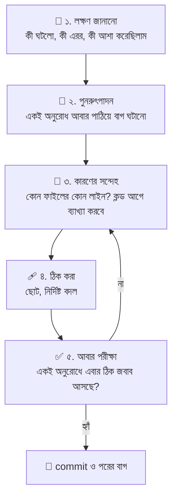

### 📝 ক্লডকে বাগের খবর দেওয়ার "ডাক্তারি ফর্ম"

ক্লড যত স্পষ্ট লক্ষণ পায়, তত দ্রুত রোগ ধরে। চারটা জিনিস সবসময় দিন:

| উপাদান | উদাহরণ |
|---|---|
| **১. কী করেছিলাম** | `POST /api/v1/auth/login` এ সঠিক ইমেইল-পাসওয়ার্ড পাঠিয়েছি |
| **২. কী আশা করেছিলাম** | 200 স্ট্যাটাস আর token |
| **৩. আসলে কী ঘটলো** | 500 স্ট্যাটাস, টার্মিনালে এরর (**পুরো এররটা কপি করে দিন**) |
| **৪. সন্দেহের এলাকা** | `@src/controllers/auth.controller.js` |

```text
POST /api/v1/auth/login এ সঠিক ইমেইল ও পাসওয়ার্ড পাঠালেও 500 আসছে। আশা করেছিলাম 200 ও token।
টার্মিনালের এরর: "Illegal arguments: string, undefined"
সন্দেহ: @src/controllers/auth.controller.js ও @src/models/User.js
আগে কারণটা ব্যাখ্যা করো, আমি সম্মতি দিলে তারপর ঠিক করবে।
ঠিক করার পর একই curl চালিয়ে দেখাও যে এবার 200 আসছে।
```

> 🔑 **"আগে কারণ বলো, তারপর ঠিক করো"** বাক্যটা সোনার মতো দামি। এতে আপনি শেখেন, আর ক্লড আন্দাজে এলোমেলো বদল করে বসে না। ট্রেইনি ডেভেলপার হিসেবে এটাই আপনার সবচেয়ে বড় শেখার সুযোগ।

### 🪲 ট্রাভেলোর "বাগ-ডায়েরি": সম্ভাব্য সাতটা সাধারণ বাগ

নতুনরা এই জায়গাগুলোতেই আটকায়। প্রতিটা বাগের লক্ষণ, কারণ ও ওষুধ:

**বাগ ১: লগইনে 500, "Illegal arguments: string, undefined"**

```javascript
// ❌ ভুল: select('+password') নেই
const user = await User.findOne({ email });
await user.comparePassword(password); // user.password = undefined, কারণ Schema-য় select: false!

// ✅ ঠিক
const user = await User.findOne({ email }).select('+password'); // লুকানো ফিল্ডটা চেয়ে নিলাম
```

**বাগ ২: ইউজারের প্রোফাইল বদলের পর লগইন ভেঙে যায়**

```javascript
// ❌ ভুল: পাসওয়ার্ড না বদলালেও প্রতিবার hash করছে, ফলে hash-এর উপর hash হয়ে আসল পাসওয়ার্ড হারিয়ে যায়
userSchema.pre('save', async function () {
  this.password = await bcrypt.hash(this.password, 12);
});

// ✅ ঠিক: বদলালে তবেই hash
userSchema.pre('save', async function () {
  if (!this.isModified('password')) return; // এই এক লাইনই বাঁচিয়ে দেয়
  this.password = await bcrypt.hash(this.password, 12);
});
```

**বাগ ৩: `GET /bookings/my` দিলে "Cast to ObjectId failed for value 'my'"**

```javascript
// ❌ ভুল ক্রম: /:id আগে বসেছে, তাই "my" শব্দটাকেই id ধরে নিচ্ছে
router.get('/:id', c.getBooking);
router.get('/my', c.getMyBookings);

// ✅ ঠিক ক্রম: নির্দিষ্ট পথ আগে, প্যারামিটারওয়ালা পথ পরে
router.get('/my', c.getMyBookings);
router.get('/:id', c.getBooking);
```

**বাগ ৪: `await` ভুলে যাওয়া। `totalPrice` হয়ে যাচ্ছে `NaN`**

```javascript
// ❌ ভুল: await নেই, তাই tour আসলে একটা Promise ("প্রতিশ্রুতি"), ট্যুর নয়
const tour = Tour.findById(tourId);
const totalPrice = tour.price * numberOfPeople; // undefined * 2 = NaN

// ✅ ঠিক
const tour = await Tour.findById(tourId);
```

**বাগ ৫: সবাই অ্যাডমিন! (`restrictTo` ছাড়া রুট)**

| লক্ষণ | কারণ | ওষুধ |
|---|---|---|
| সাধারণ ইউজার `POST /tours` করতে পারছে | রুটে `restrictTo('admin')` লেখা হয়নি | প্রতিটা লেখার (POST/PATCH/DELETE) রুট যাচাই করুন |

**বাগ ৬: ক্লায়েন্টের পাঠানো দামে বুকিং**

| লক্ষণ | কারণ | ওষুধ |
|---|---|---|
| `totalPrice: 1` পাঠিয়ে ১ টাকায় বুকিং হয়ে যাচ্ছে | `Booking.create(req.body)` | দাম সার্ভারে হিসাব (`tour.price * numberOfPeople`), `pick` ব্যবহার |

**বাগ ৭: `secretOrPrivateKey must have a value`**

| লক্ষণ | কারণ | ওষুধ |
|---|---|---|
| রেজিস্টার/লগইনে 500 | `.env`-এ `JWT_SECRET` নেই বা `dotenv` লোড হয়নি | `.env` যাচাই, সার্ভার রিস্টার্ট (`.env` বদলালে `nodemon` নিজে রিস্টার্ট নাও করতে পারে) |

### 🔬 নিজে বাগ ধরার ছোট ছোট যন্ত্র

| যন্ত্র | কীভাবে | কখন |
|---|---|---|
| টার্মিনালের এরর পড়া | লাল লেখার **প্রথম লাইন** আর কোন ফাইলের কত নম্বর লাইন লেখা আছে দেখুন | সবসময় প্রথমে |
| `console.log` | সন্দেহের লাইনের আগে `console.log('tour:', tour)` বসিয়ে মান দেখুন | মান কী আসছে বুঝতে |
| Postman-এর জবাব | স্ট্যাটাস কোড আর `message` পড়ুন | ক্লায়েন্টের দিক থেকে দেখতে |
| `mongosh` / Compass | ডাটাবেসে আসল ডেটা কেমন আছে দেখুন | ডেটা ঠিকঠাক সেভ হয়েছে কি না |
| `git diff` | কাল পর্যন্ত কাজ করছিল, আজ ভাঙলো? কী বদলেছে দেখুন | "হঠাৎ ভেঙে গেল" ধরনের বাগে |

> ⚠️ ডিবাগ শেষে `console.log`-গুলো মুছে ফেলতে ভুলবেন না। পাসওয়ার্ড বা টোকেন ভুলেও `console.log` করবেন না, লগ ফাইলে সব ফাঁস হয়।

### 🛡️ Claude Code দিয়ে "নিরাপত্তা-পরিদর্শন"

বাগ শুধু ভেঙে পড়া কোড নয়। **ঝুঁকিপূর্ণ কোডও এক ধরনের বাগ।** পুরো কাজ শেষে ক্লডকে ইনস্পেক্টর বানিয়ে বলুন:

```text
এই প্রজেক্টের src/ ফোল্ডারটা নিরাপত্তার চোখে পরীক্ষা করো। কিছু বদলাবে না, শুধু রিপোর্ট দাও:
১) কোনো রুটে protect বা restrictTo বাদ পড়েছে কি না
২) কোথাও req.body সরাসরি Model-এ যাচ্ছে কি না (Mass Assignment)
৩) কোডে hardcoded secret আছে কি না
৪) সংবেদনশীল তথ্য (পাসওয়ার্ড, hash) জবাবে চলে যেতে পারে কি না
প্রতিটা সমস্যার জন্য ফাইলের নাম, লাইন আর ছোট সমাধান লিখো।
```

> 🎓 ক্লডের রিপোর্ট পেয়ে **অন্ধভাবে সব ঠিক করাবেন না।** প্রতিটা অভিযোগ নিজে বুঝে নিন, কারণ ক্লড কখনো কখনো এমন সমস্যা "আবিষ্কার" করে যা আসলে নেই।

---

## ৯. Postman ও Thunder Client দিয়ে Test

### গল্প

অফিসের উদ্বোধন হয়েছে, কিন্তু সব কাউন্টার ঠিকঠাক কাজ করছে কি না কীভাবে জানবেন? পাঠান একজন **ছদ্মবেশী গ্রাহক (Mystery Shopper)**: সে নিবন্ধন করবে, লগইন করবে, ট্যুর দেখবে, বুকিং করবে, বাতিল করবে, আর ইচ্ছে করে ভুল কাজও করবে (যেমন অ্যাডমিন-ঘরে ঢোকার চেষ্টা)। এই ছদ্মবেশী গ্রাহকই **Postman** বা **Thunder Client**।

| হাতিয়ার | কোথায় | বৈশিষ্ট্য |
|---|---|---|
| **Postman** | আলাদা অ্যাপ | বেশি ফিচার, Collection, স্বয়ংক্রিয় টেস্ট-স্ক্রিপ্ট |
| **Thunder Client** | VS Code-এর এক্সটেনশন | হালকা, এডিটর ছেড়ে বেরোতে হয় না |
| `curl` | টার্মিনাল | দ্রুত, কিন্তু বড় ক্রম মনে রাখা কঠিন |

### ⚙️ প্রস্তুতি: Environment Variable

প্রতিটা অনুরোধে লম্বা URL ও টোকেন বারবার লিখলে ক্লান্তিকর। তাই একবার **ভেরিয়েবল** বানিয়ে `{{নাম}}` দিয়ে ডাকবেন:

| ভেরিয়েবল | মান | কাজ |
|---|---|---|
| `baseUrl` | `http://localhost:5000/api/v1` | সব URL-এর সাধারণ অংশ। ব্যবহার: `{{baseUrl}}/tours` |
| `token` | (শুরুতে ফাঁকা) | লগইনের পর পাওয়া প্রবেশপত্র |
| `tourId` | (পরে বসবে) | তৈরি করা ট্যুরের id |
| `destinationId` | (পরে বসবে) | তৈরি করা গন্তব্যের id |

**টোকেন বসানোর নিয়ম:** সুরক্ষিত রুটের অনুরোধে **Authorization ট্যাব → Bearer Token → `{{token}}`** বসান। এতে Postman নিজে `Authorization: Bearer <টোকেন>` হেডার বানিয়ে দেয়। (Thunder Client-এও Auth ট্যাবে Bearer অপশন আছে।)

### 🤖 টোকেন নিজে নিজে সেভ করানো (Postman)

লগইনের জবাব থেকে প্রতিবার টোকেন কপি-পেস্ট করা বিরক্তিকর। Login অনুরোধের **Tests ট্যাবে** এই স্ক্রিপ্ট বসিয়ে দিন:

```javascript
// Postman > Login অনুরোধ > Tests ট্যাব

// res = সার্ভারের জবাবের JSON অংশ (Postman একে অবজেক্টে বদলে দেয়)
const res = pm.response.json();

// pm.test = একটা স্বয়ংক্রিয় পরীক্ষা। প্রথম অংশ পরীক্ষার নাম, দ্বিতীয় অংশ কী যাচাই করবে
pm.test('স্ট্যাটাস 200 এসেছে', () => {
  pm.response.to.have.status(200);
});

pm.test('জবাবে token আছে', () => {
  pm.expect(res.token).to.be.a('string'); // token লেখা (string) হতে হবে
});

// token ভেরিয়েবলে সংরক্ষণ। এরপর সব অনুরোধে {{token}} আপনা-আপনি কাজ করবে
pm.environment.set('token', res.token);
```

> 🔧 **Thunder Client-এ** একই কাজের জন্য অনুরোধের **Tests/Vars ট্যাবে** "Set Env Variable" অপশন থাকে (জবাবের `json.token` থেকে `token` ভেরিয়েবলে)। ভার্সনভেদে ট্যাবের নাম একটু আলাদা হতে পারে।

### 👑 অ্যাডমিন বানানো

নিজের রেজিস্ট্রেশনে `role: admin` পাঠালে কাজ হবে না, কারণ `pick` সেটা ফেলে দেয় (এটাই আমরা চেয়েছিলাম!)। তাই আগে সাধারণ ইউজার হিসেবে নিবন্ধন করে, তারপর **ডাটাবেসে গিয়ে নিজে হাতে** ভূমিকা বদলান:

```javascript
// mongosh-এ (অথবা MongoDB Compass-এ ডকুমেন্ট এডিট করে)
use travello  // travello = আমাদের ডাটাবেসের নাম

// updateOne = একটা ডকুমেন্ট বদলানো। প্রথম অংশ: কাকে? দ্বিতীয় অংশ: কী বদলাবো?
db.users.updateOne(
  { email: "admin@example.com" },      // যে ইউজারকে অ্যাডমিন বানাচ্ছি
  { $set: { role: "admin" } }          // $set = এই ফিল্ডের মান বসাও
)
```

`protect` প্রতিবার ডাটাবেস থেকে ইউজার আনে, তাই role বদলের পর নতুন টোকেন নেওয়ার দরকার নেই। আর অ্যাডমিন-রুট চালানোর আগে অ্যাডমিন ইউজার দিয়েই লগইন করে টোকেন নিন।

### 🧪 পুরো পরীক্ষার যাত্রা (এই ক্রমে চালান)

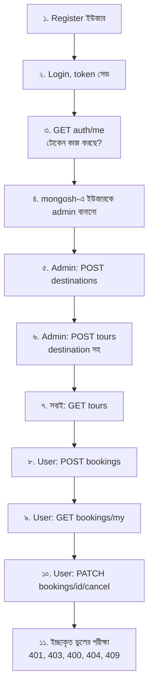

| # | Method ও URL | Auth | Body (মূল অংশ) | প্রত্যাশিত স্ট্যাটাস |
|---|---|---|---|---|
| ১ | `POST {{baseUrl}}/auth/register` | না | `name, email, password` | **201** |
| ২ | `POST {{baseUrl}}/auth/login` | না | `email, password` | **200** (token আসবে) |
| ৩ | `GET {{baseUrl}}/auth/me` | Bearer | | **200** |
| ৫ | `POST {{baseUrl}}/destinations` | Bearer (অ্যাডমিন) | `name: "Sylhet", country: "Bangladesh"` | **201** |
| ৬ | `POST {{baseUrl}}/tours` | Bearer (অ্যাডমিন) | `title, destination: <id>, price, durationDays, maxGroupSize, startDates` | **201** |
| ৭ | `GET {{baseUrl}}/tours?page=1&limit=5` | না | | **200** |
| ৮ | `POST {{baseUrl}}/bookings` | Bearer | `tour: <id>, startDate: "2026-12-20", numberOfPeople: 2` | **201** |
| ৯ | `GET {{baseUrl}}/bookings/my` | Bearer | | **200** |
| ১০ | `PATCH {{baseUrl}}/bookings/<id>/cancel` | Bearer | | **200** |

### 😈 ইচ্ছাকৃত ভুলের পরীক্ষা (Negative Testing)

**ভালো পরীক্ষক শুধু "ঠিক কাজ ঠিক হচ্ছে" দেখে না, "ভুল কাজ আটকাচ্ছে কি না"-ও দেখে।** এগুলো না করলে নিরাপত্তার ফাঁক ধরা পড়বে না:

| ভুলের পরীক্ষা | কীভাবে | প্রত্যাশিত |
|---|---|---|
| টোকেন ছাড়া সুরক্ষিত রুট | `GET /bookings/my`, Auth খালি | **401** |
| নকল টোকেন | টোকেনের শেষ অক্ষর বদলে দিন | **401** ("অবৈধ টোকেন") |
| সাধারণ ইউজার দিয়ে অ্যাডমিন-কাজ | ইউজারের টোকেনে `POST /tours` | **403** |
| ভুল পাসওয়ার্ড | `POST /auth/login` | **401** |
| একই ইমেইলে দুইবার নিবন্ধন | `POST /auth/register` আবার | **409** |
| ছোট পাসওয়ার্ড | `password: "123"` | **400** ("৮ অক্ষরের...") |
| ভুল ID-র ফরম্যাট | `GET /tours/abc` | **400** |
| না-থাকা ID | `GET /tours/<বৈধ কিন্তু নেই এমন ObjectId>` | **404** |
| ঋণাত্মক দাম | `POST /tours` এ `price: -5` | **400** |
| সিটের বেশি বুকিং | `numberOfPeople` > `maxGroupSize` | **400** ("সিট বাকি...") |
| অন্যের বুকিং দেখা | অন্য ইউজারের বুকিং id দিয়ে `GET /bookings/<id>` | **403** |
| নিজেকে অ্যাডমিন ঘোষণা | register-এ `"role":"admin"` পাঠানো | নিবন্ধন হবে, কিন্তু `role` থাকবে `user` |
| দাম নিজে ঠিক করা | booking-এ `"totalPrice": 1` পাঠানো | বুকিং হবে, কিন্তু দাম সার্ভারের হিসাবে |

### 🧠 Claude Code দিয়ে সরাসরি Test চালানো

Claude Code নিজেই টার্মিনালে `curl` চালিয়ে আপনার API পরীক্ষা করতে পারে। বাগ ঠিক করার পর "সত্যিই ঠিক হলো কি না" দেখার জন্য সবচেয়ে কাজের:

```text
সার্ভার চালু আছে (port 5000)। curl দিয়ে এই ক্রমে পরীক্ষা করো আর প্রতিটার স্ট্যাটাস ও জবাব দেখাও:
১) নতুন ইউজার নিবন্ধন, ২) লগইন করে টোকেন নেওয়া, ৩) টোকেন ছাড়া GET /api/v1/bookings/my (401 আসা উচিত),
৪) টোকেন দিয়ে একই রুট (200 আসা উচিত)।
কোনো ফাইল বদলাবে না, শুধু পরীক্ষা করে রিপোর্ট দাও।
```

> 🔁 **আদর্শ চক্র:** ক্লড বাগ ঠিক করলো → ক্লড নিজে `curl` চালিয়ে দেখালো → আপনি **Postman-এ আরেকবার নিজে** চালিয়ে নিশ্চিত হলেন। এই "দ্বিতীয় চোখ" আপনার অভ্যাস করে ফেলুন।

---

## ১০. Claude Code-কে দেওয়ার প্রম্পটের ক্রম

### গল্প

আগের টপিকের মতোই এখানেও নিয়ম: **ক্লডকে "সব বানিয়ে দাও" বলবেন না।** শেখার জন্য ধাপে ধাপে এগোন, প্রতিটা ধাপ বুঝে, পরীক্ষা করে, commit করে।

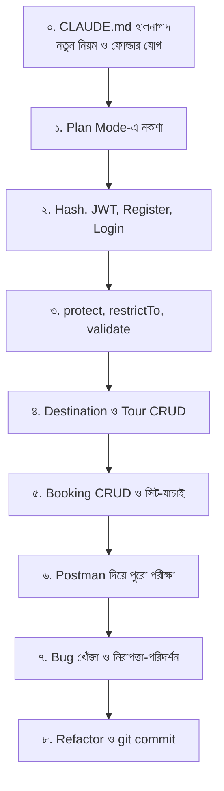

### প্রথমে `CLAUDE.md`-তে নতুন নিয়ম যোগ করুন

```markdown
## Auth Rules
- পাসওয়ার্ড bcryptjs দিয়ে hash হবে (User model-এর pre save হুকে), সাদা লেখায় কখনো নয়
- JWT payload-এ শুধু user id, secret আসবে process.env.JWT_SECRET থেকে
- লেখার (POST/PATCH/DELETE) রুটে protect আছে কি না, অ্যাডমিন-রুটে restrictTo আছে কি না সবসময় যাচাই করবে

## Code Rules
- Model-এ req.body সরাসরি দেবে না, src/utils/pick.js দিয়ে অনুমোদিত ফিল্ড বাছবে
- ভুলের জন্য AppError ছুঁড়বে, controller-এ আলাদা try/catch লিখবে না (Express 5)
- সব জবাবের গড়ন: { success, data } বা { success: false, message }
- update-এ new: true ও runValidators: true দেবে
- দাম হিসাব সবসময় সার্ভারে, ক্লায়েন্টের পাঠানো দামে নয়
```

### প্রম্পট ১: নকশা (Plan Mode)

```text
CLAUDE.md পড়ে নাও। আমি এই প্রজেক্টে এখন যোগ করতে চাই: Register/Login (bcryptjs + JWT), protect ও restrictTo middleware,
express-validator দিয়ে validation, এবং Destination, Tour, Booking-এর পূর্ণ CRUD API।
কোড লেখার আগে প্ল্যান দাও: কোন কোন নতুন ফাইল, কোন কোন পুরোনো ফাইল বদলাবে, কোন প্যাকেজ লাগবে, আর কাজের ক্রম।
আমি অনুমোদন না দেওয়া পর্যন্ত কিছু লিখবে না।
```

### প্রম্পট ২: Authentication

```text
প্ল্যান অনুযায়ী শুধু Authentication অংশ বানাও। bcryptjs, jsonwebtoken, express-validator ইনস্টল করো।
User model-এ pre('save') হুক (পাসওয়ার্ড hash, isModified চেকসহ) ও comparePassword মেথড যোগ করো।
src/utils/ এ AppError, pick, generateToken লেখো। auth controller (register, login, getMe) ও routes বানাও।
register-এ শুধু name, email, password, phone নেবে, role নয়। প্রতিটা ভেরিয়েবল কেন, তা কমেন্টে বাংলায় লেখো।
শেষে curl দিয়ে register ও login চালিয়ে দেখাও।
```

### প্রম্পট ৩: Middleware

```text
src/middleware/auth.js এ protect (Bearer টোকেন যাচাই, ইউজার খুঁজে req.user বসানো) ও restrictTo(...roles) লেখো।
src/middleware/validate.js ও src/validators/ ফোল্ডারে auth-এর নিয়ম লেখো।
errorHandler-এ JsonWebTokenError ও TokenExpiredError (দুটোই 401) যোগ করো।
অন্য ফাইলে হাত দেবে না।
```

### প্রম্পট ৪: CRUD (একটা একটা করে)

```text
Destination model ও এর পূর্ণ CRUD বানাও (controller, routes, validators)। পড়া সবার জন্য, লেখা শুধু admin-এর।
মোছার আগে দেখবে কোনো Tour এই destination ব্যবহার করছে কি না, থাকলে 400 দেবে।
এরপর Tour model থেকে location সরিয়ে destination (ObjectId, ref) বসাও এবং Tour CRUD লেখো।
GET /tours-এ destination ও maxPrice ফিল্টার, page ও limit পাতা-ব্যবস্থা (limit সর্বোচ্চ ৫০) থাকবে।
DELETE হবে soft delete (isActive: false)।
```

### প্রম্পট ৫: Booking

```text
Booking CRUD বানাও। createBooking-এ: ট্যুর খোঁজা, তারিখ tour.startDates-এ আছে কি না যাচাই,
aggregate দিয়ে ওই তারিখে বুক হওয়া সিট গুনে বাকি সিট দেখা, totalPrice সার্ভারে হিসাব করা।
ইউজার আসবে req.user থেকে। getBooking ও cancelBooking-এ মালিক বা admin কি না যাচাই করবে।
'/my' রুট '/:id'-এর আগে বসাবে।
```

### প্রম্পট ৬ থেকে ৮: পরীক্ষা, বাগ, Refactor

```text
সার্ভার চালু আছে। curl দিয়ে পুরো ক্রমে পরীক্ষা করো (register, login, admin ছাড়া POST /tours-এ 403, বুকিং, বাতিল)।
কোথায় প্রত্যাশার সাথে মিলছে না, রিপোর্ট দাও। এখনই কিছু ঠিক করবে না।
```

```text
এখন src/ নিরাপত্তার চোখে পরীক্ষা করো (সেকশন ৮-এর প্রম্পট)।
এরপর আমার অনুমোদনে একটা একটা করে সমস্যা ঠিক করো, প্রতিটার পর পরীক্ষা চালাও।
```

```text
createBooking-এর সিট গণনা src/services/booking.service.js-এ আলাদা করো। আচরণ একটুও বদলাবে না।
```

### 🎓 শেখার কৌশল: ক্লডকে শিক্ষক বানান

```text
@src/middleware/auth.js ফাইলটা লাইন বাই লাইন সহজ বাংলায় বোঝাও।
কেন protect-এ টোকেন থাকা সত্ত্বেও আবার ডাটাবেস থেকে ইউজার খোঁজা হয়? না খুঁজলে কী সমস্যা হতো?
```

```text
JWT আর session-এর পার্থক্য একটা গল্পের উদাহরণ দিয়ে বোঝাও। আমার কোর্সের Node.js + Express প্রজেক্টে কোনটা কখন ভালো?
```

### 🚫 যা করবেন না

| ❌ ভুল অভ্যাস | কেন সমস্যা | ✅ বদলে কী করবেন |
|---|---|---|
| "লগইন সিস্টেম বানিয়ে দাও" বলে ছেড়ে দেওয়া | পাসওয়ার্ড ও টোকেনের মতো সংবেদনশীল কাজ না বুঝে মেনে নেওয়া ঝুঁকির | ধাপে ধাপে বানান, প্রতিটা ফাইল পড়ুন |
| `.env`-এর আসল `JWT_SECRET` প্রম্পটে পেস্ট করা | গোপন চাবি ফাঁস | শুধু ভেরিয়েবলের নাম বলুন, মান নিজে বসান |
| বাগ বলতে শুধু "কাজ করছে না" লেখা | ক্লড আন্দাজে ঘুরবে | চার-উপাদানের "ডাক্তারি ফর্ম" ব্যবহার করুন |
| ক্লডের ঠিক করা কোড না পড়েই মেনে নেওয়া | নতুন বাগ ঢুকতে পারে | `git diff` পড়ুন, নিজে পরীক্ষা করুন |
| Refactor আর নতুন ফিচার একসাথে করানো | কিছু ভাঙলে কারণ ধরা কঠিন | আলাদা আলাদা প্রম্পট ও commit |
| পরীক্ষা ছাড়া "হয়ে গেছে" ধরে নেওয়া | লুকানো বাগ পরে ফাটে | Postman-এর পুরো তালিকা চালান |

---

## ১১. সাধারণ ভুল ও সমাধান

| এরর / সমস্যা | কারণ (গল্পে) | সমাধান |
|---|---|---|
| `Illegal arguments: string, undefined` | সিলগালা খামটাই আনা হয়নি (`password` লুকানো) | লগইনে `.select('+password')` দিন |
| `secretOrPrivateKey must have a value` | সিলমোহর (`JWT_SECRET`) নেই | `.env` ফাইল ও নাম যাচাই করুন, সার্ভার রিস্টার্ট করুন |
| `jwt malformed` / `invalid signature` | টোকেনটা ভাঙা বা নকল | Postman-এ টোকেনের আগে-পিছে ফাঁকা বা কোটেশন আছে কি দেখুন, নতুন করে লগইন করুন |
| `jwt expired` | প্রবেশপত্রের মেয়াদ শেষ | আবার লগইন করুন। প্রয়োজনে `JWT_EXPIRES_IN` বাড়ান |
| সবসময় 401 "লগইন করতে হবে" | `Authorization` হেডার ভুল ফরম্যাটে | ঠিক ফরম্যাট: `Bearer <ফাঁকা জায়গা><টোকেন>`। শুধু টোকেন বা `Bearer` ছাড়া দিলে চলবে না |
| সাধারণ ইউজারের টোকেনে অ্যাডমিন-রুটে 403 | ঠিক আছে, এটা গার্ডের কাজ! | অ্যাডমিন ইউজার দিয়ে লগইন করে নতুন টোকেন নিন |
| `Cast to ObjectId failed for value "my"` | রুটের ক্রম ভুল (`/:id` আগে) | নির্দিষ্ট পথ (`/my`) আগে বসান |
| `E11000 duplicate key` (সাথে `name`/`email`) | `unique` নিয়ম ভাঙা | `409` দিয়ে সুন্দর বার্তা আসছে কি দেখুন (`errorHandler`) |
| `Cannot read properties of undefined (reading 'role')` | `protect` ছাড়াই `restrictTo` চলেছে | রুটে ক্রম ঠিক করুন: `protect`, তারপর `restrictTo` |
| `req.body` ফাঁকা, validation বলছে সব ফিল্ড নেই | Postman-এ Body টাইপ `raw → JSON` নয় | Body → raw → JSON বেছে নিন, `Content-Type: application/json` |
| `price: -500` দিয়ে `PATCH` করলেও সেভ হয়ে গেল | `runValidators: true` নেই | `findByIdAndUpdate`-এর তৃতীয় আর্গুমেন্টে যোগ করুন |
| `Cannot set headers after they are sent` | একই অনুরোধে দুইবার জবাব পাঠানো | `res.json()`-এর আগে `return` দিন, অথবা `throw AppError` ব্যবহার করুন |
| পুরোনো ট্যুরে `destination` নেই বলে `populate` কিছু দেখায় না | `location` থেকে `destination`-এ যাওয়ার সময় পুরোনো ডেটা রয়ে গেছে | শেখার ডেটা হলে `db.tours.deleteMany({})`, নইলে Migration |
| ক্লড অনেক ফাইল বদলে ফেলেছে | প্রম্পটে সীমা বলা হয়নি | `git diff` দেখুন, দরকারে `git restore .`, সীমা দিয়ে আবার বলুন |

---

## ১২. সারসংক্ষেপ ও Practice আইডিয়া

### 🧠 এক নজরে পুরো গল্প

| গল্পের চরিত্র | টেকনিক্যাল নাম | মনে রাখার এক লাইন |
|---|---|---|
| "তুমি কে?" | Authentication (401) | পরিচয় যাচাই |
| "তোমার অনুমতি আছে?" | Authorization (403) | ভূমিকা ও মালিকানা যাচাই |
| ডিম ভাজা | Password Hashing (`bcrypt`) | ফেরানো যায় না, শুধু মিলিয়ে দেখা যায় |
| লবণ ও রান্নার সময় | Salt ও Cost | একই পাসওয়ার্ডের hash আলাদা, আর অনুমান ধীর |
| প্রবেশপত্র | JWT (header, payload, signature) | তথ্য পড়া যায়, বদলানো যায় না। গোপন কিছু রাখবেন না |
| গোপন সিলমোহর | `JWT_SECRET` | ফাঁস হলে সব শেষ। `.env`-এ রাখুন |
| গেটের গার্ড | `protect` | টোকেন যাচাই, `req.user` বসানো |
| VIP দারোয়ান | `restrictTo` | `protect`-এর পরে বসে, role মেলায় |
| ফর্ম যাচাইকারী | `express-validator` + `validate` | ডাটাবেসে পৌঁছানোর আগেই খারাপ ডেটা ফেরত |
| অভিযোগ-ডেস্ক | `errorHandler` + `AppError` | সব ভুল এক জায়গায় সামলানো |
| কাউন্টারের চার সেবা | CRUD (`POST/GET/PATCH/DELETE`) | সঠিক Method ও স্ট্যাটাস কোড |
| বাছাই-কর্মী | `pick` | Mass Assignment ঠেকায় |
| "বন্ধ" স্ট্যাম্প | Soft Delete (`isActive`) | রসিদের ইতিহাস অক্ষত থাকে |
| সার্ভারে দাম হিসাব | `totalPrice = price × people` | ক্লায়েন্টকে বিশ্বাস নয় |
| ভেতরটা গোছানো | Refactor | আচরণ না বদলে কোড পরিষ্কার করা |
| ডাক্তারি ইনস্পেক্টর | Debug (লক্ষণ, পুনরুৎপাদন, সন্দেহ, ঠিক, যাচাই) | "আগে কারণ বলো, তারপর ঠিক করো" |
| ছদ্মবেশী গ্রাহক | Postman / Thunder Client | ঠিক ও ভুল দুই ধরনের পরীক্ষাই চালান |

### Practice-এর জন্য আইডিয়া

১. **পুরোটা নিজে হাতে টাইপ করুন**, কপি-পেস্ট নয়। বিশেষ করে `protect` আর `pre('save')` হুক।
২. **JWT খুলে দেখুন:** লগইনের টোকেনটা <https://jwt.io>-তে পেস্ট করে payload-এ কী আছে দেখুন। তারপর ভাবুন, কেন এখানে পাসওয়ার্ড রাখা যাবে না।
৩. **hash-এর খেলা:** একই পাসওয়ার্ডে দুটো ইউজার নিবন্ধন করুন। ডাটাবেসে দুটোর hash আলাদা দেখে salt-এর কাজ বুঝুন।
৪. **বাগ বসিয়ে ধরুন:** ইচ্ছে করে `isModified` লাইনটা মুছে প্রোফাইল বদলের পর লগইন করুন। কী ভাঙলো? ক্লডকে "ডাক্তারি ফর্ম" দিয়ে বাগটা ধরাতে বলুন।
৫. **টোকেনের মেয়াদ:** `JWT_EXPIRES_IN=30s` করে ৩০ সেকেন্ড পর কোনো সুরক্ষিত রুট ডাকুন। `TokenExpiredError` আসে কি না দেখুন।
৬. **রুটের ক্রম:** `/my`-কে `/:id`-এর পরে বসিয়ে কী এরর আসে দেখুন, তারপর ঠিক করুন।
৭. **Negative Testing:** সেকশন ৯-এর ১৩টা ভুলের পরীক্ষার সবগুলো Postman Collection-এ সাজিয়ে একসাথে চালান।
৮. **নিজস্ব রুট:** `GET /api/v1/tours/:id` ছাড়াও `PATCH /api/v1/auth/update-me` বানান, যেখানে ইউজার শুধু নিজের `name` ও `phone` বদলাতে পারবে (`role` বা `password` নয়)।
৯. **ভাবনার প্রশ্ন:** দুইজন একসাথে শেষ সিটটা বুক করতে চাইলে কী হবে? (ইঙ্গিত: দুটো অনুরোধই একসাথে "বাকি সিট ১" দেখতে পারে। এর সমাধানে Transaction লাগে, যা পরের ধাপের বিষয়।)
১০. **Refactor:** `booking.service.js`-এর মতো `tour` ও `destination`-এর বারবার আসা "গন্তব্য আছে কি না" চেক একটা সহায়ক ফাংশনে আনুন। আচরণ না বদলে।
১১. **Claude Code-কে পরীক্ষক বানান:** ক্লডকে বলুন "আমার API-র জন্য Postman-এ কী কী পরীক্ষা লেখা উচিত তার তালিকা দাও", তারপর তালিকাটা নিজে মিলিয়ে দেখুন।
১২. **ছোট ছোট commit:** প্রতিটা সেকশন শেষে commit। `git log --oneline` দিলে পুরো যাত্রা দেখতে পাবেন।
১৩. **এরপর:** Rate limiting (`express-rate-limit`), `helmet`, refresh token, আর ডিপ্লয়ের আগের নিরাপত্তা-তালিকা নিয়ে এগিয়ে যান।

---
